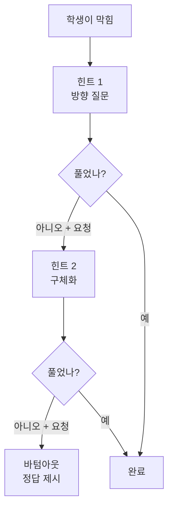
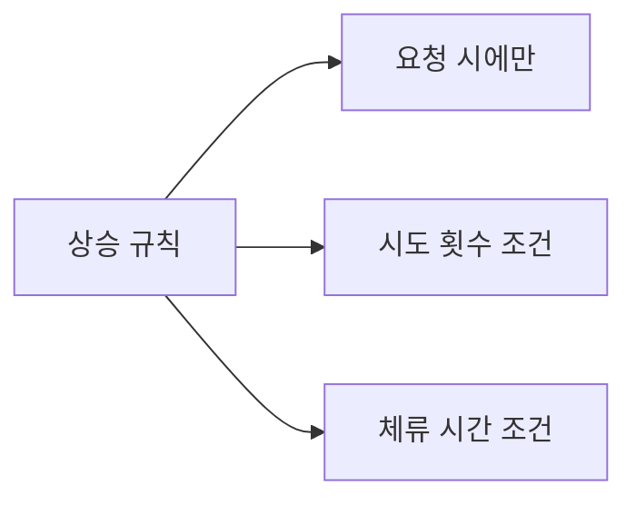

# 힌트 상승 규칙

> 단계별 힌트(staged hints)에서 "언제 다음 단계의 더 구체적인 힌트로 넘어가고, 언제 정답을 보여 주나"를 정하는 규칙. 너무 빨리 정답을 주면 학습이 사라지고, 너무 늦으면 막힌 학생이 포기한다.

## 쉽게 말하면
과외 선생님이 처음엔 "어느 공식이 떠오르니?"라고 묻고, 그래도 막히면 "이 식을 써 보자", 마지막에야 풀이를 보여 주는 순서다. 문제는 그 사이 단계를 언제 올리느냐다.

## 자세히
- **구조**: 학습 시스템의 힌트는 보통 점진적이다. 요청할 때마다 더 구체적이고, 마지막 단계가 정답을 주는 바텀아웃(bottom-out) 힌트. 한 연구 인터페이스는 "Show hint x of y" 버튼을 썼고 힌트 요청은 오답으로 기록했다(PMC6310403, 열어 읽음).
- **일찍 열어 줄까**: 같은 연구에서 여름 학기엔 초기 3문제의 힌트 허용이 성취를 올리지 못하고 시간만 늘렸고, 학기 중 반복 실험에선 정답률이 올랐다(0.67 vs 0.59). 저자들은 사전지식이 낮고 마감이 짧은(약 1.2주 vs 13주) 맥락 때문일 수 있다고 본다. 표본이 둘뿐이고 이탈률이 달라(74% vs 84%) 일반화는 조심한다.
- **중간 단계의 가치**: 초기 허용 집단이 힌트를 더 많이 썼지만(1.22 vs 0.84), 바텀아웃 요청은 후기 허용 집단이 유의하게 더 많았다. 앞 단계를 거친 학생이 나중에 정답 열람이 적다는 해석이 제시된다.
- **상승 규칙 설계 선택지**(위 결과에서 끌어낸 일반론, 정답 규칙은 아님): 학생이 요청할 때만 올리는 방식(on-demand)과 시스템이 판단해 올리는 방식이 있다. 검색 요약에는 on-demand가 더 낫다는 연구(WPI)가 있었으나 그 PDF는 읽지 못했다. 막힌 시도 횟수·시간을 조건으로 쓰는 규칙은 검색에서 구체 임계값을 찾지 못했다.
- **한계**: 이 논문은 단계별 힌트 일반을 다룬 것이라 LLM 튜터에 그대로 적용된다는 증거는 아니다.

## 그림으로 보기

## 예시
- 프롬프트 설계: "정답은 말하지 말고, 학생이 요청할 때마다 한 단계씩 더 구체적으로. 3단계에서도 막히면 풀이 예시를 보이고 비슷한 문제를 내라."
- 교육 실습: 같은 문제에 힌트 3단계를 직접 써 보고 단계 간 정보량이 점점 늘어나는지 점검.

## 헷갈리는 것과 비교
| 개념 | 차이 |
|---|---|
| 힌트 상승 규칙 | 단계 올리는 조건 |
| [힌트 남용 탐지](#hint-abuse-detection) | 시도 없이 힌트만 쓰는 패턴 감지 |
| 바텀아웃 힌트 | 마지막 단계, 정답 제시 |
| 소크라테스식 질문 | 정답 대신 질문 연쇄(힌트 단계보다 개방적) |

## 더 읽을거리
- [Hints in an online learning system (PMC6310403)](https://pmc.ncbi.nlm.nih.gov/articles/PMC6310403) — 힌트 허용 시점·바텀아웃 결과(열람)
