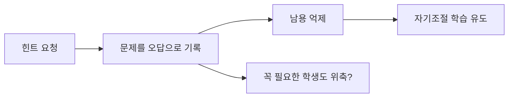

# 힌트 요청 패널티

> 힌트나 정답 보기를 요청하면 **그 문제를 오답으로 기록**하는 설계다. 힌트 남용을 억제하고 스스로 푸는 습관을 기르려는 의도지만, 도움이 필요한 학생도 위축시킬 수 있다.

## 쉽게 말하면
시험 중 "모르는 건 손들고 물어보세요. 단, 물어보면 그 문항은 감점"이라는 규칙이다. 함부로 묻지는 않게 되지만, 정말 막힌 학생도 손을 못 든다.

## 자세히
(Inventado 외, "Contextual factors affecting hint utility", Int. J. STEM Education 2018을 PMC에서 직접 읽었다. 8학년 수학 ASSISTments 실험이며 이 논문은 패널티의 효과를 **따로 비교하지 않았다.**)
- **사실(논문)**: 이 시스템은 힌트나 결국 정답을 요청한 학생을 **오답으로 표시**했다. 저자들은 이것이 힌트 사용을 막을 수 있지만 **자기조절 학습을 돕는 효과**도 있을 수 있다고 적는다. 힌트는 "Show hint x of y" 버튼으로 하나씩 열린다.
- **실험 조건**: 초기 3문제에서 힌트 없이 "Show Answer"만 주는 집단(NHE)과 처음부터 단계 힌트를 허용하는 집단(HE). 이후엔 둘 다 힌트 사용 가능.
- **결과(논문 수치)**: 학기 중 표본(N=289)에서 정답률 HE 0.67 vs NHE 0.59(p<.01). 여름 표본(N=390)은 0.64 vs 0.60으로 차이 없음. 학기 중 HE는 평균 힌트 1.22회 vs NHE 0.84회, NHE가 **바텀아웃 요청은 더 많았다**.
- **해석 주의**: 이 결과는 "초기에 중간 단계 힌트를 허용하느냐"의 효과이지, 패널티 유무의 효과가 아니다. 두 표본은 사전지식·학년·과제 길이가 달라 원인을 가리기 어렵다.
- **미확인**: 패널티를 없애면 힌트 사용이나 학습이 어떻게 달라지는지는 이 글의 근거로는 모른다.

## 그림으로 보기

## 예시
- 설계 질문: 힌트 1~2단계는 감점 없이, 바텀아웃(정답 보기)만 오답 처리로 할까(제안).
- 교육 소재: 같은 점수 제도에서 힌트를 쓰는 학생과 안 쓰는 학생의 행동 차이를 토론.

## 헷갈리는 것과 비교
| 개념 | 차이 |
|---|---|
| 힌트 요청 패널티 | 요청 자체를 감점 |
| [힌트 상승 규칙](#hint-escalation-rule) | 단계 올리는 조건 |
| [요청 시 힌트](#hints-on-demand) | 시점을 학생이 정하는 방식 |

## 더 읽을거리
- [Inventado et al. (2018) — Contextual factors affecting hint utility](https://pmc.ncbi.nlm.nih.gov/articles/PMC6310403) — 직접 읽음.
