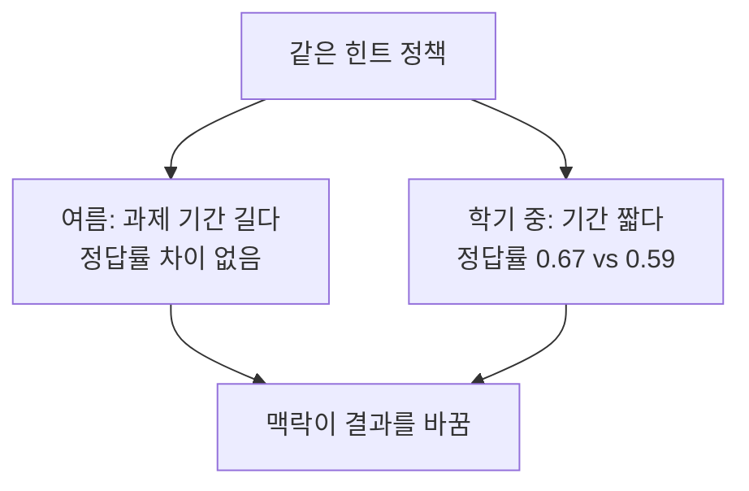

# 힌트 시점과 맥락

> 힌트를 **언제 열어 주느냐**의 효과는 학생의 사전지식·과제 기간·환경에 따라 달라서, 한 연구 결과를 일반 규칙으로 삼기 어렵다.

## 쉽게 말하면
같은 약도 환자 상태에 따라 효과가 다르듯, 같은 힌트도 시험 직전 속성반과 한 학기 수업에서 다르게 작동할 수 있다.

## 자세히
(Inventado 외 2018 PMC 논문을 직접 읽었다. 같은 연구의 두 표본을 비교한 것이며 맥락 효과는 저자의 *추정*이다.)
- **설계**: 초기 3문제에 힌트를 허용(HE)하느냐 막느냐(NHE)를 무작위 배정, 이후엔 모두 힌트 가능. 8학년 "Finding Slope" 과제.
- **여름(2015-06~09, N=390)**: 정답률 0.64 vs 0.60 차이 없음. HE의 **완료 시간이 중앙값 44.90분 vs 20.77분으로 유의하게 더 길었다**(p<.05).
- **학기 중(2016-01~05, N=289)**: HE 정답률 0.67 vs 0.59(p<.01, 효과 크기 Cliff's d=.14). 완료 시간 차이 없음(21.12 vs 17.88분). 숙달 속도와 총 시도 횟수도 차이 없음.
- **맥락 차이(논문)**: 사전지식, 학년, 학교 위치, **과제 기간(여름 중앙값 약 13주 vs 학기 중 약 1.2주)**이 달랐다. 완료율도 여름 84%, 학기 중 74%로 다르다(p<.005). 그래서 효과 차이의 원인을 분리할 수 없다.
- **한계(논문)**: 표본 둘뿐, 극단값(최대 4개월 체류)으로 윈저화 필요, 학교 수준 분산을 다루는 위계 분석은 더 큰 표본이 필요.
- **교훈**: 힌트 정책은 한 번에 정하지 말고 학습자 집단별로 시험한다.

## 그림으로 보기

## 예시
- 사내 AI 튜터: 신입 온보딩(2주)과 장기 교육(3개월)에서 힌트 허용 시점을 따로 A/B 테스트한다(제안).

## 헷갈리는 것과 비교
| 개념 | 차이 |
|---|---|
| 힌트 시점 | 처음부터 vs 나중에 허용 |
| [힌트 상승 규칙](#hint-escalation-rule) | 단계 올리는 조건 |
| [힌트 요청 패널티](#hint-request-penalty) | 요청 자체의 불이익 |

## 더 읽을거리
- [Inventado et al. (2018)](https://pmc.ncbi.nlm.nih.gov/articles/PMC6310403) — 직접 읽음.
