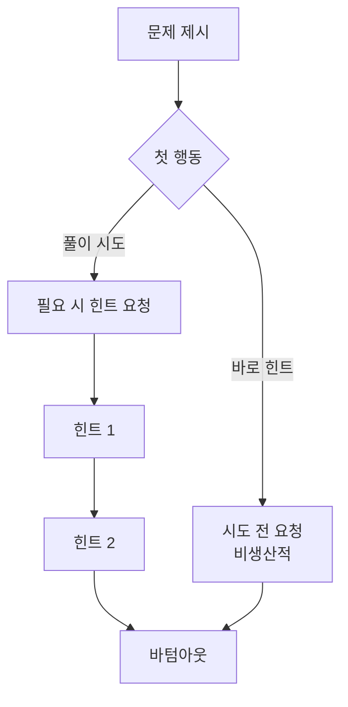

# 요청 시 힌트

> 학생이 **힌트 버튼을 눌러야** 다음 단계 힌트가 나오는 방식(on-demand hints). 학생이 도움받을 시점을 조절하게 하는 대신, 첫 시도 전에 누르거나 대충 넘기는 우회가 생기기 쉽다.

## 쉽게 말하면
정답지를 책상 위에 항상 펴 두고 "필요하면 보세요"라고 하는 것과 같다. 필요한 만큼만 보는 학생도 있지만, 문제를 읽자마자 정답지부터 펴는 학생도 있다. 정답지가 눈에 늘 보이는 것 자체가 신호가 된다.

## 자세히
(An·Mehrvarz·Stamper·McLaren, LAK 2026 논문을 PDF로 직접 읽었다. 대상은 초등·중등 소수 수학 학습 게임 Decimal Point이며 LLM 튜터에 대한 직접 증거는 아니다. 표의 일부 숫자는 PDF 변환이 깨져 확인하지 못했고 본문 문장의 수치만 적는다.)
- **정의**: 지능형 튜터링 시스템(ITS)에서 흔한 다단계 힌트. 일반적 안내 → 구체적 안내 → 마지막 **바텀아웃** 힌트(답 제시). 이 게임은 문제마다 **3단계 힌트**를 두고, 예로 Level 1 "먼저 숫자가 얼마나 변하는지 찾아봐", Level 2 "0.3에서 0.6까지 변화는?", Level 3 답 제시를 든다. 학생은 Hint 버튼과 Previous/Next로 이동한다.
- **이론 근거(논문)**: Vygotsky의 근접발달영역 — 적시의 도움이 현재 능력과 잠재력의 간극을 메운다. 도움 시점을 학생이 조절할 때 더 이득이라는 선행 연구가 있고, Aleven 등의 종합 연구는 on-demand 힌트가 기대만큼은 아니지만 **조건부로 유익해 계속 넣어야 한다**고 결론 냈다.
- **두 가지 비생산적 사용(논문 지표)**: ① **시도 전 힌트 요청** — 문제에서 첫 행동이 힌트 ② **힌트 대충 읽기** — 앞 단계를 건너뛰고 바텀아웃으로 직행.
- **결과(논문)**: 3개 학기, 분석 대상 **999명**(참가 1,370명 중). 시도 전 힌트 요청은 사전 점수와 강한 음의 상관(스피어만 ρ = −0.567, p < 0.001) — 사전지식이 낮을수록 더 자주 쓴다. 두 지표 모두 사전 점수를 통제해도 사후·1주 뒤 지연 사후 점수를 **음으로 예측**했다(시도 전 요청 사후 β = −0.14~−0.28, 대충 읽기 β = −0.06~−0.11). 상관 연구이므로 인과는 아니다.
- **해석(논문)**: 힌트 버튼이 항상 보이는 것이 *지각된 어포던스*가 되어 하위권 학생에게 조기 의존을 유도할 수 있고, 답이 문제 시작에 공개되는 설계와 같아진다. 자유로운 힌트가 격차를 키울 수 있다는 지적이다.
- **LLM 튜터에의 시사(제안)**: "한 번 시도한 뒤 힌트", 단계 잠금 같은 설계가 후보지만 이 논문은 해결책을 시험하지 않았다.

## 그림으로 보기

## 예시
- 챗봇 튜터 프롬프트(제안): "학생이 아직 아무 시도도 안 했으면 힌트 대신 '지금까지 어디까지 생각했는지' 물어라."
- 점검: 로그에서 "문제당 첫 행동이 힌트인 비율"을 구해 보면 도움 남용 신호가 된다.

## 헷갈리는 것과 비교
| 방식 | 힌트 시점 결정 | 위험 |
|---|---|---|
| 요청 시(on-demand) | 학생 | 시도 전 요청·건너뛰기 |
| 자동 제공 | 시스템 | 학생이 막히기 전에 개입 |
| [바텀아웃 힌트](#bottom-out-hint) | 마지막 단계 | 읽지 않고 복사 |
| [힌트 상승 규칙](#hint-escalation-rule) | 단계를 올리는 조건 | – |

## 더 읽을거리
- [An et al. (2026) — Revisiting the Hint Button, LAK 2026](https://www.cs.cmu.edu/afs/cs.cmu.edu/Web/People/bmclaren/pubs/AnEtAl-RevisitingTheHintButton-LAK2026.pdf) — 직접 읽음.
- [Shih et al. (2008) — Bottom-out hints as worked examples](https://www.cmu.edu/dietrich/philosophy/docs/scheines/Shih_Koedinger_Scheines_2008_EDM.pdf) — 바텀아웃 힌트가 오히려 도움이 될 조건(직접 읽음).
