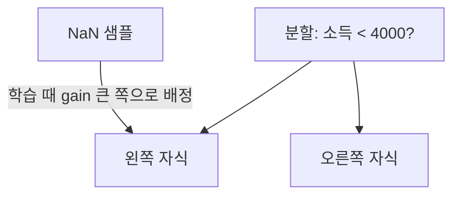

# HistGradientBoosting의 NaN 규칙

> scikit-learn의 `HistGradientBoosting` 분류·회귀 모델은 NaN을 따로 대체하지 않고도 학습한다. 각 분할에서 결측 샘플을 왼쪽·오른쪽 자식 중 어디로 보낼지 학습 때 정한다.

## 쉽게 말하면
갈림길마다 "비어 있는 사람은 이쪽 길로"라는 안내판을 학습 중에 가장 이득이 되는 쪽으로 세워 두는 것이다. 결측값을 채우는 대신 결측 자체를 길 안내에 반영한다.

## 자세히
(scikit-learn 앙상블 문서를 하위 에이전트가 읽은 노트 기준.)
- **학습 시**: 트리 성장기가 각 분할에서 이득(gain)을 보고 **NaN 샘플을 왼쪽/오른쪽 중 어디로 보낼지** 학습한다.
- **예측 시**: 학습 중 NaN이 없었던 특징에서 예측 때 NaN이 오면 **샘플이 더 많은 쪽 자식**으로 보낸다.
- **의미**: 대체값을 임의로 만들지 않아도 되고, 결측 패턴이 정보면 모델이 활용한다. 해석 시에는 결측 분기를 따로 확인([결측 분기의 해석](#nan-interpretability)).
- **한계(제안)**: 결측 메커니즘이 학습과 서빙에서 다르면 성능이 흔들릴 수 있다([결측 패턴 드리프트](#missing-pattern-drift)).

## 그림으로 보기



## 예시
```python
from sklearn.ensemble import HistGradientBoostingClassifier
clf = HistGradientBoostingClassifier().fit(X_with_nan, y)
```
- 교육 활용: 대체 없이 학습한 모델과 평균 대체 모델의 성능 비교.

## 헷갈리는 것과 비교
| 개념 | 차이 |
|---|---|
| 네이티브 NaN 처리 | 모델이 결측을 직접 다룸 |
| 대체(imputation) | 결측 값을 먼저 채움 |
| [NaN 지원 모델 목록](#nan-support-model-list) | 어떤 모델이 가능한지 |

## 더 읽을거리
- [sklearn 앙상블 문서](https://scikit-learn.org/stable/modules/ensemble.html) — 결측값 지원 설명.
