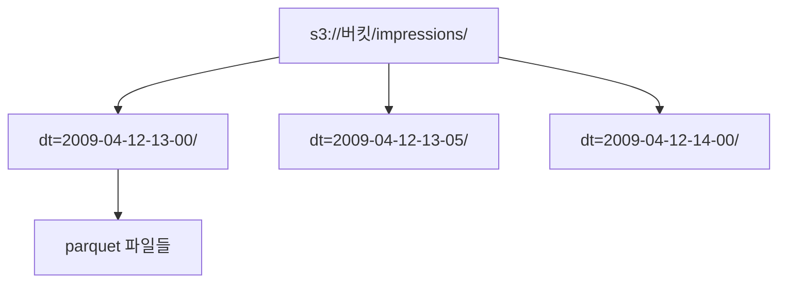
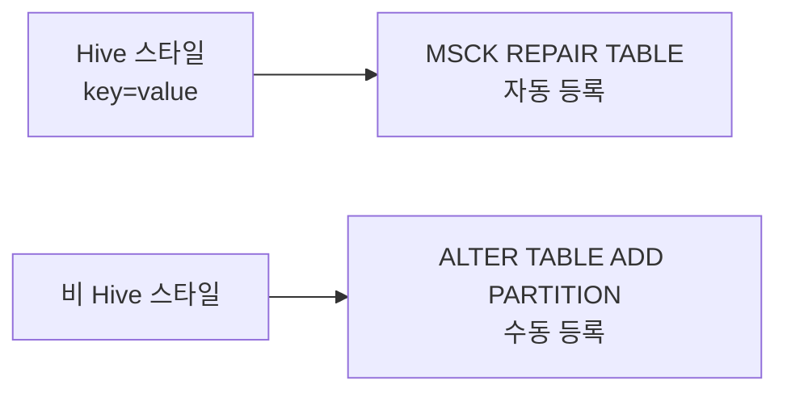

# Hive식 파티셔닝

> 데이터를 `year=2021/month=01/day=26/`처럼 **`키=값` 형태의 폴더 이름**으로 나눠 저장하는 방식이다. 폴더 경로 자체가 "어떤 열의 어떤 값인지"를 담고 있어 쿼리 엔진이 경로만 보고 파티션을 알아낸다.

## 쉽게 말하면
서랍마다 "연도=2021", "월=01" 같은 라벨을 붙여 두면, 서랍 안을 열어 보지 않고도 라벨만으로 무슨 서류인지 알 수 있다. 라벨 규칙이 같은 방식(`키=값`)이면 어떤 도구든 같은 방식으로 읽는다.

## 자세히
(AWS Athena 공식 문서 "Partition your data"를 직접 읽었다. Athena 특화 동작은 표시했다.)
- **형식(Athena 문서)**: Apache Hive 스타일 파티션은 데이터 경로에 등호로 이은 키-값 쌍이 들어간다. 예: `country=us/...`, `year=2021/month=01/day=26/...`. 경로가 **파티션 키의 이름과 값을 모두** 담는다.
- **테이블 만들기(Athena)**: `CREATE EXTERNAL TABLE ... PARTITIONED BY (dt string) ... LOCATION 's3://…/impressions/'`처럼 파티션 열과 루트 위치를 선언한다. 문서의 광고 노출 예시는 `dt=2009-04-12-13-00/`, `dt=2009-04-12-13-05/` 같은 폴더가 5분 단위로 나뉜 구조다.
- **파티션 로드**: Hive 스타일이면 **`MSCK REPAIR TABLE impressions`** 로 폴더에서 파티션을 한 번에 찾아 등록한다. 이 명령은 **Hive 스타일에만** 동작한다. Hive 스타일이 아닌 경로(예: `elb/plaintext/2015/01/01/`)는 `ALTER TABLE ... ADD PARTITION (dt='2015-01-01') location '...'`으로 하나씩 수동 등록한다. 이때 폴더마다 별도 파티션 열이 필요하지 않고 파티션 값이 S3 키와 달라도 된다. 이미 있으면 오류가 나므로 `IF NOT EXISTS`를 쓴다.
- **가지치기 효과(Athena)**: 파티션된 테이블을 `WHERE`에 파티션 조건으로 질의하면 해당 파티션의 데이터만 스캔해 성능이 오르고 비용이 준다. 파티션 키는 아무 열이나 가능하고 시간 기준이 흔하다(시간별 수집은 연·월·일·시, 소스 여럿에 하루 한 번이면 소스 ID+날짜).
- **주의점(Athena 문서)**: ① 경로는 소문자여야 한다. 카멜 케이스(`userId`)면 `MSCK REPAIR TABLE`이 파티션을 카탈로그에 추가하지 못한다 ② 위치는 `s3://` 프로토콜이어야 하며 `s3a://`는 실패 ③ `MSCK REPAIR TABLE`은 하위 폴더까지 스캔하므로 서로 다른 테이블의 데이터는 **겹치지 않는 폴더 계층**에 둔다 ④ Glue 카탈로그의 테이블은 파티션 1천만 개까지 지원하지만 Athena는 한 번의 스캔에서 100만 개를 넘게 읽지 못한다(이럴 때 파티션 인덱스).
- **대안**: 구조가 미리 알려진 파티션이 매우 많은 테이블은 **파티션 프로젝션**으로 메타데이터 조회 대신 설정값으로 파티션 값을 계산한다(문서 요약, 세부는 읽지 않음).
- **일반성**: `키=값` 폴더는 Hive에서 유래해 Spark·DuckDB 같은 다른 엔진도 인식하는 널리 쓰는 관행이다(이 지도의 부모 글에서 DuckDB로 확인한 내용 참고).

## 그림으로 보기



## 예시
```sql
CREATE EXTERNAL TABLE impressions (...) PARTITIONED BY (dt string)
LOCATION 's3://elasticmapreduce/samples/hive-ads/tables/impressions/';
MSCK REPAIR TABLE impressions;
SELECT dt, impressionid FROM impressions
WHERE dt < '2009-04-12-14-00' AND dt >= '2009-04-12-13-00';
```
- 교육 소재: AI 학습 로그를 `date=…/model=…/` 폴더로 정리해 특정 날짜·모델만 읽기.

## 헷갈리는 것과 비교
| 개념 | 차이 |
|---|---|
| Hive식 파티셔닝 | `키=값` 폴더 이름으로 파티션 표현 |
| 비 Hive식(날짜 폴더) | 값만 있는 폴더, 수동 등록 필요 |
| [파티셔닝과 가지치기](#data-partitioning-pruning) | 파티션을 만들고 건너뛰는 상위 개념 |
| [작은 파일 폭증 문제](#too-many-small-files) | 너무 잘게 나눌 때의 비용 |

## 더 읽을거리
- [Partition your data (AWS Athena)](https://docs.aws.amazon.com/athena/latest/ug/partitions.html) — Hive 스타일, MSCK REPAIR, ADD PARTITION, 주의점(직접 읽음).
