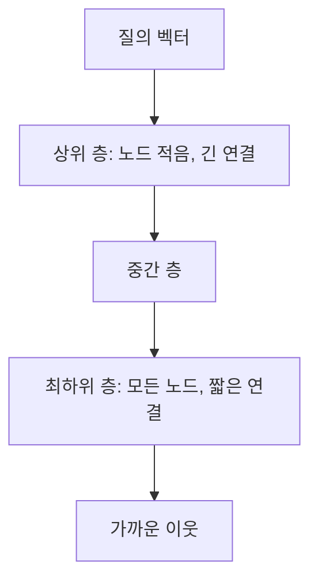

# HNSW 인덱스

> 벡터를 **여러 층의 근접 그래프**로 연결해 두고, 위층에서 거칠게 길을 잡은 뒤 아래층에서 세밀하게 좁혀 가까운 이웃을 빠르게 찾는 근사 최근접 검색(ANN) 알고리즘.

## 쉽게 말하면
도시 지도에서 먼저 고속도로 지도로 대략 지역을 찾고, 그다음 동네 지도, 골목 지도로 내려가며 목적지에 접근하는 방식이다. 모든 집을 하나씩 확인하지 않아도 된다.

## 자세히
(HNSW 논문 arXiv 1603.09320 초록 읽음.)
- 구조: 저장된 요소의 **중첩된 부분집합마다 근접 그래프를 쌓은 다층 구조**. 각 요소의 최상위 층은 **지수적으로 감소하는 확률**로 무작위 결정된다. 별도의 거친 검색 구조가 필요 없다.
- 검색: **위층에서 시작**하고 층마다 서로 다른 거리 규모의 연결을 사용한다. 이 규모 분리 덕에 이전 NSW 방식보다 **로그 수준의 복잡도 증가**를 보인다고 초록이 주장한다(초록에는 증명이나 수치 없음).
- 휴리스틱: 이웃 선택 휴리스틱이 높은 재현율과 강하게 군집된 데이터에서 성능을 높인다.
- 주장: 이전 오픈소스 최신 벡터 전용 방식들을 크게 능가한다고 하나 구체 비교 대상·수치는 초록에 없다. 스킵 리스트와 유사해 분산 구현이 가능하다고도 한다.
- 실무: Azure AI Search 문서가 벡터 검색의 알고리즘으로 HNSW를 명시한다. 정확도-속도-메모리를 조절하는 파라미터(층 연결 수, 탐색 폭)가 있다는 점은 일반 지식이며 이 출처로 확인한 것은 아니다.
- 한계: **근사** 검색이라 항상 진짜 최근접을 보장하지 않는다.

## 그림으로 보기

## 예시
- 수백만 문서 임베딩에서 질문과 가장 가까운 20개를 밀리초 단위로 찾기.
- 교육: 소규모 데이터로 전수 비교와 근사 검색의 결과 차이를 확인하는 실습.

## 헷갈리는 것과 비교
| 개념 | 차이 |
|---|---|
| HNSW | 그래프 기반 근사 검색 |
| 전수(brute-force) 검색 | 모두 비교, 정확하지만 느림 |
| [RRF](#reciprocal-rank-fusion) | 검색 결과의 순위를 합치는 단계 |

## 더 읽을거리
- [HNSW 논문](https://arxiv.org/abs/1603.09320) — 다층 근접 그래프(초록 읽음).
- [Hybrid search scoring (Microsoft Learn)](https://learn.microsoft.com/en-us/azure/search/hybrid-search-ranking) — 벡터 검색 알고리즘 표기(읽음).
