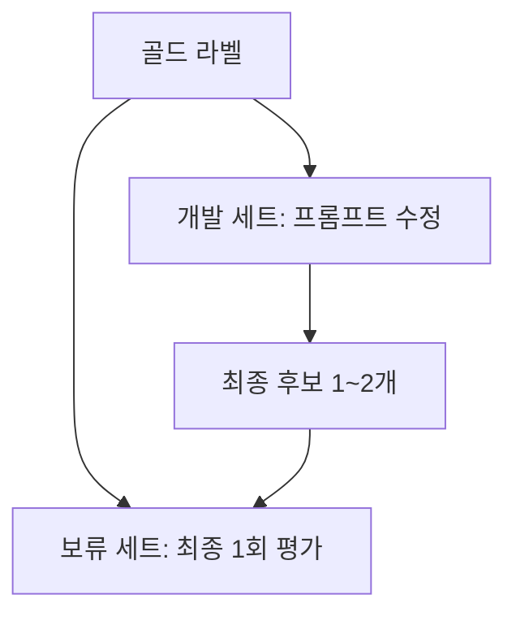
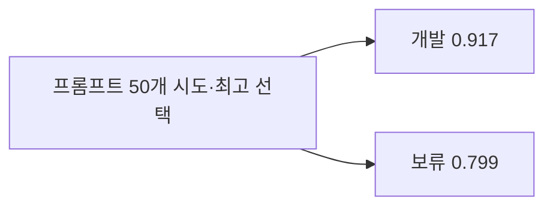

# 프롬프트 튜닝용 보류 세트

> LLM 라벨러의 프롬프트를 개발할 때 개발용(dev) 세트로 프롬프트를 고치고, 따로 떼어 둔 보류(hold-out) 세트로 최종 정확도를 한 번만 재서, 프롬프트를 많이 시도하다 개발 세트에 과적합되는 것을 막는다.

## 쉽게 말하면
모의고사로 공부 방법을 계속 바꿔 가며 점수를 올렸다면, 그 모의고사 점수는 실력이 아니라 모의고사에 맞춘 결과다. 한 번도 안 본 진짜 시험으로 재야 실력을 안다.

## 자세히
- **원리(scikit-learn 교차 검증 문서)**: 학습에 쓴 데이터로 평가하는 것은 방법론적 오류이고 이를 과적합이라 한다. 해결로 일부 데이터를 테스트 세트로 떼어 둔다. 하지만 설정값(하이퍼파라미터)을 테스트 세트 점수에 맞춰 계속 조정하면 테스트 세트의 정보가 모델에 "새어 들어가" 점수가 일반화 성능을 말해 주지 못한다. 그래서 검증 세트를 따로 두고, 실험이 성공해 보일 때 마지막에 테스트 세트로 최종 평가한다. 단점은 데이터를 세 조각으로 나누면 학습에 쓸 수 있는 양이 크게 줄고 결과가 특정 분할에 좌우된다는 것이다.
- **프롬프트에 옮겨 보면(해석)**: 프롬프트도 일종의 "설정값"이다. 프롬프트 문구·예시를 바꿔 가며 같은 평가 세트 점수를 올리면 그 세트에 과적합된다.
- **직접 시뮬레이션(모든 후보 프롬프트의 실제 정확도를 0.80으로 똑같이 둠, 개발 세트 크기 n, 시도한 프롬프트 수 K, 개발 세트에서 가장 높은 것을 고름, 각 1,500회)**:

| 개발 세트 크기 | 시도한 프롬프트 수 | 최고 프롬프트의 개발 세트 정확도 | 새 보류 세트 정확도 |
| --- | --- | --- | --- |
| 50 | 5 | 0.864 | 0.802 |
| 50 | 20 | 0.900 | 0.800 |
| 50 | 50 | 0.917 | 0.799 |
| 100 | 20 | 0.872 | 0.799 |
| 300 | 20 | 0.842 | 0.801 |
| 300 | 50 | 0.850 | 0.799 |

  실제 정확도가 모두 0.80으로 같은데도, 개발 세트 50개로 프롬프트 50개를 시험해 최고를 고르면 0.917까지 "개선"된 것처럼 보인다. 보류 세트에서는 0.80으로 돌아온다. 개발 세트가 클수록, 시도 수가 적을수록 부풀림이 줄어든다. (모든 후보가 같다는 가정의 시뮬레이션이다. 실제로는 일부는 진짜로 낫다.)
- **운영(해석)**: ① 골드 라벨을 개발용·보류용으로 나눈다(예: 30% 개발 / 70% 보류, 보류는 [평가셋 고정](#evaluation-set-freeze)) ② 프롬프트 수정은 개발 세트에서만 ③ 최종 후보 1~2개만 보류 세트로 재고, 그 뒤에는 보류 세트를 보고 더 고치지 않는다(고치면 새 보류 세트 필요) ④ 프롬프트에 경계 사례 예시를 넣을 때([경계 사례 → few-shot 예시](#case-to-fewshot)) 예시로 쓴 샘플은 개발·보류 세트에서 제외한다 ⑤ 시도한 프롬프트 수를 기록한다.

## 그림으로 보기

## 예시
- 골드 400개 중 120개로 프롬프트를 고치고, 280개로 최종 점수를 한 번 잰다.
- 교육 활용: 위 시뮬레이션을 돌려 시도 수와 부풀림의 관계를 확인한다.

## 헷갈리는 것과 비교
| 개념 | 차이 |
| --- | --- |
| 개발 세트 | 프롬프트를 고치는 데 반복 사용 |
| 보류 세트 | 최종 평가에 한 번만 |
| [경계 사례 → few-shot 예시](#case-to-fewshot) | 예시로 쓴 샘플은 세트에서 제외 |
| [평가셋 고정](#evaluation-set-freeze) | 평가셋을 바꾸지 않는 규칙 |

## 더 읽을거리
- [scikit-learn Cross-validation 가이드](https://scikit-learn.org/stable/modules/cross_validation.html) — 테스트·검증 세트 분리와 누수
