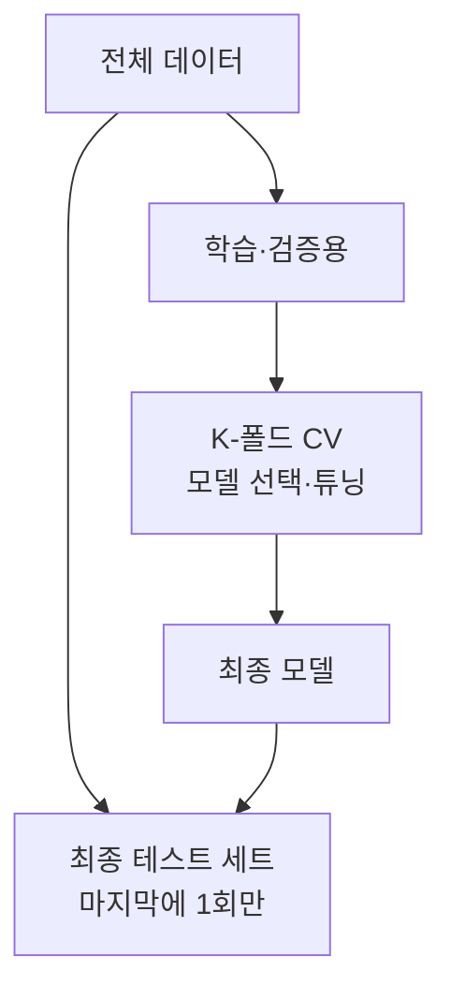
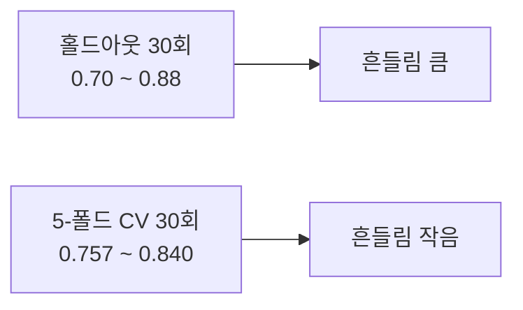

# 홀드아웃과 CV 추정 비교

> 데이터를 한 번만 나눠 재는 **홀드아웃** 점수와 여러 번 나눠 평균내는 **교차검증(CV)** 점수의 차이다. 홀드아웃은 값싸지만 분할 운에 크게 흔들리고, CV는 비싸지만 더 안정적이다.

## 쉽게 말하면
시험 문제 20문항으로 한 번 보는 것(홀드아웃)과 서로 다른 20문항 시험 5번의 평균(CV)을 비교하는 것이다. 한 번 본 시험은 그날의 문제 운에 점수가 크게 좌우된다.

## 자세히
- **직접 실험(scikit-learn 1.9.1, digits 300샘플, 결정 트리, 시드 30개)**
  - 홀드아웃(20% 테스트): 평균 0.797, 표준편차 **0.0426**, 최소 0.700, 최대 0.883.
  - 5-폴드 CV: 평균 0.790, 표준편차 **0.0170**, 최소 0.757, 최대 0.840.
  - 평균은 비슷하지만 분할 하나에 따라 홀드아웃은 70%~88%까지 흔들린다. 같은 모델인데 "운"만으로 18%p 차이다.
- **트레이드오프**
  | 구분 | 홀드아웃 | K-폴드 CV |
  |---|---|---|
  | 학습 횟수 | 1 | k |
  | 추정 안정성 | 낮음(분할 의존) | 높음 |
  | 학습에 쓰는 데이터 | 일부만 | 폴드마다 (k-1)/k |
  | 적합한 상황 | 데이터 많음·학습 비쌈(대형 모델) | 데이터 적음·학습 가벼움 |
- **데이터가 아주 많으면** 테스트 세트도 충분히 커서 홀드아웃 노이즈가 작아진다. 딥러닝·LLM 평가는 보통 홀드아웃이다.
- **최종 보고**는 튜닝에 한 번도 쓰지 않은 **별도 테스트 세트**(홀드아웃)로 한 번만 잰다. CV는 모델 선택·튜닝용, 최종 테스트는 마지막 확인용으로 역할을 나누는 것이 일반적인 관행이다. 이 분리가 없으면 튜닝 과정이 검증 점수에 스며들어 낙관적이 된다.
- CV 점수와 최종 테스트 점수가 크게 어긋나면 누수·분포 차이·튜닝 과적합을 의심한다([층화와 누수](#stratification-vs-leakage)).

## 그림으로 보기

## 예시
- 데이터 300개 → CV로 모델·하이퍼파라미터 선택 + 60개는 처음부터 떼어 둔 최종 테스트로 1회 평가.
- LLM 파인튜닝(학습 몇 시간) → 고정 검증 세트 1개와 테스트 세트 1개.

## 헷갈리는 것과 비교
| 개념 | 차이 |
|---|---|
| 홀드아웃 | 한 번 분할 |
| [K-폴드 CV](#cv-variance-bias-tradeoff) | k번 분할, 평균 |
| [반복 CV](#repeated-cross-validation) | 분할을 바꿔 더 반복 |
| [최종 테스트 세트](#final-test-set-confirmation) | 튜닝에 안 쓴 마지막 확인용 |

## 더 읽을거리
- [scikit-learn 교차검증 가이드](https://scikit-learn.org/stable/modules/cross_validation.html) — 학습·검증·테스트 세트를 나누는 이유와 CV 소개.
