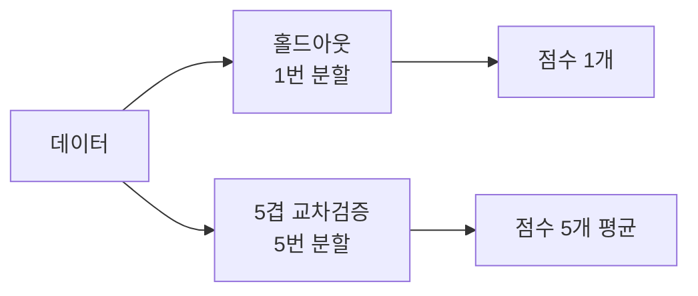
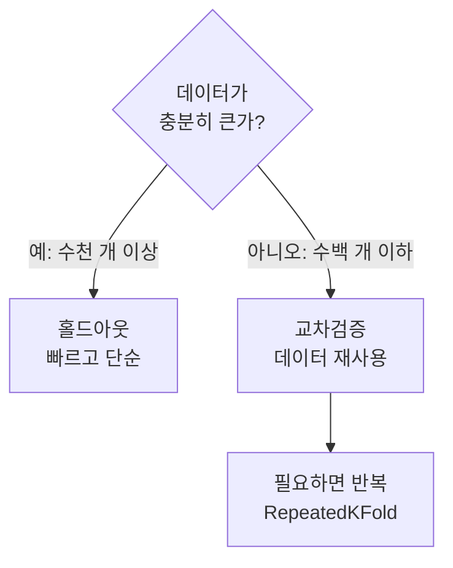

# 홀드아웃 vs 교차검증

> 홀드아웃은 데이터를 한 번 나눠 한 번만 평가하는 방식이고, 교차검증은 여러 번 나눠 평가해 평균내는 방식이다. 데이터가 작을수록 홀드아웃 점수는 어떻게 나눴느냐에 크게 흔들린다.

## 쉽게 말하면
시험 문제 20개 중 4개만 골라 한 번 풀어 보고 실력을 판단하는 것이 홀드아웃이다. 운 좋게 쉬운 4개가 걸리면 실력이 높게 보인다. 5번 나눠 돌려 가며 모든 문제를 한 번씩 시험 문제로 쓰고 평균을 내면 이 운이 줄어든다. 대신 채점을 5번 해야 한다.

## 자세히
- **홀드아웃**: `train_test_split`으로 한 번 나눠 학습·평가. 빠르고 단순하다. 단점은 평가에 쓰는 표본이 적고 점수가 특정 분할에 의존한다는 점이다. 학습·검증·시험 3개로 나누면 학습에 쓸 데이터가 크게 줄어든다(scikit-learn 교차검증 문서, 열람).
- **교차검증(K겹)**: 학습 데이터를 K조각으로 나눠 K-1조각으로 학습, 1조각으로 검증을 K번 하고 평균한다. 데이터를 덜 낭비하지만 계산이 K배 든다. 최종 시험 세트는 따로 남겨 둔다(같은 문서).
- **직접 해 본 시뮬레이션(scikit-learn, 로지스틱 회귀, 시드마다 새 합성 데이터 100번 반복, 시험 20%·5겹)**: 표본 100개에서 정확도의 표준편차는 홀드아웃 0.085, 5겹 평균 0.056이었다. 표본 1,000개에서는 0.044 대 0.040으로 거의 같았다. 평균 정확도는 두 방식이 사실상 같았다(100개: 0.885 대 0.886). 이 표준편차에는 데이터 자체의 변동이 섞여 있어 분할 변동만의 크기는 아니지만, 같은 조건에서 작은 데이터일수록 홀드아웃이 더 흔들렸다.
- **선택 기준(해석)**: 표본이 수천 개 이상이고 학습이 오래 걸리면 홀드아웃, 수백 개 이하이면 교차검증. 시간순 데이터는 `TimeSeriesSplit`, 같은 사람·문서가 여러 행이면 `GroupKFold`처럼 분할 규칙부터 맞춘다.
- **주의**: 어느 쪽이든 전처리는 학습 조각에서만 배워야 한다. `Pipeline`으로 묶으면 안전하다([RepeatedKFold](#repeated-kfold)에서 반복으로 변동을 더 줄이는 법을 본다).

## 그림으로 보기

## 예시
- 고객 후기 300건 감성 분류: 홀드아웃(60건 시험)은 점수가 ±몇 %p 흔들리므로 `cross_val_score(model, X, y, cv=5)`로 평균과 표준편차를 함께 보고한다.
- 교육 활용: 같은 데이터를 시드만 바꿔 홀드아웃 10번 돌려 점수가 얼마나 달라지는지 학습자가 직접 확인하게 한다.

## 헷갈리는 것과 비교
| 개념 | 차이 |
| --- | --- |
| 홀드아웃 | 1회 분할, 빠름, 점수 변동 큼 |
| 교차검증 | K회 분할, 계산 K배, 점수 안정적 |
| [교차검증의 분산·편향 절충](#cv-variance-bias-tradeoff) | K 선택의 상위 주제 |
| [RepeatedKFold](#repeated-kfold) | 교차검증을 여러 번 반복 |

## 더 읽을거리
- [scikit-learn: Cross-validation](https://scikit-learn.org/stable/modules/cross_validation.html) — 홀드아웃의 한계와 K겹, 전처리 누수, 분할기 종류
