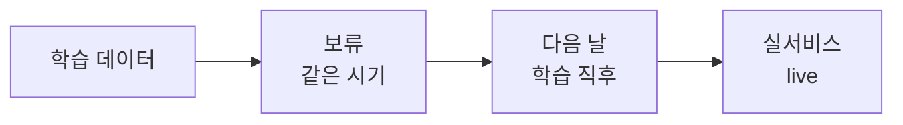
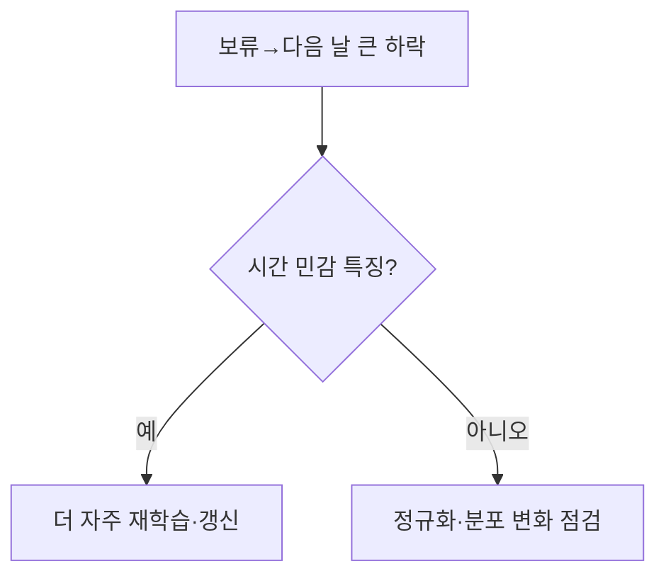

# 보류 vs 다음 날 비교

> 학습-서빙 skew를 세 구간으로 쪼갰을 때 **두 번째 구간**이다. 같은 시기에서 떼어 둔 보류(holdout) 데이터의 성능과 **학습 이후 "다음 날"의 데이터** 성능을 비교해, 시간에 민감한 특징이 모델을 낡게 만드는지 본다.

## 쉽게 말하면
모의고사(보류)는 잘 봤는데 다음 날 실제 시험(다음 날 데이터)에서 점수가 크게 떨어졌다면, 공부한 내용 중 "유행 지난 문제"가 섞여 있었다는 뜻이다. 어느 부분이 상했는지 찾아 더 자주 갱신해야 한다.

## 자세히
(Google "Rules of Machine Learning"의 Rule #37, 직접 확인.)
- **세 구간(Rule #37)**:
  1. **학습 vs 보류**: 이 격차는 항상 존재하며 반드시 나쁜 것은 아니다.
  2. **보류 vs 다음 날**: 이 격차도 항상 있으나 튜닝 지침이 된다. 글은 정규화를 **다음 날 성능이 최대가 되도록** 조정하라고 권한다. 보류에서 다음 날로 크게 떨어지면 **시간에 민감한 특징**이 모델을 악화시키고 있을 수 있다.
  3. **다음 날 vs 실서비스**: 버그를 가장 시사하는 구간. 같은 예시는 학습과 서빙에서 같은 점수가 나와야 하므로 어긋나면 엔지니어링 오류일 가능성이 높다.
- **두 번째 구간의 처방**: 어떤 특징이 낡는지 확인하고 더 자주 재학습·갱신한다(Rules of ML의 신선도 규칙 #8 참조).
- **세 번째 구간의 처방(참고)**: 학습·서빙 환경이 같은 모델에 같은 점수를 내는지 테스트(Rule #5), 서빙 시점 특징을 로깅해 학습에 사용(Rule #29), 두 파이프라인의 코드 재사용(Rule #32).
- **그 밖의 skew 원인(문서)**: 파이프라인 차이, 조인되는 테이블이 변하는 데이터 변화(서빙 시점 로깅이나 테이블 스냅샷, Rule #31), 피드백 고리(Rule #36).
- **운영 방법(일반 원칙)**: 보류는 학습과 같은 기간에서 무작위로 남긴 것, 다음 날은 [시간 기반 분할](#time-based-split-rule)로 학습 직후 기간을 시험용으로 둔다. 격차가 몇 %부터 문제인지는 도메인마다 달라 [허용 편향 기준](#acceptable-skew-threshold)으로 정한다.

## 그림으로 보기

## 예시
- 수요 예측: 보류 정확도 92%, 다음 날 정확도 84%. "지난 7일 판매량" 특징의 갱신이 하루 늦는 것을 발견해 매일 갱신으로 변경(예시 수치).
- 교육 소재: "모의고사와 다음 날 시험의 차이는 어디서 오나?"

## 헷갈리는 것과 비교
| 구간 | 의미 | 큰 격차의 의심 |
|---|---|---|
| 학습 vs 보류 | 과적합 정도 | 정규화 부족 |
| 보류 vs 다음 날 | 시간 변화 | 시간 민감 특징 |
| 다음 날 vs 실서비스 | 파이프라인 일치 | 엔지니어링 버그 |
| [학습-서빙 특징 일관성 점검](#feature-consistency-check) | 세 번째 구간을 파고드는 방법 | |

## 더 읽을거리
- [Rules of Machine Learning (Google)](https://developers.google.com/machine-learning/guides/rules-of-ml) — Rule #37 Measure Training/Serving Skew(직접 확인).
