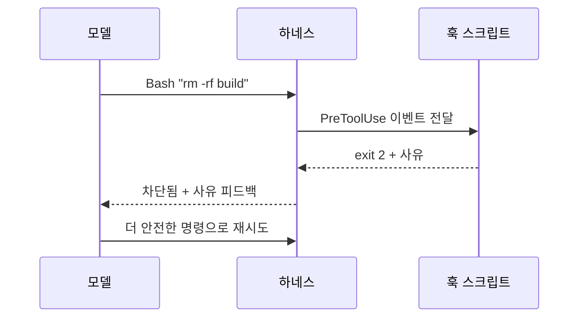
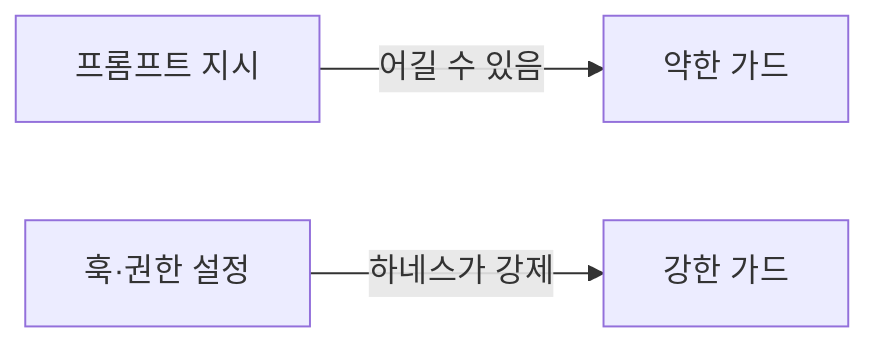

# 훅과 가드레일

> 훅(hook)은 에이전트의 정해진 시점(도구 실행 전·후, 턴 종료 등)에 자동으로 실행되는 사용자 정의 명령이다. "AI가 알아서 지키겠지"가 아니라 "어길 수 없게" 규칙을 강제하는 가드레일을 만드는 수단이다.

## 쉽게 말하면
"위험한 곳에 들어가지 마세요"라는 안내문(프롬프트)은 읽고도 어길 수 있다. 훅은 문에 설치한 자동 잠금장치다. 사람이 읽지 않아도, 에이전트가 잊어도 문이 열리지 않는다.

## 자세히
Claude Code 훅 가이드(2026-11 확인) 기준:
- 훅은 라이프사이클의 특정 시점에 실행되는 셸 명령으로, LLM의 선택에 맡기지 않고 항상 실행되는 결정적 제어를 준다. 판단이 필요하면 프롬프트 기반·에이전트 기반 훅으로 모델에게 조건을 평가시킬 수도 있다.
- **주요 이벤트**: `PreToolUse`(도구 실행 전, 차단 가능), `PostToolUse`(성공 후), `PostToolUseFailure`, `Stop`(턴 종료 시도), `SessionStart`, `UserPromptSubmit` 등.
- **종료 코드 규약**: exit 0은 이의 없음(PreToolUse에서 0이어도 일반 권한 흐름은 그대로 — 승인이 아니다). **exit 2는 차단**: stderr의 사유가 Claude에 피드백으로 전달된다. 그 외 코드는 대부분 비차단 오류로 진행된다.
- **여러 훅이 겹치면** PreToolUse 권한 판정은 가장 엄격한 쪽(deny > defer > ask > allow)이 이긴다.
- **용도**: 편집 후 포매터 자동 실행(`Edit|Write` 매처), `rm -rf` 같은 명령 차단, 민감 파일 쓰기 거부, 명령 로그 남기기, 입력 대기 알림, Stop 훅으로 타입체크 통과 전엔 끝내지 못하게 하기.
- **한계**: 훅은 하네스가 실행하므로 모델이 우회할 수 없지만, 훅 스크립트가 허술하면 구멍이 생긴다. 규칙이 "예외가 있을 수 없는 것"일 때만 훅으로 굳힌다.

## 그림으로 보기



## 예시
```json
{ "hooks": { "PreToolUse": [ { "matcher": "Bash",
  "hooks": [ { "type": "command", "command": "./scripts/deny-rm.sh" } ] } ] } }
```
`deny-rm.sh`는 stdin의 명령에 `rm -rf`가 있으면 stderr에 사유를 쓰고 `exit 2`. 설정 파일은 `.claude/settings.json`.

## 헷갈리는 것과 비교
| 개념 | 차이 |
| --- | --- |
| 프롬프트 규칙(CLAUDE.md) | 모델이 읽고 따르길 기대 — 권고 |
| 훅 | 하네스가 실행 — 강제 |
| 권한 설정(allow/deny) | 도구별 허용 목록. 훅은 그보다 세밀한 로직 가능 |
| [최소 권한](#least-privilege-agents) | 애초에 줄 수 있는 권한을 줄이는 원칙 — 훅과 함께 |
| [승인 정책](#approval-policy) | 어떤 행동에 사람 승인을 걸지 정하는 설계 |

## 더 읽을거리
- [Claude Code: Hooks guide](https://code.claude.com/docs/en/hooks-guide) — 이벤트·종료 코드·예제
- [Claude Code: Best practices](https://code.claude.com/docs/en/best-practices) — 예외 없는 규칙은 강제하라
