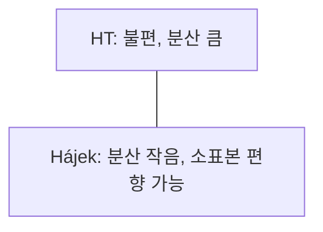

# Horvitz–Thompson 추정량

> **Horvitz–Thompson(HT) 추정량**은 각 단위가 표본에 들어올 **확률(포함 확률)을 알 때**, 뽑힌 값을 그 확률로 나눠 더한 값 `Σ y_i/π_i`으로 모집단 **합계**를 **편향 없이(불편)** 추정하는 방법이다. 역확률 가중의 가장 기본 형태다.

## 쉽게 말하면
복권 판매점이 "내 가게는 전체 응모권의 10%만 모아 파니 모은 금액을 10배 하면 전체 매출이다"라고 계산하는 것과 같다. 확률이 낮은 가게일수록 더 크게 곱해서 전체를 되살린다.

## 자세히
(이 세션에서 numpy로 **직접 시뮬레이션**했다. 6개 단위의 작은 모집단(값 10~60, 합계 210)에 **포아송 표집**(단위마다 독립적으로 포함 확률 0.9, 0.8, 0.5, 0.4, 0.2, 0.1)을 20만 번 반복했다. Wikipedia IPW 문서는 HT 추정량을 "알려진 표집 확률의 역수로 가중한 초기 추정량"으로 소개하지만 공식은 싣지 않는다(직접 확인).)
- **정의**: 합계 추정 `T̂ = Σ_{i∈표본} y_i / π_i`. 모집단 평균은 `T̂/N`(N을 알 때).
- **불편성(실행 결과)**: 진짜 합계 210에 대해 HT의 평균은 **209.78**로, 그냥 뽑힌 값의 합 평균 **71.92**와 크게 다르다. 이론 기댓값 Σ(y_i·π_i/π_i)=210과 일치한다.
- **분산이 크다(실행 결과)**: HT의 표준편차는 **213.9**로 합계 210과 같은 크기다. 포아송 표집의 이론식 √Σ((1−π_i)/π_i·y_i²)=214.0과 맞았다. 포함 확률이 낮은 큰 값(예: π=0.1, y=60)이 가끔 뽑히면 추정치가 폭증하기 때문이다. → [극단 가중치 불안정](#extreme-weight-instability)
- **평균을 구할 때 HT와 Hájek(실행 결과)**: 진짜 평균 35.0에 대해
  | 추정 | 평균 | 표준편차 |
  |---|---|---|
  | HT (÷N=6) | 35.176 | 35.669 |
  | Hájek (÷Σ1/π) | **28.622** | 10.951 |
  → 이 작은 모집단에서는 Hájek이 **분산은 훨씬 작지만 편향이 있었다**(28.6 vs 35.0). 큰 모집단 시뮬레이션([역확률 가중](#inverse-probability-weighting))에서는 편향이 0에 가까웠으므로, **표본이 작을 때는 정규화 추정이 편향될 수 있다**는 예로 읽는다(이 장난감 설정 한정).
- **조건**: 모든 단위의 포함 확률이 0보다 커야 하고(양의 확률), 확률을 정확히 알아야 한다. → [양의 확률 가정](#positivity-assumption)
- **쓰임(해석)**: 편향된 로그·설문·라벨링 표본에서 모집단 통계를 추정할 때의 기초. 오프폴리시 평가 같은 곳의 가중 기법도 같은 아이디어다(이 노드에서 확인하지 않음).

## 그림으로 보기

## 예시
- 응답 확률이 그룹별로 알려진 설문에서 총 구매 금액을 추정: 응답자의 금액을 각자의 응답 확률로 나눠 합산.
- 교육 활동: 표본 3개에 확률 0.5, 0.2, 0.1을 주고 HT 합계를 손으로 계산.

## 헷갈리는 것과 비교
| 개념 | 차이 |
|---|---|
| HT 추정량 | 확률의 역수 가중 합계, 불편 |
| Hájek 추정량 | 가중치 합으로 정규화한 평균 |
| 단순 표본 합 | 표집 확률을 무시해 합계를 과소·과대 추정 |
| [역확률 가중](#inverse-probability-weighting) | 개념의 일반 설명 |

## 더 읽을거리
- [Inverse probability weighting (Wikipedia)](https://en.wikipedia.org/wiki/Inverse_probability_weighting) — HT 추정량을 초기 가중 추정량으로 소개(직접 확인). 표의 수치는 이 노드의 직접 시뮬레이션이다.
