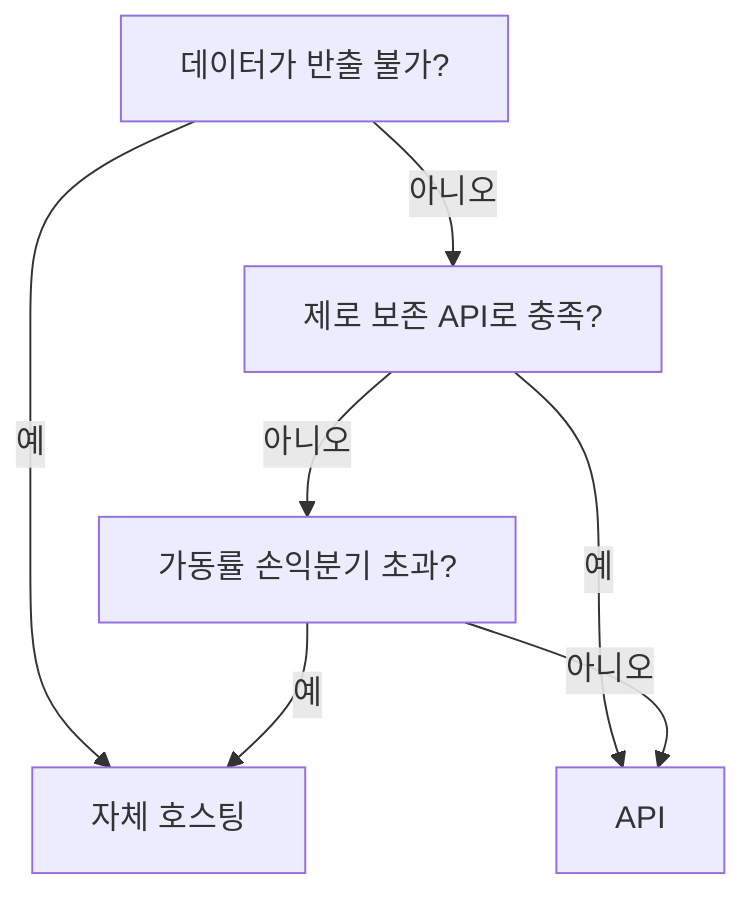
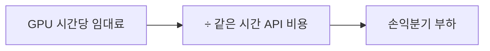

# 호스팅 결정 체크리스트

> LLM을 **직접 호스팅할지, API로 쓸지** 고르는 질문 목록. 핵심 변수는 데이터 반출 제약, GPU 가동률, 비교 대상 모델, 운영 인력이다.

## 쉽게 말하면
자가용을 살지 택시를 탈지의 문제다. 매일 오래 타면 자가용이 싸지만, 가끔 타면 택시가 싸다. 기름값만 보지 말고 주차·정비·보험까지 합쳐야 한다.

## 자세히
(검색 요약 기준. 출처 간 수치가 충돌하고 일부는 스폰서 글이다.)
- **손익분기 부하(OpenRouter 설명)**: GPU 시간당 임대료 ÷ 같은 시간만큼의 토큰을 API로 썼을 때 비용. 30%라면 임대한 시간의 30% 이상 GPU가 일해야 API보다 싸다. 100%를 넘으면 가득 돌려도 API가 이긴다.
- 단순 계산(월 GPU 비용 ÷ 토큰당 API 가격)은 거의 항상 틀린 답을 낸다는 분석이 있다. 교차점은 총량보다 **트래픽 패턴**을 따른다.
- 규모 감각(출처별 상이): 최고급 폐쇄 모델 대비라면 하루 200~500만 토큰에서 손익분기라는 주장, 저렴한 오픈 모델 API 대비로는 하루 5,000만 토큰 이상으로 크게 올라간다는 주장. 어떤 블로그는 하루 5.5~6.5만 요청.
- 숨은 비용: 실제 비용은 GPU 가격의 3~5배라는 가이드가 있다. 자체 모델과 최고급 호스팅 모델은 **같은 급**에서 비교해야 한다.
- 프라이버시: 데이터가 법·계약상 나갈 수 없으면 자체 호스팅이 사실상 필수. 다만 데이터 보존 제로 엔드포인트로 상당 부분 해결된다는 주장도 있다(공급자 약관으로 확인).
- 체크리스트(출처에서 도출): ① 데이터가 반드시 내부에 있어야 하나 ② 제로 보존·지역 한정 API로 충족되나 ③ 같은 모델을 서비스하는 가장 싼 API와 비교 ④ 유휴·여유분 포함 현실적 가동률 ⑤ 운영·장애 대응 인력 ⑥ 가격 재확인.

## 그림으로 보기

## 예시
- 사내 문서 요약을 하루 20만 토큰 처리: 가동률이 낮아 API가 유리할 가능성이 큼.
- 교육: 체크리스트를 수강생 회사 상황에 대입해 답해 보는 실습.

## 헷갈리는 것과 비교
| 개념 | 차이 |
|---|---|
| 자체 호스팅 | 통제·고정비 |
| API | 변동비·운영 위탁 |
| [로컬+API 혼합](#hybrid-local-api) | 두 방식 혼합 |

## 더 읽을거리
- [OpenRouter: Self-Hosted LLM vs API](https://openrouter.ai/blog/insights/self-hosted-llm-vs-api/) — 손익분기 부하(검색 결과 확인, API 업체 글).
- [arXiv 2509.18101: 온프레미스 LLM 비용-편익](https://arxiv.org/abs/2509.18101) — 학술 분석 링크.
