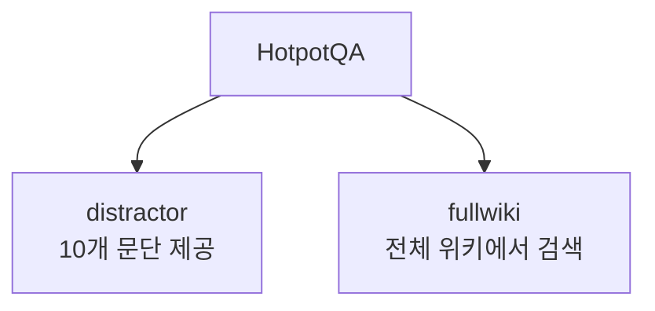

# HotpotQA

> HotpotQA는 위키백과 기반의 멀티홉 질문 응답 데이터셋이다. 11.3만 개의 질문-답 쌍으로, 답하려면 여러 문서를 찾아 조합해야 하고 답의 근거가 된 문장(supporting facts)까지 표시돼 있다. EMNLP 2018에서 발표됐다.

## 쉽게 말하면
"〈영화 A〉의 감독이 태어난 도시는 어디인가?"에 답하려면 먼저 영화 A 문서에서 감독 이름을 찾고, 다시 그 감독 문서에서 출생 도시를 찾아야 한다. 한 문서에서 끝나지 않고 두 번 건너야 하는 질문 모음이며, 어디서 정보를 찾았는지 밑줄 친 근거까지 달려 있다.

## 자세히
- **구성(논문 초록, 열람)**: 위키백과에서 만든 질문-답 쌍 11.3만 개. 특징은 ① 여러 지원 문서를 조합해야 하는 추론 ② 기존 지식 그래프의 틀에 묶이지 않는 다양한 질문 ③ 문장 단위의 근거(supporting facts)로 설명 가능한 예측과 강한 지도 학습 ④ 새 유형인 비교 질문(두 대상의 사실을 뽑아 비교)이다.
- **두 가지 설정(공식 페이지, 열람)**: ① distractor — 10개 문단(정답 문단 + 방해 문단)을 읽고 답과 근거를 낸다 ② fullwiki — 위키백과 전체에서 필요한 문서를 직접 찾아 답한다. 후자가 검색까지 필요해 더 어렵다.
- **지표(같은 페이지)**: 답(Ans)·근거(Sup)·결합(Joint) 각각에 대해 정확 일치(EM)와 F1을 보고한다. 계산 방식은 페이지가 아닌 평가 스크립트를 따른다. 라이선스는 데이터와 가공된 위키 코퍼스 모두 CC BY-SA 4.0이다.
- **데이터 필드**: 공식 페이지는 필드 구성을 설명하지 않아 이 글에서는 확인하지 못했다.
- **의미(해석)**: 한 문서만 읽고 답을 맞히는 "지름길"을 막고 근거를 함께 평가하려는 설계다. 근거 주석은 모델이 우연히 맞힌 답과 진짜 추론을 구분하는 단서다([근거 문장 주석](#supporting-fact-annotation)). 이후 지름길을 더 줄인 데이터셋이 나왔다([MuSiQue](#musique)).
- **교육 활용**: 검색 증강(RAG)이 왜 한 번 검색으로 끝나지 않는지, "두 번 건너는 질문"을 예로 설명하기 좋다.

## 그림으로 보기

## 예시
- 질문 유형: ① 다리형(한 사실을 거쳐 다음 사실) ② 비교형(두 대상의 속성 비교, 예: 누가 먼저 태어났나).
- 교육 활용: 같은 질문을 한 문서만 주었을 때와 두 문서를 주었을 때 모델 답이 어떻게 달라지는지 비교한다.

## 헷갈리는 것과 비교
| 개념 | 차이 |
| --- | --- |
| 단일 홉 QA | 한 문서에서 답을 찾음 |
| HotpotQA | 문서 둘 이상 조합, 근거 문장 포함 |
| [MuSiQue](#musique) | 단일 홉 질문을 합성한 2~4홉 데이터 |
| [멀티홉 질문 응답](#multi-hop-qa) | 과제의 상위 개념 |

## 더 읽을거리
- [HotpotQA 논문 (arXiv 1809.09600)](https://arxiv.org/abs/1809.09600) — 데이터셋 설계와 특징
- [HotpotQA 공식 페이지](https://hotpotqa.github.io/) — 설정, 지표, 라이선스
