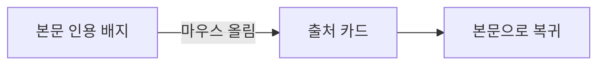

# 호버 카드 인용

> 본문에 **인용 배지를 두고 마우스를 올리면 출처 정보 카드가 뜨는** 방식이다. 읽던 자리를 떠나지 않고 출처를 미리 확인한다.

## 쉽게 말하면
책의 각주 번호에 손가락을 대면 작은 메모가 튀어나오는 것이다. 책 끝까지 넘기지 않고 바로 확인한다.

## 자세히
(He·Liu, "Seeing to Think?"(arXiv 2601.14611) HTML 본문 앞부분 약 10만 자를 직접 읽었다. 나머지 약 2.7만 자는 읽지 못했다. 사전 인쇄본이다.)
- **설계(논문)**: 인용 배지가 본문에 inline으로 남고, 배지에 호버하면 출처 세부 카드가 뜬다.
- **실험**: Prolific 372명, 집단 간 설계. Perplexity sonar-pro 기반 챗 어시스턴트로 증거를 모아 미국 정책(의료·뉴스 규제·과학) 논증 에세이를 쓴다. 최소 50단어, 4회 이상 대화, 서로 다른 출처 4개 이상 인용.
- **결과(논문)**: 호버 사용자는 주로 배지 클릭으로 인용하고 **인용에서 글쓰기로 넘어가는 전이 확률이 0.393**. 인용 밀도가 높아지면 **작업 부담이 증가**(β=0.05, p<.05)하고 **증거 평가 점수는 개선**(β=0.08, p<.05).
- **인식 결과**: 인터페이스 조건은 투명성·신뢰·확신에 유의한 영향이 없었다.
- **불일치 주의**: 초록과 결과는 4개 조건, 절차 부분은 5개라고 적어 확인하지 못했다.

## 그림으로 보기

## 예시
- 사내 AI 리서치 도구에서 인용 번호 위에 호버 시 문서 제목·날짜·해당 문단을 미리보기로 보여 준다(제안). 인용이 많은 답에서는 부담이 커질 수 있다.

## 헷갈리는 것과 비교
| 방식 | 특징 |
|---|---|
| 호버 카드 | 필요할 때만 상세 표시 |
| [정렬 사이드바](#aligned-sidebar-citation) | 본문과 나란히 상시 표시 |
| 접이식 | 토글 뒤에 숨김 |
| 푸터 | 응답 끝에 나열 |

## 더 읽을거리
- [He & Liu — Seeing to Think? (arXiv 2601.14611)](https://arxiv.org/html/2601.14611v1) — 앞부분 직접 읽음.
