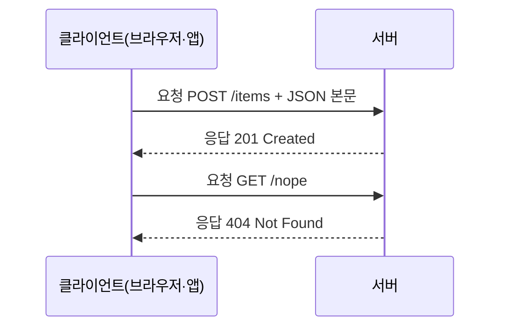
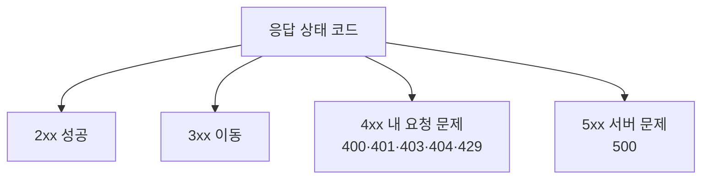

# HTTP 요청과 상태 코드

> 웹 브라우저·앱·AI API가 서버와 대화하는 규칙. 클라이언트가 **요청(메서드+주소+헤더+본문)** 을 보내면 서버가 **응답(상태 코드+헤더+본문)** 을 돌려준다. 상태 코드의 첫 자리 숫자만 알아도 "성공/이동/내 잘못/서버 잘못"을 바로 구분할 수 있어, 바이브코딩 중 오류 메시지를 읽는 기본기가 된다.

## 쉽게 말하면
식당에서 주문서(요청)를 내면 주방이 "음식 나갑니다(200)", "메뉴가 바뀌었어요(301)", "그런 메뉴 없어요(404)", "주방에 불이 났어요(500)"처럼 번호표로 답한다. 번호의 앞자리가 누구 문제인지 알려 준다.

## 자세히
- **요청 구성**: 메서드(GET 읽기, POST 만들기, PUT/PATCH 수정, DELETE 삭제), 주소(URL), 헤더(인증 토큰·콘텐츠 형식), 본문(보통 JSON).
- **상태 코드 5종류**(MDN 기준): 1xx 진행 중 / **2xx 성공** / **3xx 추가 조치 필요(이동)** / **4xx 클라이언트 오류**(요청에 문제) / **5xx 서버 오류**(유효한 요청을 서버가 처리 못 함).
- **자주 보는 코드**(MDN 요약): 200 성공, 201 새 리소스 생성(보통 POST 뒤), 301 영구 이동, 400 형식이 잘못된 요청, **401 사실상 "인증 안 됨"**(이름은 Unauthorized지만 인증이 필요하다는 뜻), **403 인증은 됐지만 권한 없음**, 404 리소스 없음(권한 숨기려고 403 대신 쓰기도 함), **429 요청이 너무 많음(속도 제한)**, 500 서버 일반 오류.
- **직접 실행**(파이썬 내장 서버를 로컬에 띄워 요청): `GET /ok → 200`, `GET /old → 301`, `GET /nope → 404`, `GET /secret → 401`, `GET /boom → 500`, `POST /items`에 올바른 JSON → `201`, JSON이 아닌 본문 → `400`.
- **AI·API 오류 읽기**: AI API가 401이면 키 누락·오타, 403이면 권한·지역·모델 접근 문제, 429면 호출 속도·한도 초과(잠시 후 재시도), 5xx면 공급자 쪽 장애일 수 있다. 오류 본문(JSON)에 이유가 적힌 경우가 많으니 **상태 코드와 본문을 함께** 읽는다.
- 한계: 상태 코드 의미는 표준(RFC 9110)이 정하지만 서버마다 비표준 코드나 관례가 있을 수 있다.

## 그림으로 보기



## 예시
```bash
curl -i https://example.com/api/items/1        # 상태 코드와 헤더 함께 보기
curl -X POST https://example.com/api/items \
  -H "Content-Type: application/json" -d '{"name":"책"}'
```
```python
import urllib.request, urllib.error
try:
    print(urllib.request.urlopen("https://example.com/nope").status)
except urllib.error.HTTPError as e:
    print(e.code)   # 404
```
- 바이브코딩 프롬프트: "이 API 호출이 401로 실패했어. 요청 헤더와 환경 변수를 점검할 순서를 알려 줘."

## 헷갈리는 것과 비교
| 개념 | 차이 |
|---|---|
| 401 | 인증이 안 됨(누구인지 모름) |
| 403 | 인증됐지만 권한 없음 |
| 4xx | 요청 쪽 문제(고치면 해결) |
| 5xx | 서버 쪽 문제(재시도·공급자 확인) |
| [환경 변수와 API 키](#env-secrets) | 401의 흔한 원인(키 누락) 점검 |

## 더 읽을거리
- [MDN: HTTP response status codes](https://developer.mozilla.org/en-US/docs/Web/HTTP/Reference/Status) — 모든 상태 코드의 표준 설명.
