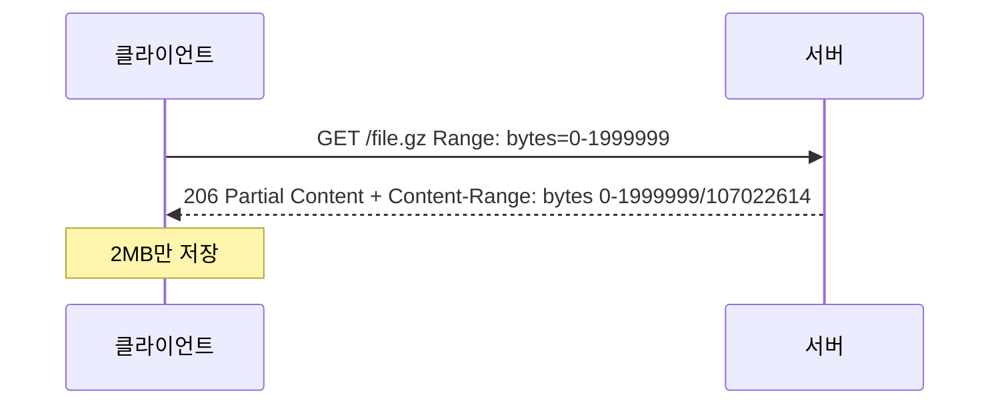
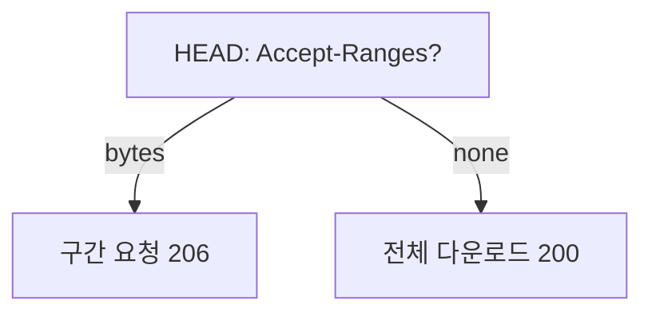

# HTTP Range 요청

> 파일 전체를 받지 않고 **바이트 구간 일부만 요청하는** HTTP 기능이다. 요청 헤더에 `Range: bytes=0-1999999`를 넣으면 서버가 `206 Partial Content`로 그 구간만 돌려준다. 수 GB짜리 크롤 데이터에서 일부만 보고 싶을 때 쓴다.

## 쉽게 말하면
도서관에서 책 한 권을 통째로 빌리지 않고 "30쪽부터 50쪽까지만 복사해 주세요"라고 요청하는 것이다. 책이 얼마나 두꺼운지 몰라도 필요한 쪽만 받는다.

## 자세히
- 직접 실행(2026-11-27, Common Crawl `CC-MAIN-2024-10`):
  - `curl -r 0-199 .../wet.paths.gz` → `HTTP/2 206`, `content-range: bytes 0-199/180690`, `content-length: 200`, `accept-ranges: bytes`. 전체 크기(180,690바이트) 중 200바이트만 받았다.
  - 경로 목록의 첫 파일(`…/CC-MAIN-20240220211055-20240221001055-00000.warc.wet.gz`)은 헤더 요청(`curl -I`)으로 **크기 107,022,614바이트(약 102MiB)**, `accept-ranges: bytes`임을 확인. 앞 2,000,000바이트만 받으니 2MB 파일이 저장됐다.
  - 이 2MB를 `zcat`으로 풀자 WARC/WET 텍스트가 나왔고 레코드 시작 줄 `WARC/1.0`이 589개 셌다.
- 응답 코드: `206` = 구간 응답, `200` = 서버가 Range를 무시하고 전체를 보냄, `416` = 요청 구간이 파일 범위 밖. 서버가 지원하는지는 `Accept-Ranges: bytes` 헤더(또는 `curl -I`)로 먼저 본다.
- 문법: `bytes=시작-끝`(양끝 포함), `bytes=시작-`(끝까지), `bytes=-N`(마지막 N바이트).
- 용도: ① 대용량 파일의 앞부분 샘플링 ② 큰 파일 이어받기 ③ 압축 파일을 레코드 단위로 읽기([gzip 멤버 경계](#gzip-member-boundary)).
- 주의: 구간이 압축 멤버 중간에서 끊기면 마지막 레코드는 깨진다(위 실험은 마지막이 잘렸을 수 있음, `zcat`이 경고를 낼 수 있다). 또 앞부분 샘플은 대표성이 없을 수 있다([파일 앞부분 샘플의 편향](#head-sample-bias)). 공개 데이터라도 요청 빈도를 지키고 공식 이용 안내를 따른다(제안).

## 그림으로 보기



## 예시
```bash
curl -s -r 0-1999999 -o part.gz https://data.commoncrawl.org/<경로>.warc.wet.gz
zcat part.gz | grep -c "^WARC/1.0"
```
- 교육: "102MiB 파일을 다 받지 않고 2MB로 정제 파이프라인을 시험"하는 비용 절감 사례.

## 헷갈리는 것과 비교
| 개념 | 차이 |
|---|---|
| Range 요청 | 한 파일의 바이트 구간 |
| 페이지네이션 | API가 결과를 쪽 단위로 나눔(서버 규약) |
| 이어받기 | Range로 중단 지점부터 받는 용도 |

## 더 읽을거리
- [MDN: HTTP range requests](https://developer.mozilla.org/en-US/docs/Web/HTTP/Range_requests) — 개념 문서.
- [Common Crawl 데이터](https://commoncrawl.org/get-started) — 공개 크롤 데이터 위치.
- 직접 실행: curl로 Range 요청 실험.
