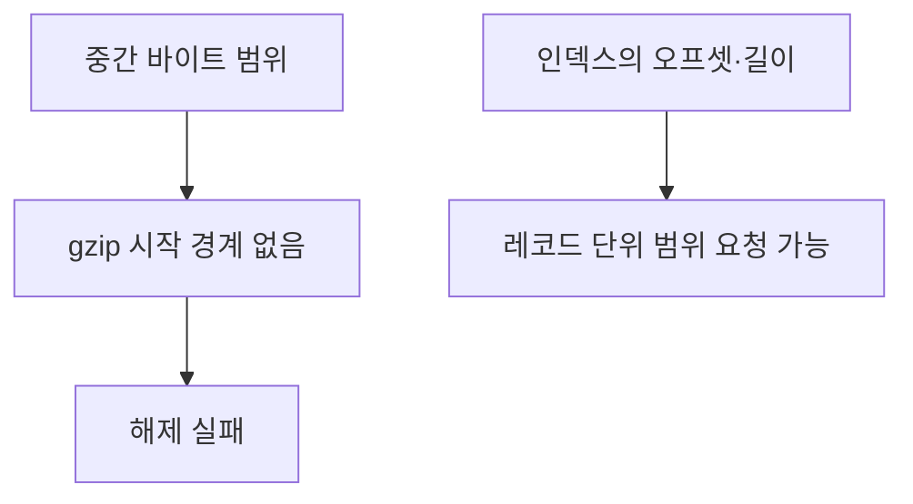

# 범위 요청으로 샘플링

> HTTP **Range 요청**은 파일 전체가 아니라 **앞의 N바이트 같은 일부만 받는** 방법이다. 수백 MB짜리 Common Crawl 파일도 앞부분만 받아 내용과 형식을 확인할 수 있다. 단, 압축 파일은 **중간부터 받으면 못 읽는다.**

## 쉽게 말하면
백과사전 한 권을 사지 않고 첫 몇 쪽만 복사해 와서 무슨 책인지 확인한다. 하지만 두꺼운 책을 중간 한 줄만 복사하면 문장이 중간에 잘려 읽을 수 없다.

## 자세히
(`data.commoncrawl.org`의 `CC-MAIN-2024-10` 첫 WET 파일, 전체 107,022,614바이트로 직접 시험, 2026-11-20)
- 요청: `curl -r 시작-끝 URL`. 서버가 범위를 지원하면 해당 바이트만 보내고 응답 헤더에 `Content-Range: bytes 0-1999/107022614`처럼 범위와 전체 크기를 적는다.
- 실험 결과:

| 요청 범위 | 받은 크기 | gzip 해제 결과 |
|---|---|---|
| 0–1,999 | 2,000바이트 | 레코드 1개(`warcinfo` 제외 conversion 레코드 1개 읽힘) |
| 0–299,999 | 300,000바이트 | 레코드 약 95개 |
| 5,000,000–5,001,999 | 2,000바이트 | **`gzip: not in gzip format`**, 0개 |
- 해석: 파일 **앞부분**은 gzip 스트림의 시작이라 잘려도 앞쪽 내용은 풀린다(전체의 0.3%인 300KB에서 95개 문서). **중간**은 gzip 스트림 경계 밖이라 복원할 수 없다. 중간·특정 레코드만 받으려면 파일 목록(인덱스)에 적힌 **레코드 시작 바이트와 길이**가 필요하다(Common Crawl이 WARC 레코드별 오프셋을 제공한다는 점은 이 실험에서 확인하지 않음).
- 쓰임(제안): ① 새 데이터 소스의 형식·품질을 100KB 단위로 먼저 확인 ② 파이프라인 단위 시험에 파일 일부만 사용 ③ 전체 다운로드 전 헤더(`curl -I`)로 크기 확인.
- 주의: 앞 300KB는 파일 앞쪽 문서만 담고 있어 **대표성이 없을 수 있다**(같은 시간대·같은 크롤 구간 편중 가능). 통계는 여러 파일에서 앞부분을 따는 식으로 보완한다.

## 그림으로 보기



## 예시
```bash
u=https://data.commoncrawl.org/crawl-data/CC-MAIN-2024-10/segments/1707947473347.0/wet/CC-MAIN-20240220211055-20240221001055-00000.warc.wet.gz
curl -r 0-299999 "$u" | zcat | head
```
- 교육: "먼저 맛보기, 그다음 전체" — 큰 데이터를 다루는 기본 습관.

## 헷갈리는 것과 비교
| 개념 | 차이 |
|---|---|
| Range 요청 | 파일의 일부 바이트만 받기 |
| 전체 다운로드 | 파일 전체 |
| 레코드 단위 범위 | 인덱스로 시작·길이 알아야 함 |
| [경로 파일](#cc-paths-files) | 어느 파일을 받을지 정하는 목록 |

## 더 읽을거리
- [Common Crawl 데이터 호스트](https://data.commoncrawl.org/) — 이 글의 실험 대상 파일.
