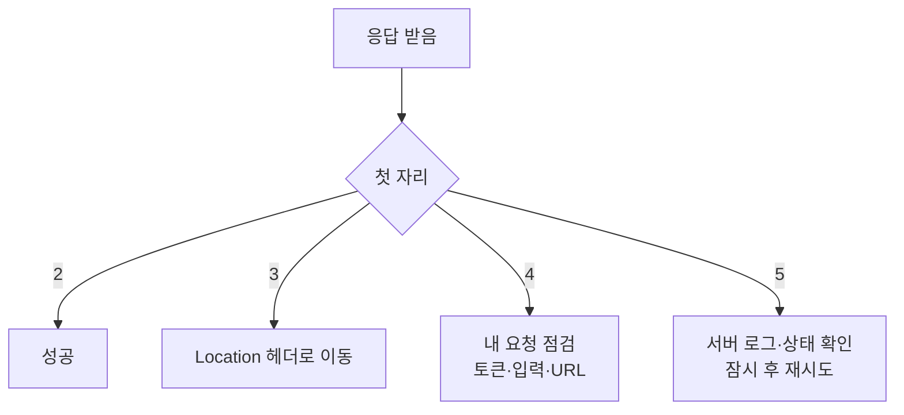
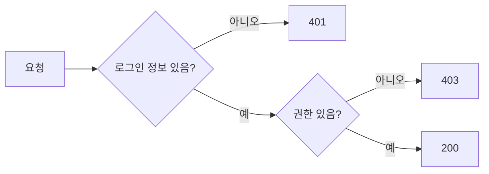

# HTTP 상태 코드 읽기

> HTTP 응답의 맨 앞에 붙는 세 자리 숫자로, 요청이 **성공했는지, 누구 잘못으로 실패했는지**를 알려 준다. 첫 자리만 봐도 대부분 원인 방향을 알 수 있다.

## 쉽게 말하면
택배 조회의 **상태 메시지**와 같다. "배송 완료(2xx)", "주소 바뀜, 다시 가세요(3xx)", "받는 분 정보가 틀림(4xx)", "택배사 사정으로 지연(5xx)". 에러 화면을 보면 숫자부터 읽는 습관이 디버깅 시간을 크게 줄인다.

## 자세히
| 분류 | 범위 | 의미 |
|---|---|---|
| 1xx | 100~199 | 진행 중 |
| 2xx | 200~299 | 성공 |
| 3xx | 300~399 | 추가 동작(리다이렉트) 필요 |
| 4xx | 400~499 | **클라이언트** 요청 문제 |
| 5xx | 500~599 | **서버** 처리 실패 |

자주 보는 코드 (MDN 기준):
- **200** OK, **201** Created(POST로 새로 만듦), **204** No Content(성공했지만 본문 없음, DELETE에 흔함).
- **301** 영구 이동, **302** 임시 이동, **304** 변경 없음(캐시 사용).
- **400** 잘못된 요청, **401** 인증 안 됨(이름과 달리 "unauthenticated"), **403** 인증은 됐으나 권한 없음, **404** 없음, **409** 현재 상태와 충돌(중복 가입 등), **422** 형식은 맞으나 의미상 처리 불가(검증 실패), **429** 요청 과다(속도 제한).
- **500** 서버 내부 오류(코드 버그·예외), **502** 게이트웨이가 상위 서버에서 잘못된 응답을 받음, **503** 점검·과부하(`Retry-After` 헤더 권장).
- 보안상 존재를 숨기려고 403 대신 404를 돌려주기도 한다([IDOR](#idor) 방어 등).

디버깅 감각: 4xx면 **요청(내 코드·입력·토큰)**을 고치고, 5xx면 **서버 로그**를 본다. 429는 재시도 간격을 늘린다.

## 그림으로 보기

## 예시
- 프론트에서 `fetch('/api/orders')`가 401 → 토큰 누락·만료([세션과 JWT](#jwt-session)). 403 → 로그인은 됐으나 역할 부족([인증과 인가](#access-control)).
- AI에게 디버깅을 시킬 때: "응답 상태 코드 422와 응답 본문 JSON, 요청 바디를 함께 붙입니다. 어떤 필드가 검증에 실패했는지 찾아 줘."

## 헷갈리는 것과 비교
| 개념 | 차이 |
|---|---|
| 401 vs 403 | 누구인지 모름 vs 알지만 허용 안 함 |
| 400 vs 422 | 문법 자체가 깨짐 vs 문법은 맞고 의미·검증이 틀림(API마다 혼용) |
| 301 vs 302 | 영구(캐시·검색엔진 갱신) vs 임시 |
| 500 vs 502/503 | 우리 코드 예외 vs 앞단·과부하 문제 |
| [REST와 JSON](#rest-json) | 상태 코드는 REST 응답 규약의 일부 |

## 더 읽을거리
- [MDN HTTP 상태 코드](https://developer.mozilla.org/en-US/docs/Web/HTTP/Reference/Status) — 모든 코드의 정의와 용례.
