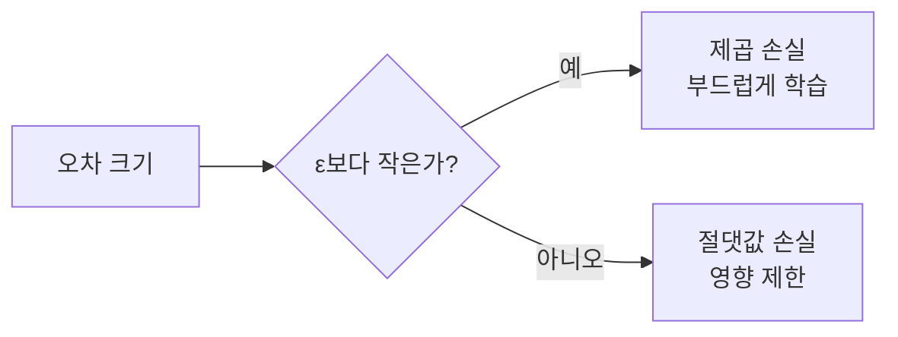
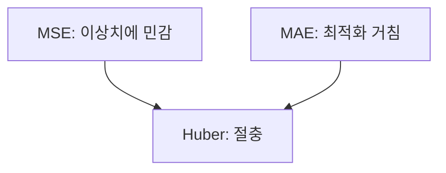

# Huber 손실

> Huber 손실은 오차가 작으면 제곱(MSE), 크면 절댓값(MAE)처럼 계산해 이상치에 덜 휘둘리면서 최적화는 부드럽게 유지하는 절충 손실 함수다.

## 쉽게 말하면
작은 실수는 꼼꼼히 혼내고(제곱), 어이없이 큰 실수는 "원래 예외겠지" 하고 일정 비율로만 반영하는 선생님이다. 이상한 점수 하나가 평균 전체를 흔들지 못한다.

## 자세히
scikit-learn `HuberRegressor` 문서 기준:
- 잔차를 σ(학습으로 추정되는 척도)로 나눈 값이 **ε보다 작으면 제곱 손실, 크면 절댓값 손실**. 큰 오차(이상치)의 영향이 선형으로만 자란다.
- 표준 정의(문서에는 수식 없음, 교과서 정의): z=(y−Xw−c)/σ일 때 |z|≤ε면 ½z², 아니면 ε|z|−½ε².
- `epsilon` 기본 1.35(1 이상). **작을수록 더 많은 샘플을 이상치로 보고 더 강건**, 클수록 최소제곱(OLS)에 가까워진다. `outliers_`가 이상치로 분류된 샘플을 알려준다. σ를 학습하므로 y의 크기를 바꿔도 ε를 다시 맞출 필요가 없다.
- 문서 예제: 4개 샘플을 극단값으로 오염시키니 OLS 계수는 [-1.9, 7.0]으로 무너졌고 Huber는 [17.8, 31.0]으로 참값 [20.5, 34.2]에 근접.
- 다른 강건 회귀: RANSAC, Theil-Sen, Huber 손실을 쓴 SGDRegressor. [MSE와 MAE](#mse-vs-mae)의 장단점을 합친 선택지다.

## 그림으로 보기



## 예시
```python
from sklearn.linear_model import HuberRegressor, LinearRegression
huber = HuberRegressor().fit(X, y)
linear = LinearRegression().fit(X, y)
print(huber.coef_, linear.coef_, huber.outliers_[:4])
```
매출 예측 데이터에 입력 실수로 큰 값이 몇 개 섞여 있을 때 Huber를 쓰면 예측선이 덜 끌려간다.

## 헷갈리는 것과 비교
| 개념 | 차이 |
|---|---|
| MSE | 큰 오차를 제곱해 이상치에 민감 |
| MAE | 이상치에 강하나 0 근처 미분이 거칠다 |
| Huber | 작을 땐 MSE, 클 땐 MAE |
| [이상치 처리](#outlier-handling) | 데이터를 고치는 쪽, Huber는 손실을 고치는 쪽 |

## 더 읽을거리
- [sklearn HuberRegressor](https://scikit-learn.org/stable/modules/generated/sklearn.linear_model.HuberRegressor.html) — ε와 이상치 강건성, 예제.
