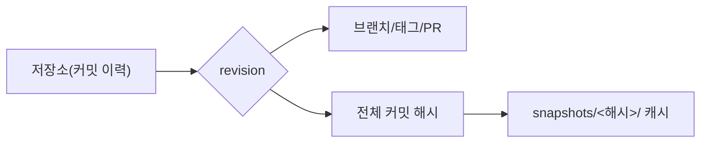
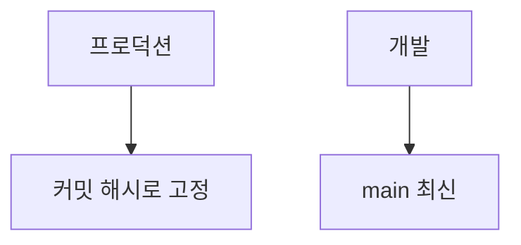

# Hugging Face Hub 버전 관리

> Hugging Face Hub의 모델·데이터셋 저장소는 Git 기반이라 커밋 단위로 버전이 남는다. 다운로드할 때 `revision`에 브랜치·태그·PR·커밋 해시를 지정해 정확한 버전을 고정할 수 있다.

## 쉽게 말하면
코드를 깃으로 관리하듯 모델 파일도 깃 저장소에 둔다. 책의 개정판 번호처럼 "이 커밋의 이 모델"을 정확히 가리킬 수 있다.

## 자세히
(Hugging Face Hub 시작 가이드와 huggingface_hub 다운로드 문서(v2.4.0)를 직접 열어 확인.)
- **저장소 모델**: git clone·add·commit·push로 변경을 쌓는다. 10MB 넘는 파일은 **git-xet**으로 추적(`git xet install`, `git xet track "*.확장자"`)하며 큰 ML 파일 확장자는 `.gitattributes`에 기본 등록된다. 웹 UI에서 "Open as a pull request"로 PR도 만들 수 있고 히스토리·diff를 볼 수 있다.
- **`hf_hub_download(repo_id, filename, revision=...)`**: 기본은 `main`의 최신 버전. `revision`에 태그(`"v1.0"`), 브랜치(`"test-branch"`), PR(`"refs/pr/3"`), **커밋 해시**를 줄 수 있다. 커밋 해시는 **전체 길이**여야 하며 7자 축약은 안 된다.
- **`snapshot_download`**: 저장소 전체를 특정 revision으로 받는다. `allow_patterns`·`ignore_patterns`로 파일 선택(예: `*.json`만, `*.bin` 제외).
- **캐시**: 파일은 `~/.cache/huggingface/hub/models--<조직>--<이름>/snapshots/<커밋 해시>/` 아래 **버전별로** 캐시된다. 캐시된 파일은 수정하지 말 것. `local_dir`로 폴더에 직접 받을 수도 있다.
- **CLI**: `hf download <repo> <파일>`, `hf://[TYPE/]ID[@REVISION][/PATH]` URI, `--dry-run`으로 다운로드 예정 파일·용량 확인.
- **빠른 전송**: `hf_xet`(청크 기반 중복 제거), huggingface_hub 0.32.0부터 함께 설치.
- **재현성(제안)**: 운영 코드에서는 `main`이 아니라 커밋 해시로 고정하고 해시를 모델 카드·실험 기록에 남긴다.

## 그림으로 보기



## 예시
```python
hf_hub_download("lysandre/arxiv-nlp", "config.json", revision="877b84a8f93f2d619faa2a6e514a32beef88ab0a")
```
- 교육 활용: 같은 모델을 태그와 커밋 해시로 받아 캐시 경로를 비교.

## 헷갈리는 것과 비교
| 개념 | 차이 |
|---|---|
| HF Hub 버전 | Git 커밋 기반, revision으로 고정 |
| [DVC](#dvc) | 데이터·파이프라인 버전 도구 |
| [Git LFS](#git-lfs-pointer-file) | 큰 파일을 포인터로 관리(Hub는 Xet 사용) |

## 더 읽을거리
- [Hub 저장소 시작 가이드](https://huggingface.co/docs/hub/repositories-getting-started) — Git·Xet.
- [huggingface_hub 다운로드 가이드](https://huggingface.co/docs/huggingface_hub/guides/download) — revision·캐시.
