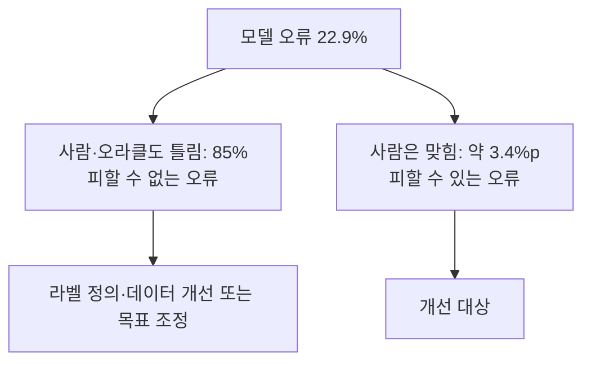

# 사람 기준 오류율

> 모델의 오류가 **사람(또는 이상적 판정자)이라도 틀렸을 만한 것인지**를 기준으로 삼아, 개선 가능한 오류(피할 수 있는 오류)와 피할 수 없는 오류(본질적 잡음)를 구분하는 접근이다. 사람 오류율은 "이 과제에서 기대할 수 있는 최선"의 대용 지표다.

## 쉽게 말하면
시험에서 일류 선생님도 틀리는 모호한 문제를 학생이 틀렸다면 학생 탓이 아니다. 선생님은 맞히는데 학생만 틀리는 문제가 학생이 실제로 고칠 수 있는 약점이다.

## 자세히
- **개념**: 오류 = 피할 수 있는 오류(모델이 더 학습하면 줄일 수 있음) + 피할 수 없는 오류(베이즈 오류, 라벨·입력 자체의 모호함). 사람 수준 오류율은 후자를 가늠하는 근사로 쓴다. 전문가끼리도 의견이 갈리는 과제(예: 의료 영상 판독, 감정 분류)는 사람 오류율이 낮지 않다. 사람 오류율은 사람의 수준(전문가·일반인·여러 명 합의)에 따라 달라 **어떤 사람인지 정의**해야 한다.
- **직접 시뮬레이션(scikit-learn 1.9.1, 합성 이진 분류 4만 개: 특징에 따라 정답 확률 p(y=1|x)가 정해지고 라벨은 그 확률로 뽑힘)**
  - **본질적 잡음**: 베이즈 오류 **0.225** → 달성 가능한 최고 정확도 0.775. (이상적 판정자인 "항상 더 가능성 높은 라벨을 고르는 오라클"의 테스트 정확도 0.779.)
  - 모델: 로지스틱 테스트 정확도 0.753, 랜덤 포레스트 **0.771**(학습 정확도 0.848로 과적합 징후).
  - 포레스트의 오류 22.9% 중 **오라클도 틀리는 오류가 85%**이고, 피할 수 있는 몫은 전체 샘플의 약 **3.4%p**뿐이다. 라벨이 본질적으로 잡음이 많은 과제에서는 정확도를 90%까지 올리려는 목표가 불가능하다.
- **쓰임**
  1. **목표 설정**: 사람 오류율을 기준으로 "여기까지 오면 더 이상 개선 여지가 작다"를 정한다.
  2. **오류 분류**: 틀린 개발 예시를 사람이 다시 보고 "사람도 헷갈림 / 사람은 맞힘"으로 나눈다([오류 분석 표](#error-analysis-spreadsheet)에 열을 추가).
  3. **라벨 품질 점검**: 사람 오류율이 높으면 라벨 정의가 모호할 수 있다([낮은 일치도 진단](#low-agreement-diagnosis)).
  4. **과소/과적합 판단**: 학습 오류가 사람 오류보다 한참 높으면 모델 문제, 학습 오류는 낮고 검증 오류가 높으면 분산 문제(위 포레스트 사례).
- **주의**: 사람 오류율을 측정하는 사람과 라벨러가 같으면 순환이다. 사람이 단서를 더 갖고 있을 수 있다(맥락). 모델이 사람을 넘는 과제에서는 사람 기준이 의미가 줄어든다. 위 실험의 "오라클"은 이론적 장치이며 실제 사람과 같지 않다.

## 그림으로 보기

## 예시
- 감정 분류에서 전문가 3명의 합의 정확도가 85%라면 모델 목표를 95%로 잡지 않는다. 모델이 85%에 근접하면 라벨 정의 개선이 더 효과적.
- 교육: 목표를 정할 때 "달성 가능한 최선"을 먼저 측정하는 접근.

## 헷갈리는 것과 비교
| 개념 | 차이 |
|---|---|
| 사람 기준 오류율 | 사람 수준의 오류, 개선 여지 가늠 |
| 베이즈 오류 | 이론적 최소 오류 |
| 피할 수 있는 오류 | 모델 개선으로 줄일 수 있는 부분 |
| [평가자 간 일치도](#inter-annotator-agreement) | 사람끼리의 일치 정도 |

## 더 읽을거리
- [McHugh 2012: kappa](https://pmc.ncbi.nlm.nih.gov/articles/PMC3900052/) — 사람 사이 일치도와 한계.
- [Overview of Annotation Creation (arXiv 1602.05753)](https://arxiv.org/abs/1602.05753) — IAA를 품질 지표로 추적하는 관점.
