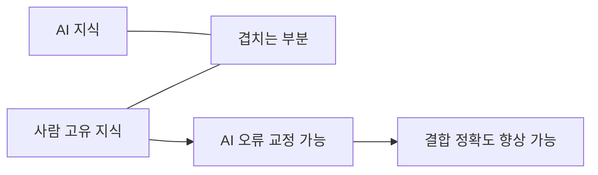

# 사람의 보완 지식

> AI가 모르는 **사람만의 고유한 지식**으로, AI의 오류를 바로잡을 수 있을 때 비로소 신뢰 보정이 최종 결정의 정확도 향상으로 이어진다.

## 쉽게 말하면
내비게이션이 모르는 "오늘은 도로 공사 중"이라는 사실을 운전자가 알고 있을 때, 내비 확신도를 보고 "이 경로는 의심해 보자"가 의미가 있다. 운전자도 내비와 똑같은 정보만 안다면 확신도를 봐도 얻는 게 없다.

## 자세히
(Zhang 외 2020 PDF를 직접 읽었다. 이 개념은 실험 결과를 해석하는 논문의 논의이며, 보완 지식이 있는 조건을 직접 시험한 결과는 아니다.)
- **전제(초록)**: 고위험 의사결정에서 완전 자동화가 바람직하지 않은 이유는 사람이 모델과 **보완적인 도메인 지식**을 갖고 있기 때문이다. 사례별로 AI를 언제 믿을지 아는 것이 핵심이다.
- **결과(논문)**: 확신도로 신뢰를 보정했지만 AI 보조 정확도는 오르지 않았다. 이유 후보: AI가 불확실한 사례는 사람에게도 어려워 **사람과 모델의 불확실성이 상관**되어 있었다.
- **단서(논문)**: 사람과 모델의 불확실성의 상관이 줄어들어, 예를 들어 전문가와 모델이 **각자 고유한 지식을 가진다면**, 신뢰를 모델 확신에 맞게 잘 보정하는 것이 의사결정 향상으로 이어질 수 있다.
- **실험 속 조작**: 일부 조건에서 모델이 결혼 여부 속성을 못 보게 한 부분 모델(83%, 완전 모델 84%)을 썼고 참가자는 그 속성을 볼 수 있었다. 모델 완전성의 효과는 유의하지 않았다.
- **의미(해석)**: AI 도입 때 "사람이 무엇을 더 아는가"를 먼저 정의해야 하며, 사람의 지식이 AI와 같으면 협업의 이득이 작다.

## 그림으로 보기

## 예시
- 고객 상담 요약 AI: 상담 현장의 비언어 맥락은 상담사만 알고 AI는 모른다. 그 부분을 사람이 보강하게 한다(제안).

## 헷갈리는 것과 비교
| 개념 | 차이 |
|---|---|
| 사람의 보완 지식 | AI가 모르는 사람의 정보 |
| [확신 점수](#confidence-score-display) | AI 불확실성을 알려 주는 UI |
| [AI 과소의존](#undertrust-ai) | 맞는 AI를 거부 |

## 더 읽을거리
- [Zhang, Liao, Bellamy (2020)](https://arxiv.org/abs/2001.02114) — 직접 읽음.
