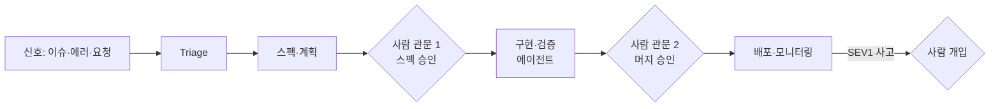

# 사람 관문 설계

> AI 팩토리(에이전트가 이슈에서 배포까지 돌리는 개발 라인)에서 **사람이 반드시 승인·판단해야 하는 지점**을 미리 정해 두는 일. 모든 PR을 사람이 보는 것이 아니라 **판단이 필요한 곳에만** 사람을 세우고, 나머지 규칙은 에이전트의 지침으로 통제한다.

## 쉽게 말하면
공장 라인에서 검사원이 모든 나사를 보지는 않는다. 설계도를 승인하는 문과 출하 전 최종 검수 문, 그리고 사고가 났을 때 라인을 세우는 문에만 사람이 서 있다. 나머지는 기계가 돈다.

## 자세히
- **Augment Code 가이드**: 소프트웨어 팩토리는 의도→명세→구현→검증→배포 단계로 이루어지고, 사람은 **두 관문**을 쥔다. ① **명세(스펙) 승인**: 요구를 잘못 읽은 것을 아직 싼 "계획" 단계에서 잡는다(큰 PR이 된 뒤보다 훨씬 싸다). ② **머지 승인**: 코드가 운영에 닿기 전 사람의 최종 판단. 혼자 IDE에서 일하는 에이전트는 팩토리가 아니며, 팩토리는 "단계·관문·각 단계의 기록"이 있어야 한다고 한다.
- **Mastra 블로그**의 사람 관문 목록: ① 아키텍처 결정, ② 호환성을 깨는 변경(breaking change)과 검증 실패, ③ 진행 중인 사고(특히 SEV1), ④ UX에 민감한 변경(시각·디자인 리뷰), ⑤ 코드 수준 서명이 필요한 규제 변경. 핵심 문장: "올바른 사람 관문은 모든 PR의 승인이 아니라, **모든 PR을 지배하는 에이전트 지침의 승인**이다."
- **관문 설계 기준**(위 두 글에서 도출한 정리):

| 질문 | 예 |
|---|---|
| 되돌리기 어렵거나 비싼가? | 배포, 데이터 마이그레이션, 결제 변경 |
| 판단·취향·책임이 필요한가? | 요구 해석, 디자인, 규제 |
| 잘못된 요구를 일찍 잡을 수 있는가? | 계획(스펙) 단계 승인 |
| 규칙으로 자동 검사할 수 있는가? | 가능하면 사람 대신 린터·테스트 |

- **함정**: 관문이 너무 많으면 사람이 병목이 된다([검증 병목](#verification-bottleneck)). 너무 적으면(예: 무인 "다크 팩토리") 틀린 방향의 대량 변경이 쌓인다. Mastra는 "모든 변경을 사람 없이 돌리는 것은 나쁜 생각"이라 한다.
- 한계: 두 글은 벤더 블로그로 자사 모델의 설명이며, 팀 규모·규제·제품 단계에 따라 관문 위치는 달라진다. Mastra도 요구가 자주 바뀌는 초기 제품, 테스트 없는 코드베이스, 고도 규제 변경에는 팩토리가 잘 맞지 않는다고 밝힌다.

## 그림으로 보기


## 예시
```markdown
# 사람 관문 정책 (예시)
- 스펙: 사람 승인 필수(요구 해석 오류는 여기서 차단)
- 머지: 보안·결제 영역은 사람 승인, 문서·테스트 추가는 에이전트 리뷰만
- 배포: 자동 롤백 가능한 것만 자동, 마이그레이션은 사람
- 에이전트 지침(AGENTS.md 등) 변경: 항상 사람 승인
```
- 교육 활용: "사람이 어디에 서야 하는가"를 되돌림 비용·판단 필요 여부 두 축으로 분류하는 워크숍.

## 헷갈리는 것과 비교
| 개념 | 차이 |
|---|---|
| 사람 관문 | 승인·판단을 맡는 지점 설계 |
| [AI 팩토리](#ai-factory) | 역할 나눈 에이전트 라인 전체 |
| [검증 병목](#verification-bottleneck) | 관문이 늘 때 생기는 대기 문제 |
| 다크 팩토리 | 사람 관문을 거의 없앤 극단 모델 |

## 더 읽을거리
- [Mastra: Software factory](https://mastra.ai/blog/software-factory) — 에이전트 역할과 사람 관문 목록.
- [Augment Code: What is a software factory?](https://www.augmentcode.com/guides/what-is-a-software-factory) — 스펙 승인·머지 승인 두 관문.
