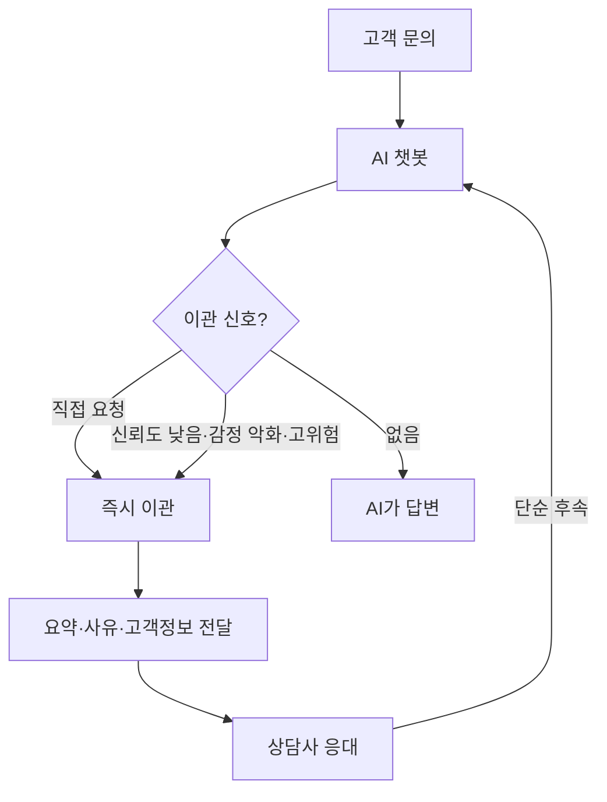

# 사람 이관 설계

> AI 챗봇이 풀 수 없거나 풀면 안 되는 문의를, 언제·어떻게 사람 상담사에게 넘길지 정하는 규칙과 전환 경험의 설계.

## 쉽게 말하면
식당 서빙 로봇이 "이건 제가 못 해요" 하고 직원을 부르는 순간이다. 직원이 손님에게 "처음부터 다시 말씀해 주세요"라고 하면 최악이고, 로봇이 상황을 전달해 둔 덕에 바로 이어 주면 최선이다.

## 자세히
- **이관 트리거(여러 신호를 함께 본다)**: ① 고객이 사람을 직접 요청 — 가장 단순하고 중요, 즉시 이관 ② AI 신뢰도·검색 실패 반복 ③ 감정 악화(분노·반복 불만) ④ 같은 질문 루프 ⑤ 고위험 주제(환불 분쟁·사기·의료·법적). 키워드 매칭만으론 약하고 의도 인식+감정+신뢰도 점수를 섞는다. 신호가 2~3개 겹치면 이관하는 식.
- **콜드 vs 웜**: 콜드는 즉시 끊고 우선 티켓(사기·보안 사고처럼 긴급할 때). 평소엔 웜 — 대화 요약·고객 정보·이관 사유를 넘기고 고객에게 "상담사에게 연결합니다, 이미 내용을 전달했어요"라고 안내.
- **이관 사유 전달**: "고객이 요청"과 "검색 반복 실패"는 상담사의 첫마디가 달라야 한다.
- **지표**: 이관율만 낮추면 고객이 갇힐 수 있다. 이관 시점, 이관 후 재설명 비율, 해결률, 포기율을 같이 본다.
- **양방향**: 사람이 처리 후 단순 후속은 AI에게 돌려준다.
- **고위험 주의**: 사람이 AI 추천을 승인만 하는 구조는 감독의 외형일 뿐이다.
- 출처 대부분이 벤더 블로그라 수치는 참고용(주장)이다.

## 그림으로 보기

## 예시
- 보험 챗봇: "보험금 지급 거절" 문의는 주제만으로 자동 이관, 이관 시 사건 번호와 대화 요약 첨부.
- 한 질문에 AI가 두 번 연속 "잘 모르겠습니다" → 세 번째 시도 전에 사람 연결을 제안.

## 헷갈리는 것과 비교
| 개념 | 차이 |
|---|---|
| 사람 이관 | 대화 주도권이 사람으로 넘어감 |
| [에이전트 어시스트](#agent-assist) | 처음부터 사람이 대화, AI는 보조 |
| Human-in-the-loop | 결정 단계마다 사람 승인. 이관은 대화 전체 이전 |

## 더 읽을거리
- [Quidget: 5 Triggers for Bot-to-Human Escalation](https://quidget.ai/blog/ai-automation/the-ai-handoff-problem-5-triggers-for-bot-to-human-escalation-best-practices/) — 트리거 정리(벤더 블로그)
- [Kustomer: Chatbot Escalation](https://www.kustomer.com/glossary/chatbot-escalation/) — 용어 정리
- [Murf: AI-to-Human Handoff Best Practices](https://murf.ai/blog/ai-to-human-handoff) — 전환 경험 사례
