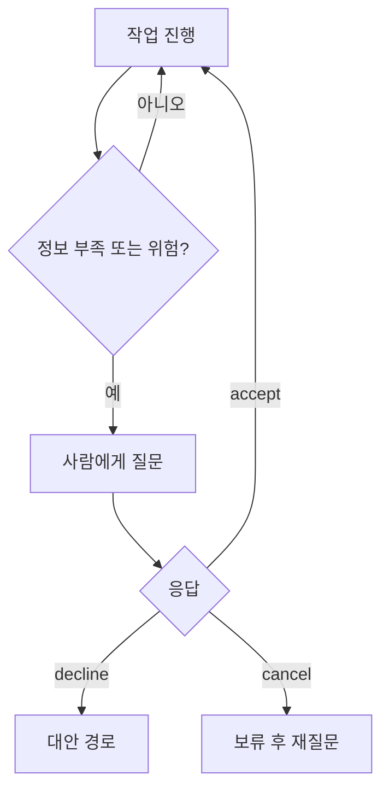

# 사람 입력 되묻기 패턴

> 에이전트가 작업 중 정보가 모자라거나 위험한 결정을 앞두면, 처음에 다 묻지 않고 **그 순간에만** 사람에게 묻고 답에 따라 계속·대안·중단하는 설계.

## 쉽게 말하면
인테리어 업자가 계약 때 모든 마감재를 정하게 하지 않고, 벽을 열어 보고 문제가 나왔을 때만 "이 배관은 교체할까요?" 하고 전화하는 것과 같다. 고객은 필요한 질문에만 답하고, 업자는 답이 올 때까지 해당 공정만 멈춘다.

## 자세히
- MCP에서는 서버가 `elicitation/create`로 클라이언트에 묻는다(스펙 2025-11-25, 확인 2026-11-12). 폼 모드는 납작한 스키마, 민감 정보는 URL 모드.
- 응답은 [accept·decline·cancel](#elicitation-actions) 셋 중 하나. 각각 처리 경로를 설계한다.
- LangGraph에서는 [interrupt](#langgraph-interrupt)로 그래프를 멈추고 체크포인트에 저장한 뒤, 사람 답으로 재개한다(체크포인터 필요).
- 설계 원칙(실무 권장, 스펙 규정 아님): 꼭 필요할 때만 묻기, 기본값 제공, 한 번에 한 가지, 거절 시 대안 경로, 같은 질문 반복 금지, 질문 속도 제한.
- 사람이 오래 답하지 않을 수 있으므로 상태를 저장하고 타임아웃·재질문 정책을 둔다.

## 그림으로 보기

## 예시
- 여행 예약 에이전트가 날짜가 비어 있을 때만 `date` 필드 하나를 되묻는다.
- 코딩 에이전트가 `rm -rf` 같은 삭제 직전에 승인을 요청한다.

## 헷갈리는 것과 비교
| 개념 | 차이 |
|---|---|
| 되묻기(elicitation) | 작업 도중 정보 수집 |
| 사전 입력(프롬프트) | 시작 전에 모두 제공 |
| 승인 정책 | 위험 행동의 허용 여부 확인에 초점 |
| [MCP Elicitation](#mcp-elicitation) | 이 패턴의 MCP 표준 구현 |

## 더 읽을거리
- [MCP Elicitation 스펙](https://modelcontextprotocol.io/specification/2025-11-25/client/elicitation) — 사용자 상호작용 모델
- [LangGraph Persistence](https://docs.langchain.com/oss/python/langgraph/persistence) — 체크포인터가 human-in-the-loop를 가능하게 한다는 설명
