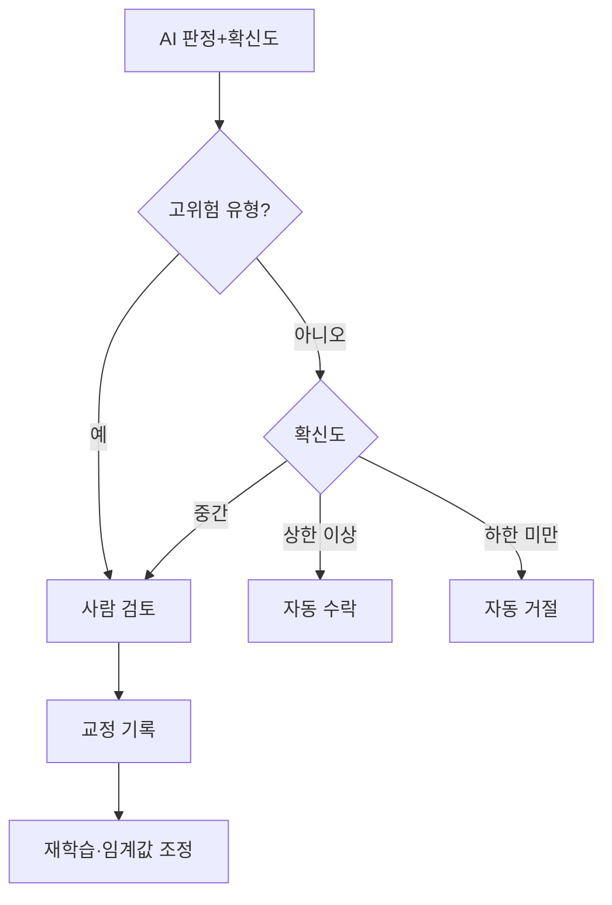

# 사람 개입 라우팅

> AI의 확신도와 업무 위험도에 따라 "자동 처리 / 사람 검토 / 거절"로 건을 나누는 설계. 사람의 검토 시간을 꼭 필요한 곳에만 쓰는 것이 목적이다.

## 쉽게 말하면
병원 접수 창구의 분류 간호사와 같다. 감기는 바로 처방, 애매하면 의사에게, 응급은 곧장 응급실로 보낸다. 모든 환자를 의사가 보면 병목이 되고, 모두 자동 처리하면 위험하다.

## 자세히
- **단일 임계값**: 확신 ≥ T 이면 자동, 아니면 사람. 임계값은 "자동화 ↔ 감독" 다이얼이다.
- **이중 임계값(arXiv 2601.05974, 2026 프리프린트)**: 위·아래 두 기준을 둔다. 위 기준 이상은 자동 수락, 아래 기준 미만은 자동 거절, 사이의 애매한 건만 사람에게 보낸다. 정확도와 검토 비용의 균형을 최적화 문제로 본다. 분석·시뮬레이션에서 검토 인력을 더 넣어도 이득이 거의 없는 "수확 체감 구간"이 있음을 보였다. 적용 예: 개체 매칭, 사기 탐지, 의료 분류, 콘텐츠 검수. (초록 확인, 임계값 설정의 현장 지침은 부족하다고 논문이 인정.)
- **전제**: 확신도가 보정돼 있어야 한다([신뢰도 보정](#confidence-calibration)).
- **운영 요령(실무 블로그 종합, 근거 약함)**: 처음엔 보수적으로 사람에게 많이 보내 실제 오류율을 측정한 뒤 임계값을 올린다. 검토 큐는 확신 낮은 것부터 정렬. 모델 버전·라우팅 시점 확신도·검토자 결정과 사유를 기록한다. 검토량이 몇 달째 줄지 않으면 교정 데이터가 학습에 안 쓰이거나 임계값이 어긋난 신호다.
- **위험 기반**: 확신이 높아도 고위험 유형(큰 금액·의료)은 항상 사람 확인.
- 경제성은 [정확도 경제학](#accuracy-economics)의 손익 계산과 연결.

## 그림으로 보기

## 예시
- 카드 이상거래: 확신 0.98↑ 자동 차단, 0.2↓ 승인, 그 사이는 심사 큐. 큐는 금액 큰 순 + 확신 낮은 순.
- 문서 분류 RPA에서 검토율 30% → 교정 데이터로 개선해 12%로 낮추는 것이 운영 목표(예시 수치).

## 헷갈리는 것과 비교
| 개념 | 차이 |
|---|---|
| 라우팅 | 건별로 자동/사람 분배 |
| 전수 사람 검토 | 느리고 비쌈 |
| 학습된 위임(learning to defer) | 위임 시점도 모델이 학습 |

## 더 읽을거리
- [A Framework for Optimizing Human-Machine Interaction in Classification Systems](https://arxiv.org/abs/2601.05974) — 이중 임계값 정책(초록 확인)
- [Stack Overflow Blog: Is your human in the loop actually slowing you down?](https://stackoverflow.blog/2026/09/28/is-your-human-in-the-loop-actually-slowing-you-down-here-s-what-we-learned/) — 실무 경험담(검색 결과로만 확인)
