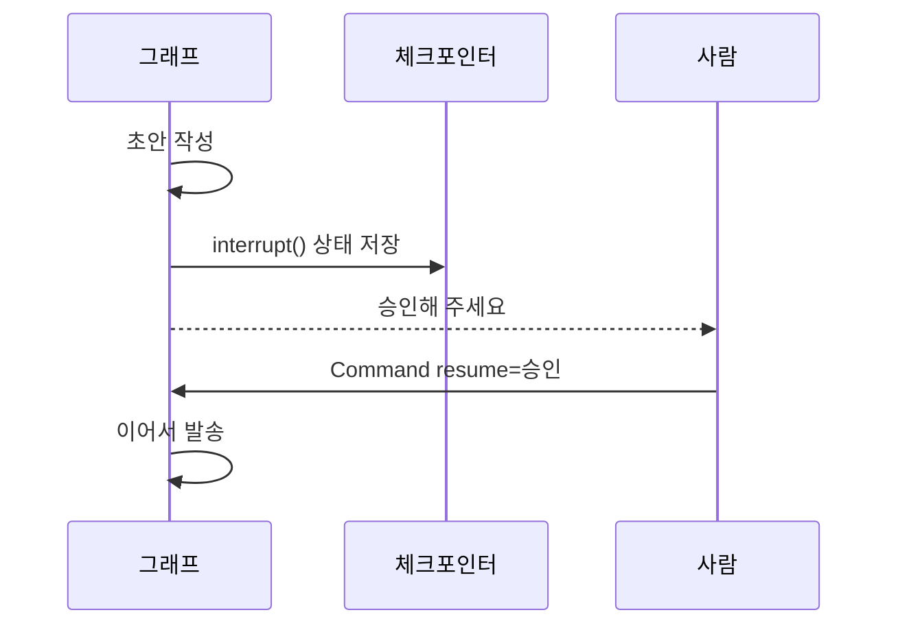

# Human-in-the-loop

> 에이전트 실행 중 특정 지점에서 멈춰 사람이 승인·수정·입력한 뒤 이어 가게 하는 설계.

## 쉽게 말하면
결재 라인이다. 직원(에이전트)이 서류를 준비하지만 송금 같은 중요한 단계에서는 팀장 도장을 받아야 다음으로 간다. 도장 받는 동안 서류는 책상 위에 그대로 있다.

## 자세히
LangGraph 문서 기준:
- `interrupt()`를 노드 안 어디서나 호출하면 실행이 멈추고 값을 호출자에게 돌려준다.
- 필요 조건: ① **체크포인터**(멈춘 상태 저장, [체크포인트](#langgraph-checkpoint)), ② `thread_id`.
- 재개: 같은 thread_id로 `Command(resume=값)`을 넣으면 그 값이 `interrupt()`의 반환값이 된다.
- 주의: 재개 시 **노드가 처음부터 다시 실행**된다. `interrupt()` 앞의 부작용(메일 발송 등)은 두 번 일어나지 않게 멱등하게 만들거나 뒤로 옮긴다. `interrupt()`를 try/except로 감싸지 않는다.
- 언제 쓰나: 결제·삭제·외부 발송 같은 되돌리기 어려운 행동, 신뢰도 낮은 판단, 사람의 사양 확정. 모든 단계에 걸면 자동화 의미가 사라지므로 위험도 기준으로 고른다.

## 그림으로 보기


## 예시
```python
from langgraph.types import interrupt, Command
def approval(state):
    ok = interrupt("이 메일을 보낼까요?")
    return {"approved": ok}
graph.invoke(Command(resume=True), config)  # 같은 thread_id
```
- 환불 처리 에이전트: 10만 원 초과 건만 사람 승인.

## 헷갈리는 것과 비교
| 개념 | 차이 |
| --- | --- |
| Human-in-the-loop | 실행 도중 승인·개입 |
| 사후 리뷰 | 끝난 결과를 검토 |
| 완전 자동 | 사람 개입 없음. 위험 낮은 작업에 한정 |

## 더 읽을거리
- [LangGraph Interrupts](https://docs.langchain.com/oss/python/langgraph/interrupts) — interrupt와 Command(resume)
- [LangGraph Persistence](https://docs.langchain.com/oss/python/langgraph/persistence) — 체크포인터 요구 조건
