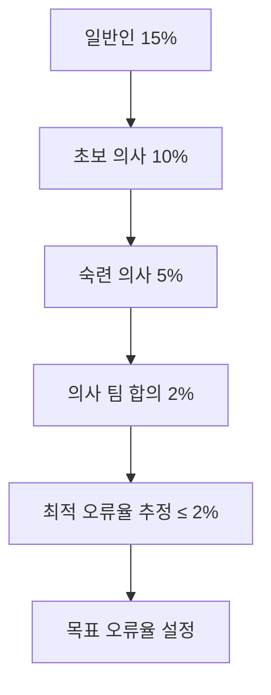
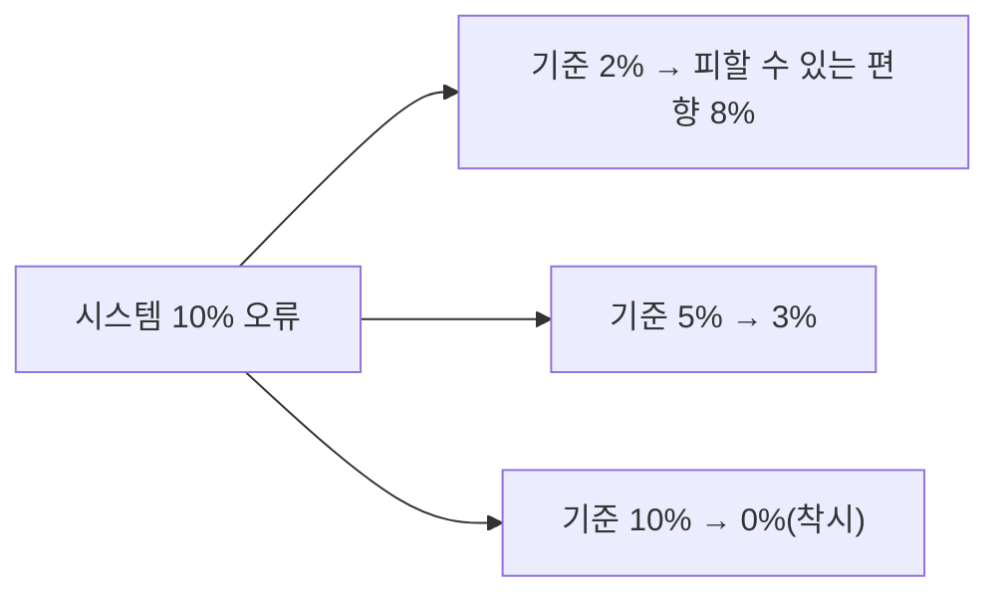

# 사람 수준 정의

> "사람 수준 성능"을 기준으로 삼을 때 **어떤 사람**(일반인, 초보 전문가, 숙련 전문가, 합의 팀)의 오류율을 쓸지 정해야 한다. 최적 오류율의 추정치로 쓰려면 **가능한 가장 낮은 사람 오류율**(예: 전문가 팀 합의)이 합리적이다.

## 쉽게 말하면
"사람만큼 잘한다"에서 사람이 누군지 안 정하면 목표가 흔들린다. X선 판독에서 일반인 15%, 초보 의사 10%, 숙련 의사 5%, 의사 팀 토론 2%라면 어느 쪽이 "사람 수준"일까? 이 시스템의 진짜 한계를 알려 주는 숫자는 2%다.

## 자세히
(Andrew Ng, Machine Learning Yearning 초안 33·34·35장, 본문 확인)
- **왜 비교하나(33장)**: ① 사람이 라벨을 달기 쉽다(고양이 사진) ② 오류 분석에 **사람의 직관**을 쓸 수 있다(예: "pair of apples"를 "pear"로 오인한 전사에서 사람이 쓰는 단서를 파악) ③ **사람 수준으로 최적 오류율을 추정**하고 달성 가능한 목표 오류율을 정한다(알고리즘 10% vs 사람 2% → 최적 ≤ 2%이고 피할 수 있는 편향 ≥ 8%라 편향 감소를 시도).
- **정의 방법(34장 예)**: X선 진단 오류율이 일반인(기초 훈련) 15%, 초보 의사 10%, 숙련 의사 5%, **의사 팀 토론 2%**일 때 Ng는 **2%를 사람 수준 대용값**으로 쓰겠다고 한다. 이유: 최적 오류율은 2%보다 낮을 수는 있어도 높을 수는 없다(팀이 2%를 달성했으므로). 5%·10%를 최적 오류율 추정으로 쓰는 것은 필연적으로 너무 높은 추정이라 합리적이지 않다.
- **비용 절충**: 모든 이미지를 팀 전체가 보면 비싸므로 **초보 의사가 대부분을 라벨링하고 어려운 사례만 숙련 의사·팀으로** 보낸다. 시스템 오류가 40%일 때는 초보 10%와 숙련 5%의 차이가 중요하지 않지만, 10% 오류에서는 사람 기준을 2%로 두는 편이 개선 도구를 더 준다.
- **사람을 넘어섰을 때(35장)**: 소음 많은 음성에서 사람 오류 10%인데 시스템이 8%여도 **사람이 시스템보다 훨씬 잘하는 부분집합**(예: 빠른 발화)을 찾으면 같은 기법(사람 라벨·직관·목표 설정)을 쓸 수 있다. 개발 세트에 "사람은 맞고 알고리즘은 틀린 예시"가 있는 한 전체 평균이 사람을 앞서도 많은 기법이 적용된다. 기계가 사람보다 나은 문제(영화 평점 예측, 배송 시간 예측, 대출 승인 등)는 사람이 알고리즘의 명백한 오류를 식별하기 어려워 **진전이 대체로 느리다**.
- **주의(실무)**: ① "사람 수준"의 정의(누가, 어떤 조건, 합의 여부)를 문서에 적는다 ② 사람 오류 자체가 라벨의 모호함·피로로 흔들릴 수 있다([라벨 모호함의 상한](#label-ambiguity-ceiling)) ③ 연구 논문의 "사람 수준" 주장은 비교한 사람 집단을 확인한다([범위 명시](#citing-ai-research-scope)).

## 그림으로 보기

## 예시
- 계약서 조항 분류: 일반 직원 12%, 변호사 4%, 변호사 2인 합의 2% → 목표 기준은 2%(비용 상 어려운 사례만 합의 라벨).
- 점검 습관: "사람 수준 95% 달성" 보고서에서 "어떤 사람(예: 크라우드워커)인지"를 반드시 묻는다.

## 헷갈리는 것과 비교
| 기준 | 용도 |
|---|---|
| 일반인 오류 | 쉬운 과제의 현실적 대조군 |
| 전문가 오류 | 높은 기준 |
| 합의 팀 오류 | 최적 오류 추정에 가장 적합(상한이 낮음) |
| [베이즈 오류](#bayes-error) | 이론적 하한(사람 오류보다 낮을 수 있음) |

## 더 읽을거리
- [Andrew Ng, Machine Learning Yearning(초안 PDF) 33~35장](https://home-wordpress.deeplearning.ai/wp-content/uploads/2022/03/andrew-ng-machine-learning-yearning.pdf) — 사람 수준 정의·초월 시 전략(본문 열어 확인).
