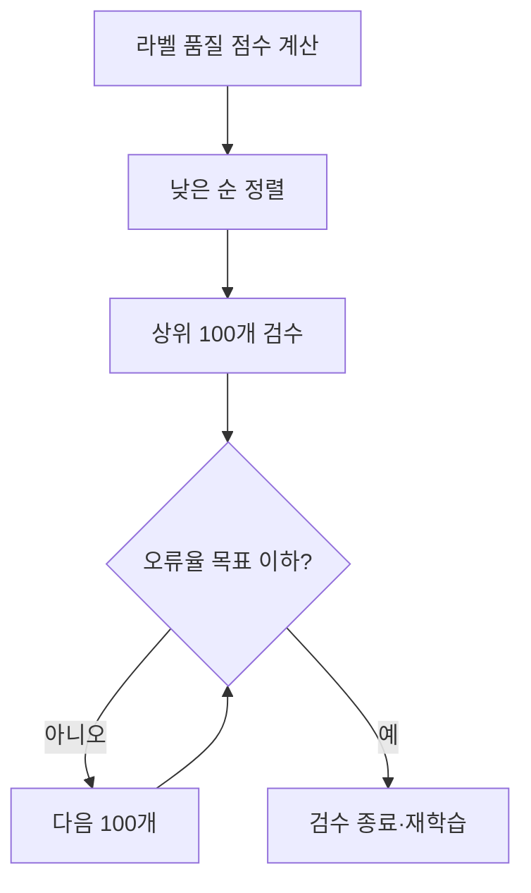
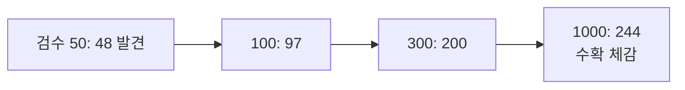

# 의심 샘플 재검수 순서

> 라벨 오류가 의심되는 샘플을 **점수 순으로 줄 세워 사람이 앞에서부터 검수**하면, 같은 인건비로 더 많은 오류를 고칠 수 있다. 어디서 멈출지도 비용 대비 효과로 정한다.

## 쉽게 말하면
응급실 분류(triage)처럼 급한 환자부터 본다. 모든 라벨을 처음부터 끝까지 읽는 대신, 오류 가능성이 높은 것부터 확인하고 효과가 떨어지면 멈춘다.

## 자세히
- **순서 만들기**: [라벨 품질 점수](#cleanlab-label-quality-score)를 오름차순 정렬(`np.argsort(scores)`)하거나 `find_label_issues(..., return_indices_ranked_by='self_confidence')`로 순위가 매겨진 후보를 받는다. 교차검증 확률이 전제다.
- **직접 실험(cleanlab 2.9.0, 3클래스 합성 2,000개, 라벨 12% 오염 → 오류 247개, self_confidence 순위)** — 몇 개를 검수했을 때 오류를 얼마나 찾나:
  | 검수 수 | 발견한 오류 | 재현율 | 무작위 검수 기대 |
  |---|---|---|---|
  | 50 | 48 | 0.19 | 6 |
  | 100 | 97 | 0.39 | 12 |
  | 200 | 168 | 0.68 | 25 |
  | 300 | 200 | 0.81 | 37 |
  | 500 | 235 | 0.95 | 62 |
  | 1000 | 244 | 0.99 | 124 |
  앞 100개는 97%가 진짜 오류지만 300~500 구간에서는 추가 35개를 찾으려고 200개를 검수한다(수확 체감). `find_label_issues`가 고른 312개 후보의 정밀도는 0.66이었고 상위 50개는 0.96이었다. 합성 데이터이므로 실제 비율은 데이터·모델에 따라 다르다.
- **멈출 지점 정하기**: ① 예산(검수 가능한 개수) ② 최근 100개 중 오류 비율이 목표 이하로 떨어질 때 ③ 모델 성능 개선이 멈출 때. 정지 규칙을 미리 기록한다.
- **사람 검수 설계**: 한 샘플을 2명이 보고 불일치 시 전문가가 판정. 검수자에게는 "원래 라벨"을 가리고 새로 라벨하게 하면 확증 편향을 줄인다(일반 관행).
- **주의**: 어려운 샘플(모호한 문장)도 낮은 점수를 받으므로 오류가 아니라 "원래 모호"일 수 있다. 라벨 가이드를 고치는 계기로 삼는다. 검수 결과로 모델을 재학습하면 점수가 달라지므로 라운드를 나눠 반복(정리→재학습→재점수).

## 그림으로 보기

## 예시
- 라벨 2만 건 점검: 점수 하위 500건을 이중 검수, 전체 오류의 약 95%(합성 실험 기준)를 회수했다고 가정하고 예산을 추정한 뒤 실제 비율로 보정.
- 교육: "전수 검사 vs 위험 기반 표본 검사" 비유.

## 헷갈리는 것과 비교
| 개념 | 차이 |
|---|---|
| 점수 순 검수 | 오류 가능성 순서로 효율적으로 |
| 무작위 표본 검수 | 전체 오류율 추정에는 좋지만 효율은 낮음 |
| [라벨 품질 점수](#cleanlab-label-quality-score) | 순서를 만드는 재료 |
| 전수 재라벨링 | 가장 비싸고 확실 |

## 더 읽을거리
- [cleanlab.rank 문서](https://docs.cleanlab.ai/stable/cleanlab/rank.html) — 점수 정렬과 `find_top_issues`.
- [cleanlab 튜토리얼](https://docs.cleanlab.ai/stable/tutorials/indepth_overview.html) — `find_label_issues`의 순위 옵션.
