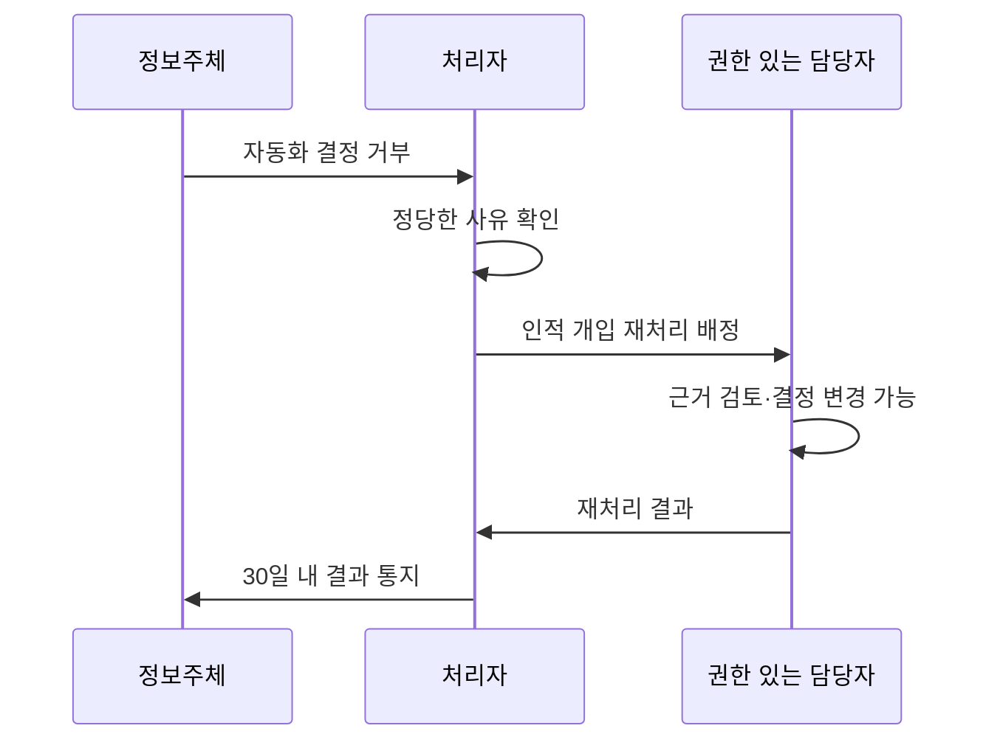

# 인적 개입 재처리

> 정보주체가 자동화된 결정을 거부했을 때, 개인정보처리자가 그 결정을 적용하지 않거나 **사람이 개입해 다시 처리**하고 결과를 알려 주는 조치. 시행령 제44조의3에 규정된 것으로 해설된다. (법률 자문 아님)

## 쉽게 말하면
자동 심사에서 떨어진 사람이 "사람이 다시 봐 주세요"라고 하면 창구 직원이 다시 검토해 답을 주는 절차다. 단, 직원이 AI 결과를 못 바꾸고 도장만 찍는다면 다시 본 것이 아니다.

## 자세히
출처: itwiki 시행령 제44조의3 해설(본문 확인, 법령 원문은 아님), 검색 요약(고시 정의). 항 번호는 원문 대조가 필요하다.
- **선택지**: 거부를 받으면 정당한 사유가 없는 한 ①그 자동화 결정을 적용하지 않거나 ②인적 개입으로 재처리하고, 결과를 정보주체에게 알린다.
- **기한**: 거부·설명 요구를 받은 날부터 30일 이내에 서면 등으로 조치. 정당한 사유가 있으면 이유를 알리고 2회, 각 30일까지 연장(최대 60일 추가)이라고 해설한다.
- **인적 개입의 뜻(검색 요약, 고시 제2조 해설)**: 자동화 시스템의 결정을 바꿀 권한이 있는 사람이 결정·재처리 과정에 실질적으로 관여하는 것.
- **함께 정해진 통지**: 설명 요구에는 결과, 주요 개인정보 유형, 주요 기준, 처리 절차를 간결하고 의미 있게 설명. 검토(의견 제출) 요구에는 반영 여부와 결과를 알린다.
- **거절 사유**: 다른 사람의 생명·신체·재산 등을 부당하게 침해할 우려 같은 정당한 사유가 있으면 거절 가능하며, 사유를 지체 없이 서면으로 알려야 한다.

## 그림으로 보기

## 예시
- AI 서류 전형에서 탈락한 지원자가 거부를 요청 → 채용 담당자가 서류를 직접 읽고 결과를 서면 통지.
- 운영 팁: 재처리 담당자에게 번복 권한과 근거 열람 권한을 주고, 재처리 기록을 남긴다.

## 헷갈리는 것과 비교
| 개념 | 차이 |
|---|---|
| 인적 개입 재처리 | 거부 후 사후 구제 |
| [완전 자동화 결정](#fully-automated) | 사전 적용 문턱(개입 없었는지) |
| [사람 개입의 경계](#human-in-the-loop-boundary) | 개입이 형식이 아닌지 가르는 기준 |
| [중대한 영향](#significant-impact) | 거부권이 생기는 파급력 문턱 |

## 더 읽을거리
- [itwiki: 시행령 제44조의3](https://www.itwiki.kr/w/%EA%B0%9C%EC%9D%B8%EC%A0%95%EB%B3%B4_%EB%B3%B4%ED%98%B8%EB%B2%95_%EC%8B%9C%ED%96%89%EB%A0%B9_%EC%A0%9C44%EC%A1%B0%EC%9D%983) — 항별 해설(기한·통지)
- [뉴시스 2023-11-22](https://www.newsis.com/view/NISX20231122_0002531002) — 재처리 요구 지원과 결과 통지에 관한 개인정보위 설명
