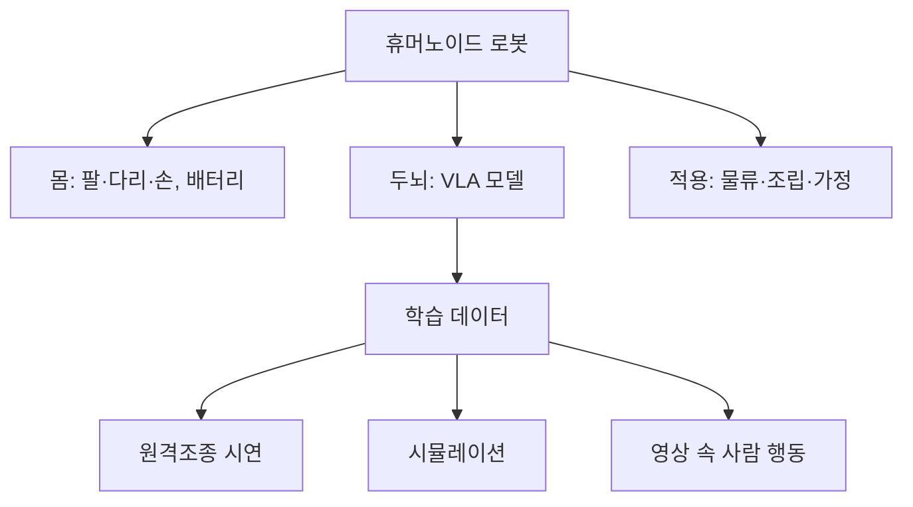
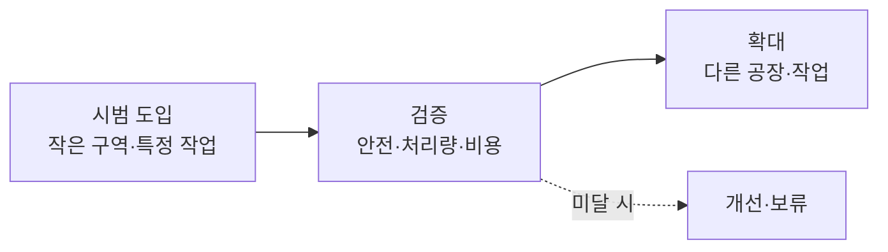

# 휴머노이드 로봇

> 사람 모양(두 팔·두 다리·손)을 한 로봇. 사람이 쓰도록 만든 공장·창고·집을 그대로 쓰면서 일할 수 있다는 기대 때문에 주목받는다. 2026년 현재는 소규모 시범 도입 단계다.

## 쉽게 말하면
계단, 문 손잡이, 선반 높이, 공구는 모두 사람 몸에 맞춰 만들어졌다. 환경을 바꾸는 대신 로봇이 사람 몸을 닮으면 어디든 투입할 수 있다는 발상이다. 마치 사람 직원 한 명을 채용하듯 "범용 일손"을 쓰자는 것이다. 다만 사람처럼 안정적으로, 안전하게, 값싸게 해내는 건 아직 어렵다.

## 자세히
**왜 사람 모양인가**: 기존 시설·도구를 바꾸지 않고 쓸 수 있고, 사람의 시연 데이터를 로봇 학습에 활용하기 쉽다는 논리. 반론은 바퀴형·고정형 로봇이 특정 작업에는 더 싸고 안정적이라는 점이다.

**두뇌 기술**: [VLA 모델](#vla-model)(카메라 영상+언어 지시→행동), [시뮬레이션→현실 이전](#sim-to-real), [원격조종 데이터](#teleoperation-data) 수집, 세계 모델이 핵심이다.

**2026년 11월 기준 확인된 사실(회사 공식 페이지)**
- **Figure AI**: 2025년 11월 19일 "F.02가 BMW에서 자동차 3만 대 생산에 기여" 발표. 2026년 4월 29일 Figure 03 생산 증설, 6월 30일 "F.03 BMW 도착", 9월 17일 "Helix 2.5: 제로샷 30개 가정 일반화" 발표(모두 회사 제목 기준, 세부 수치는 페이지에 없음).
- **Agility Robotics**: 2026년 11월 5일 나스닥 상장(AGLT, SPAC 합병 완료 11월 4일), 10월 30일 약 4억 6,500만 달러 조달 예정 발표, 10월 22일 NVIDIA와 협력 확대 속 Digit 5 상용 규모 준비("첫 협동 안전 휴머노이드"), 10월 26일 GXO와 파트너십 확대.
- **Toyota**: 캐나다 공장에서 휴머노이드를 서비스형(RaaS)으로 도입한다는 보도(2026년 2월, 2차 보도로 세부 미확인).

**주의해서 볼 주장(2차 블로그, 미검증)**: Tesla Optimus의 공장 투입 규모는 출처마다 상반된다(1,000대 이상 vs 유용한 작업 없음). 전 세계 가동 대수 7,000~8,000대 추정치도 저권위 출처다. 의사결정에는 회사 공시를 확인한다.

**현실적 과제**: 배터리 시간, 안전(사람 곁 작업), 가격, 반복 작업의 신뢰도, 손 조작 정확도, 실제 처리량 대비 비용.

## 그림으로 보기

## 예시
- 창고에서 토트(상자)를 컨베이어로 옮기는 반복 작업에 투입(Agility Digit 계열의 대표 사례).
- 자동차 공장에서 판금 부품을 지그에 올리는 작업(Figure·BMW 시범).
- 교육 활용: 직무 교육에서 "로봇은 사람 대체가 아니라 위험하거나 단순 반복 작업 보조부터"라는 단계적 도입 논의에 쓴다.

## 헷갈리는 것과 비교
| 개념 | 차이 |
|---|---|
| 휴머노이드 | 범용성 지향, 비싸고 아직 시범 단계 |
| 산업용 로봇 팔 | 고정 위치·정해진 동작에 최적, 가장 성숙 |
| [자율주행](#autonomous-driving) | 도로 위 특화 피지컬 AI. 상용화가 더 앞섬 |
| [VLA 모델](#vla-model) | 휴머노이드를 포함한 로봇의 두뇌 모델 유형 |

## 더 읽을거리
- [Figure AI 뉴스](https://www.figure.ai/news) — BMW 사례와 Figure 03·Helix 발표 목록
- [Agility Robotics 보도자료](https://www.agilityrobotics.com/about/press) — 상장·고객·Digit 5
