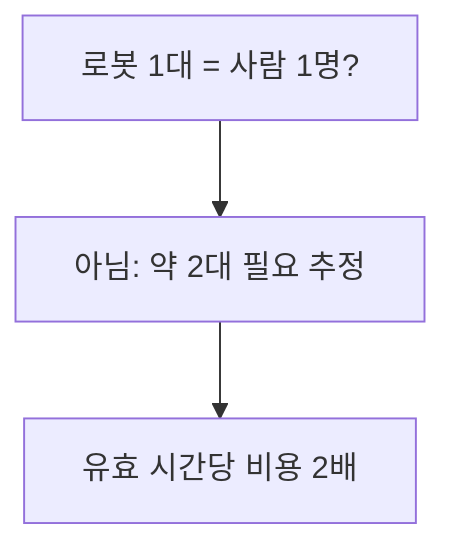

# 휴머노이드 단가와 ROI

> 휴머노이드 로봇의 가격표만 보면 안 되고, **가동 시간당 비용**과 **사람 한 명 몫을 하는 데 필요한 로봇 수**까지 계산해야 도입 타당성이 나온다.

## 쉽게 말하면
자동차 연비는 "유류비"가 아니라 "100km 가는 데 드는 총비용"으로 따진다. 로봇도 구매가·월 요금보다 "일 잘하는 한 시간당 얼마냐"가 진짜 기준이다.

## 자세히
(아래 수치는 검색으로 확인한 벤더 발표·블로그·언론 인용이며 기준 시점과 출처가 제각각이다. 도입 전 독립 검증이 필요하다.)
- 구매가: Unitree G1은 자사 스토어 약 $13,500(다른 곳은 $16,000 인용). 1X NEO는 $20,000 선구매 또는 월 $499 구독.
- 임대: Agility Digit는 한 SEC 제출 관련 보도에서 월 $8,500, 설치 약 $25,000이라고 한다. 다른 블로그는 월 $6,000~8,000, 구매 대비 손익분기 약 36개월(출처 불명).
- 벤더 주장: Agility는 "완전 부담 인건비 시간당 $30 대비 2년 미만 ROI". Schaeffler의 Digit 운영비는 시간당 $10~25로 보도됐고 신입 직원은 약 $20/시간.
- 핵심 경고(Fortune 인용): JPMorgan 추정으로 현재 **사람 1명 몫에 휴머노이드 약 2대**가 필요해, 로봇 1대=사람 1명 가정은 낙관적이다.
- 계산 틀: (구매·임대 비용) ÷ (수명 동안 실제 생산 시간) + 전력·정비·소프트웨어·통합·감독 비용.
- 변수: 가동률(충전·고장), 작업 성공률, 안전 인증·울타리 비용.

## 그림으로 보기

## 예시
- 월 $8,500, 월 160시간 가동이면 시간당 약 $53(요금만, 효율 100% 가정). 사람 몫 0.5라면 유효 비용은 더 오른다.
- 교육: ROI 계산서를 직접 만들어 보는 도입 검토 실습.

## 헷갈리는 것과 비교
| 개념 | 차이 |
|---|---|
| 구매 단가 | 일회성 가격 |
| ROI 회수 기간 | 비용 대비 절감으로 본 기간 |
| [서비스형 로봇](#robots-as-a-service) | 구매 대신 구독하는 계약 방식 |

## 더 읽을거리
- [Fortune: when will physical AI robots pay off (2026-10-16)](https://fortune.com/2026/10/16/when-will-physical-ai-robots-pay-off/) — 검색 결과로 확인한 ROI 논의.
- [The Robot Report: Digit 임대 비용](https://www.therobotreport.com/heres-what-it-could-cost-to-hire-a-digit-humanoid/) — 검색 결과 확인.
