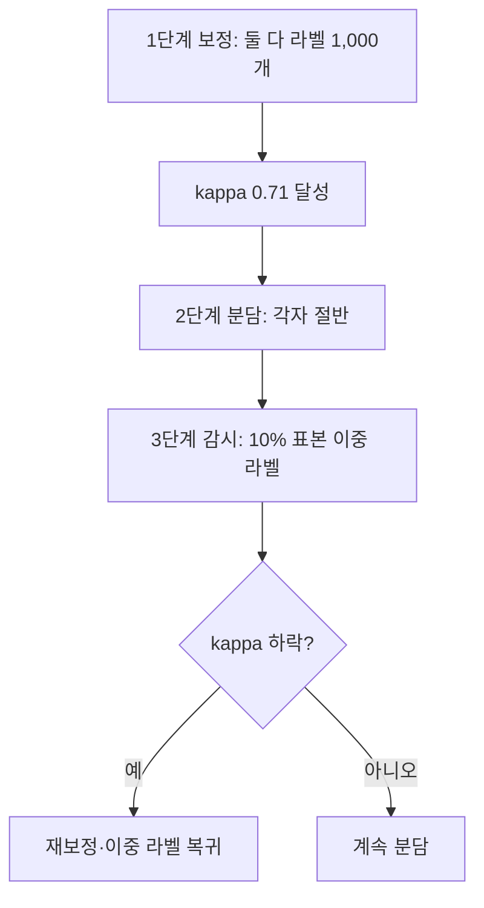
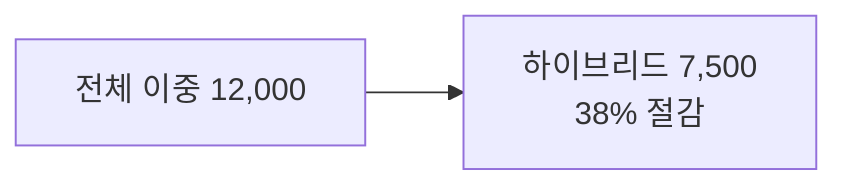

# 하이브리드 분담 라벨링

> 처음에는 **두 사람이 같은 데이터를 라벨**해 일치도를 맞추고, 목표 일치도에 도달하면 **나머지는 문서를 나눠 각자 맡아** 속도를 높이는 방식이다. 이후에는 일부 표본만 이중 라벨해 품질을 감시한다.

## 쉽게 말하면
신입 둘이 처음 몇 주는 같은 서류를 같이 처리하며 기준을 맞추고, 손발이 맞으면 서류를 반씩 나눠 처리하되 가끔 서로의 서류를 검사하는 방식이다.

## 자세히
- **단계**: ① 보정 단계: 두 사람이 같은 항목을 라벨하고 불일치를 토론하며 [가이드를 개정](#guideline-draft-iteration)하고 [목표 일치도](#target-agreement-setting)에 도달 ② 분담 단계: 나머지를 반반 분담 ③ 감시 단계: 일부 표본만 이중 라벨([표본 이중 라벨링](#sampled-double-annotation))해 일치도 추적.
- **직접 시뮬레이션(6,000개, 이진, 라벨러 2명 각자 정확도 0.92)**: 처음 1,000개를 둘 다 라벨 → kappa **0.710**. 나머지 5,000개는 각자 2,500개씩 분담하고 500개(10%)를 표본 이중 라벨 → 감시 kappa 0.728. 분담 항목의 정확도 0.920. 비용 단위로 전체 이중(12,000) 대비 하이브리드 **7,500(약 38% 절감)**.
- **위험: 기준 드리프트**: 보정 후 라벨러 B의 정확도가 뒤로 갈수록 0.92에서 0.80으로 떨어진다고 가정하면, 뒤쪽 항목의 표본 이중 라벨 kappa가 **0.463**으로 보정 때 0.710보다 확연히 낮아져 감시에서 드러났다. 감시가 없으면 분담 라벨의 품질 하락을 모르고 지나간다([라벨러 기준 드리프트](#labeler-drift)).
- **언제 적합한가**: 가이드가 안정되고 일치도가 목표를 충분히 넘었으며, 항목 수가 많고 일정이 빠듯할 때. 일치도가 낮거나 모호한 항목이 많으면 분담보다 이중 라벨이 낫다.
- **운영 요령**
  1. 분담 기준은 **무작위 배정**(한 사람이 쉬운 문서만 가지지 않게).
  2. 감시 표본 비율과 재보정 조건을 미리 정한다(예: kappa가 목표 −0.1 아래면 이중 라벨로 복귀).
  3. 새 규칙 변경 시 모든 라벨러가 동시에 공지를 받고 버전을 기록.
  4. 주기적으로 [골든 문항](#golden-items)을 섞어 개인 정확도도 확인.
- 이 수치는 합성 이진 데이터의 한 설정이며 실제로는 문서 난이도, 피로, 규칙 변경 등이 더해진다.

## 그림으로 보기

## 예시
- 약관 조항 분류 2만 건: 처음 1,500건 이중 라벨 후 목표 kappa 0.7 도달 → 나머지 분담, 주 단위 10% 표본 검사.
- 교육: "신입 교육 → 독립 업무 → 표본 검수"의 직무 훈련 구조와 비교.

## 헷갈리는 것과 비교
| 개념 | 차이 |
|---|---|
| 하이브리드 분담 | 초기 이중, 이후 분담+표본 검수 |
| 전수 이중 라벨링 | 끝까지 둘 다 |
| [표본 이중 라벨링](#sampled-double-annotation) | 분담 없이 전체 단일 + 일부 이중 |
| [이중 검수](#double-annotation-review) | 불일치는 전문가가 검수 |

## 더 읽을거리
- [Overview of Annotation Creation (arXiv 1602.05753)](https://arxiv.org/abs/1602.05753) — IAA 추적과 가이드 버전 관리를 프로젝트 과제로 제시.
- [McHugh 2012: kappa](https://pmc.ncbi.nlm.nih.gov/articles/PMC3900052/) — 일치도 해석과 한계.
