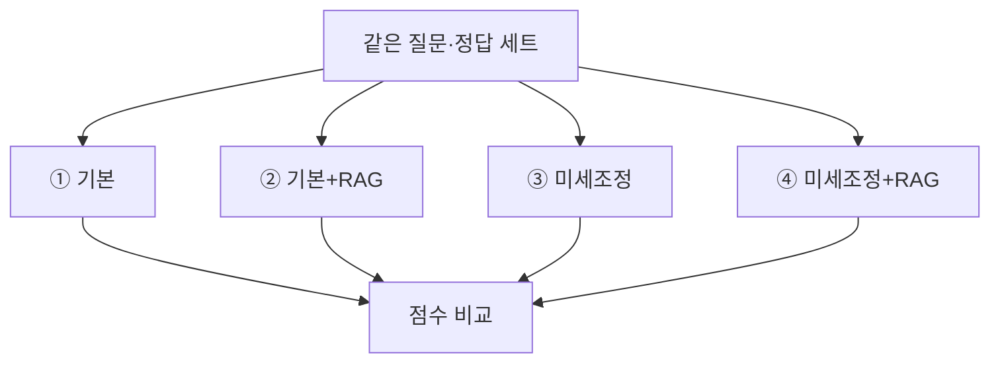
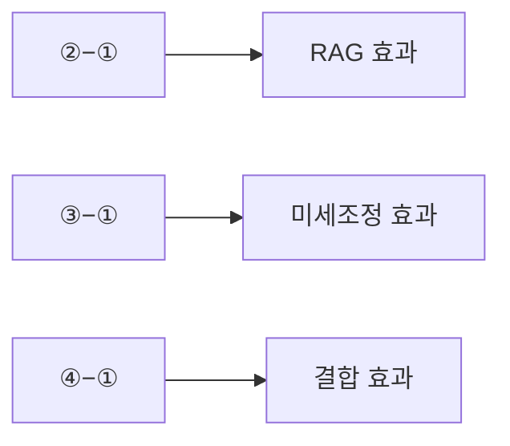

# 하이브리드 평가 설계

> RAG와 미세조정을 함께 쓰는 시스템에서 각 구성요소가 성능에 얼마나 기여하는지 따로 떼어 측정하도록 평가를 설계하는 방법. "합쳤더니 좋아졌다"가 아니라 "무엇 때문에 좋아졌나"를 알기 위한 것이다.

## 쉽게 말하면
요리 대회에서 새 칼과 새 레시피를 함께 도입했다면, 칼만 바꾼 경우, 레시피만 바꾼 경우, 둘 다 바꾼 경우의 점수를 각각 비교해야 무엇이 효과인지 안다. 평가도 네 칸짜리 표로 만든다.

## 자세히
- **기본 설계(이 글의 제안, 2×2 비교)**: 같은 질문·정답 세트로 ① 기본 모델 ② 기본 모델 + RAG ③ 미세조정 모델 ④ 미세조정 + RAG를 모두 돌려 점수를 비교한다. 이렇게 하면 RAG 효과, 미세조정 효과, 결합 효과를 분리할 수 있다. 세트 준비는 [질문·정답 세트 먼저 만들기](#eval-set-first)를 따른다.
- **근거 연구 1(Ovadia 외, arXiv 2312.05934, 초록 열람)**: 지식 주입에서 비지도 미세조정은 일부 개선을 주지만 RAG가 학습 중 본 지식과 완전히 새로운 지식 모두에서 미세조정보다 일관되게 좋았다. 새 사실을 비지도 미세조정으로 배우기 어렵고, 같은 사실의 다양한 표현으로 학습하면 이를 부분 완화한다고 보고한다.
- **근거 연구 2(Microsoft 농업 사례, arXiv 2401.08406, 초록 열람)**: PDF에서 정보를 추출하고 질답 쌍을 만들어 미세조정하며 GPT-4를 평가자로 쓰는 파이프라인에서, Llama2-13B·GPT-3.5·GPT-4로 시험했다. 미세조정이 정확도를 6%p 넘게 올렸고 RAG가 그 위에 약 5%p를 더해 효과가 누적적이었다고 보고한다. 한 실험에서 여러 지역 정보를 쓰는 미세조정 모델의 답변 유사도가 47%에서 72%로 올랐다. 두 연구는 조건이 다르므로 서로 모순된다고 단정하지 않고, 우리 데이터로 재시험이 필요하다.
- **단계별 지표(Microsoft 논문 요지)**: 파이프라인 단계마다 지표를 따로 제안한다. RAG에선 검색 평가와 생성 평가를 분리해 보는 방식이 일반적이다.
- **주의**: 평가자가 LLM이면 평가자 편향이 있다. 사람 표본 검증을 병행한다. 세트가 작으면 칸 사이 차이가 잡음일 수 있다(예: 20개 미만).

## 그림으로 보기

## 예시
- 사내 규정 QA: 네 조합 점수가 61/74/68/80이면 RAG +13, 미세조정 +7, 결합 +19(가상 숫자). 결합이 두 효과의 합보다 작거나 큰지도 확인.
- 교육 실습: 질문 10개로 네 조합을 사람이 채점해 2×2 표를 채운다.

## 헷갈리는 것과 비교
| 개념 | 차이 |
|---|---|
| 하이브리드 평가 | 구성요소별 기여를 분리 |
| 전체 시스템 평가 | 합친 결과만 봄 |
| [RAFT](#raft) | 하이브리드를 한 번에 학습시키는 방법 |
| [긴 컨텍스트 vs RAG](#long-context-vs-rag) | 다른 선택지 비교 |

## 더 읽을거리
- [Fine-Tuning or Retrieval? (arXiv 2312.05934)](https://arxiv.org/abs/2312.05934) — 지식 주입 비교(초록 열람)
- [RAG vs Fine-tuning (arXiv 2401.08406)](https://arxiv.org/abs/2401.08406) — 농업 사례와 누적 효과(초록 열람)
