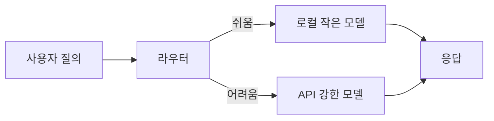
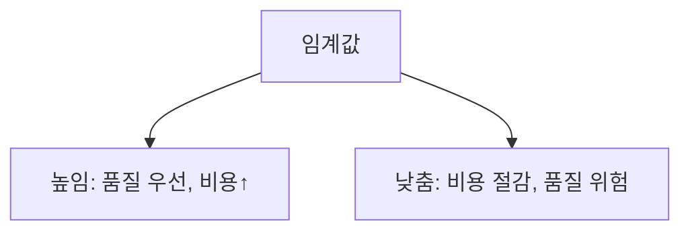

# 로컬+API 혼합

> 쉬운 요청은 **싸고 빠른 로컬(작은) 모델**이, 어려운 요청은 **강한 API 모델**이 처리하도록 **라우터**가 나눠 보내는 구성.

## 쉽게 말하면
병원의 접수 간호사가 감기는 동네 의원에서, 큰 수술은 대학병원으로 보내는 것과 같다. 대학병원(비싼 모델)의 부담을 줄이고 꼭 필요한 환자만 보낸다.

## 자세히
- **Hybrid LLM**(ICLR 2024, arXiv 2404.14618): 라우터가 쉬운 질의를 작은 모델로 보낸다. 논문은 질의의 **22%를 Llama-2 13B에 할당해도 응답 품질 하락이 1% 미만**이라고 보고(검색 요약). 작은 모델로 보낸 비율이 곧 비용 이점.
- **RouteLLM**(LMSYS, arXiv 2406.18665): 선호도 데이터로 라우팅을 학습하는 오픈소스 프레임워크. **임계값**으로 비용-품질 균형을 정하며, 문서는 받는 질의 유형에 맞춰 보정하라고 한다. 로컬 모델도 지원.
- 비용 절감 수치: 독립적으로 검증된 RouteLLM의 특정 절감률은 검색에서 확인하지 못했다. 한 블로그의 40%는 가정적 추정이고, 다른 페이지가 인용한 ConsRoute의 약 40% 지연·비용 감소는 AI 생성 페이지 인용이라 원논문 확인이 필요하다.
- 설계 포인트: 라우터 자체의 비용·오판, 목표 품질(예: 강한 모델의 90%), 질의 분포 변화에 따른 임계값 재보정, 프라이버시가 필요한 질의는 항상 로컬로.

## 그림으로 보기

## 예시
- 사내 챗봇: 사규 FAQ는 로컬, 복잡한 계약 검토는 API.
- 교육: "모든 일을 최고 전문가에게 맡기지 않는다"는 업무 위임 비유.

## 헷갈리는 것과 비교
| 개념 | 차이 |
|---|---|
| 혼합 구성 | 요청별로 나눠 보냄 |
| [호스팅 결정](#hosting-decision-checklist) | 전체를 어디서 돌릴지 |
| 모델 폴백 | 실패 시 대체, 난이도 분류와 무관 |

## 더 읽을거리
- [RouteLLM 블로그](https://lmsys.org/blog/2024-07-01-routellm/) — 프레임워크 소개(검색 결과 확인).
- [Hybrid LLM 논문](https://arxiv.org/abs/2404.14618) — 22% 결과(검색 요약).
