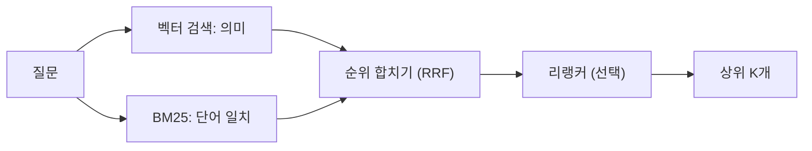
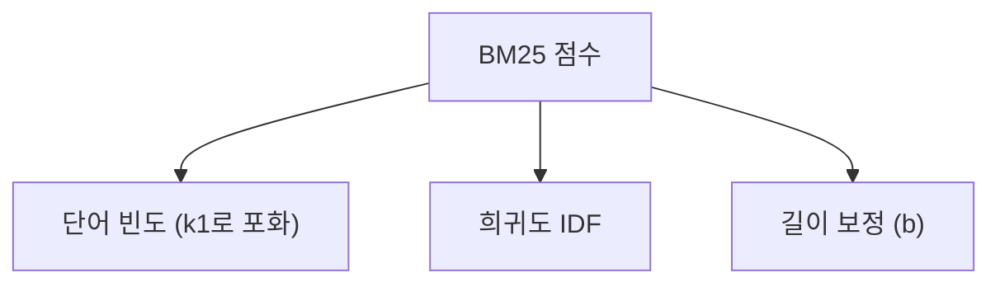

# 하이브리드 검색과 BM25

> 단어가 정확히 맞는 문서를 잘 찾는 키워드 점수(BM25)와 뜻이 비슷한 문서를 찾는 벡터 검색을 합쳐 쓰는 방식.

## 쉽게 말하면
"TS-999 오류"를 찾을 때는 글자가 똑같은 문서가 중요하고, "앱이 갑자기 꺼져요"처럼 표현이 다양한 질문은 뜻이 통하는 문서가 중요하다. 한쪽 사서는 색인 카드(단어)에 강하고 다른 사서는 내용 감각(의미)에 강하다. 둘의 추천 목록을 합치면 서로의 빈틈을 메운다.

## 자세히
- **BM25**: 단어 빈도 기반 점수 함수. 세 요소(Elastic 해설, 확인 2026-11-02):
  - **IDF**: 드문 단어일수록 가중치가 높다.
  - **k1**(기본 1.2): 같은 단어가 반복될 때 점수 증가를 제한(포화).
  - **b**(기본 0.75): 평균보다 긴 문서에 불이익을 주는 정도. 0이면 길이 무시.
- 벡터 검색은 동의어·패러프레이즈에 강하나 고유명사·코드·숫자 같은 정확한 문자열에는 약할 수 있다. BM25는 반대다.
- **결합 방법**: 두 검색의 순위를 합친다. 흔한 방식은 RRF(Reciprocal Rank Fusion, 순위의 역수를 합산)이며 점수 척도를 맞출 필요가 없다. 그 뒤 리랭커로 상위만 재정렬하기도 한다([RAG](#rag)).
- Anthropic은 Contextual Retrieval에서 임베딩 + BM25를 함께 쓰면 임베딩 단독보다 검색 실패가 줄었다고 보고했다(자체 측정).

## 그림으로 보기

## 예시
- 고객지원 봇: "ERR_4012"는 BM25가, "결제가 안 돼요"는 벡터가 잘 찾는다. 둘을 합쳐 두 유형 모두 커버.
- RRF 직관: 각 목록에서 1위는 1/(60+1) 같은 점수를 받고 두 목록에 모두 나온 문서가 합산으로 위로 올라간다.

## 헷갈리는 것과 비교
| 개념 | 차이 |
| --- | --- |
| BM25 | 어휘 일치, 설명 쉬움, 의미 모름 |
| 벡터 검색 | 의미 일치, 정확 문자열에 약함. [벡터 DB](#vector-db) |
| 리랭킹 | 이미 뽑은 후보의 순서를 재조정 |

## 더 읽을거리
- [Practical BM25 Part 2 (Elastic)](https://www.elastic.co/blog/practical-bm25-part-2-the-bm25-algorithm-and-its-variables) — k1, b, IDF 설명.
