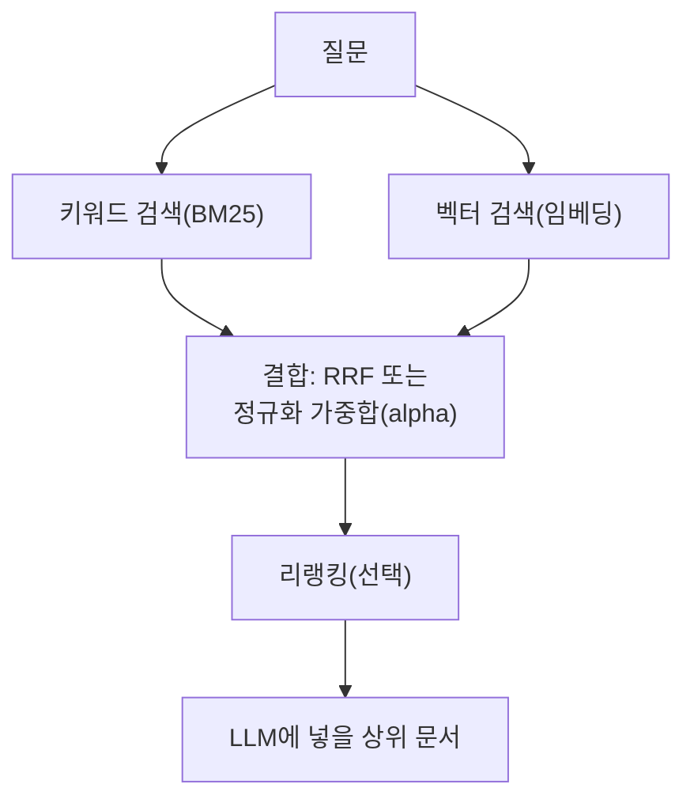
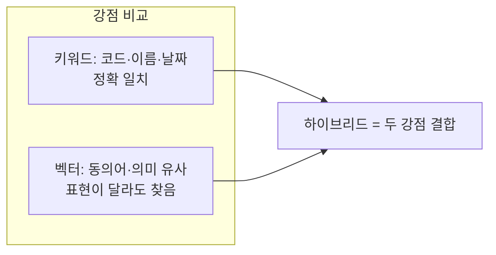

# 하이브리드 검색

> 키워드 검색(BM25)과 의미 검색(벡터)을 동시에 실행해 결과를 합치는 구성. 정확한 용어와 의미적 유사성을 둘 다 잡으려는 방식으로, RAG 검색 단계의 기본 선택지가 됐다.

## 쉽게 말하면
도서관에서 책을 찾는 두 사서가 있다. 한 사서는 제목·색인의 정확한 글자를 찾고, 다른 사서는 "이런 내용이 담긴 책"이라는 뜻으로 찾는다. 둘이 각자 찾은 목록을 합치면 코드명·고유명사도, 표현이 다른 내용도 놓치지 않는다.

## 자세히
- **왜 필요한가(Azure AI Search 문서)**: 벡터 검색은 키워드가 하나도 겹치지 않아도 **개념이 비슷한** 정보를 찾는다. 키워드 검색은 **정확 일치의 정밀도**가 장점이다. 제품 코드, 전문 용어, 날짜, 사람 이름은 키워드 검색이 더 낫다. 실제·벤치마크 데이터 실험에서 **하이브리드 + 시맨틱 랭커** 조합이 검색 관련도를 크게 높인다고 문서는 안내한다(공급사 주장).
- **작동**: 한 번의 요청에 `search`(전문 검색)와 `vectorQueries`(벡터 검색)를 함께 보낸다. 두 검색을 병렬 실행하고 [RRF](#rrf)로 결과를 합쳐 하나의 목록을 낸다. 필터·패싯·정렬·점수 프로파일 같은 기존 기능도 같이 쓴다. 단, 명시적 정렬(`orderby`)은 관련도 순위를 덮어쓴다. 시맨틱 랭커를 쓰면 `k`를 50으로 두는 것을 권장한다.
- **결합 방식 선택(Weaviate 글)**: 
  - `rankedFusion`: RRF. 순위만 사용, 상수 60.
  - `relativeScoreFusion`: v1.24부터 기본값. 각 목록의 점수를 min-max 정규화한 뒤 가중합. 점수 차이가 보존된다.
  - **alpha**(기본 0.75): 0이면 순수 키워드, 0.5면 동일 가중, 1이면 순수 벡터.
- **잘 맞는 질의**: 의미와 정확한 용어가 섞인 질문(예: 제품명·브랜드), 모호한 표현, 전문 어휘, 오타, 다국어. Weaviate 예시: "How to catch an Alaskan Pollock" — 벡터가 "catch"를 낚시로 해석하고 키워드가 "Alaskan Pollock"을 맞춘다.
- **운영 팁**: ①먼저 BM25만, 벡터만, 하이브리드를 자체 질문 세트로 비교(고정 정답 목록 필요) ②한국어는 형태소 분석기 설정이 BM25 품질을 좌우 ③합친 뒤 [리랭킹](#reranking)으로 상위 후보를 정제 ④[에이전틱 RAG](#agentic-rag)에서는 검색 도구 하나로 하이브리드를 노출한다.

## 그림으로 보기

## 예시
- 사내 규정 검색: "AX-204 장비 반출 절차" — 코드 `AX-204`는 BM25가, "반출 절차"와 비슷한 "이동 승인 방법" 문서는 벡터가 찾는다.
- 설정 예(개념): `alpha=0.5`로 시작해 질문 세트에서 정답 순위가 가장 좋은 값을 찾는다.

## 헷갈리는 것과 비교
| 개념 | 차이 |
|---|---|
| [BM25](#bm25) | 단어 빈도·희귀도 기반 키워드 점수 |
| 벡터 검색 | 의미 임베딩 간 유사도([CLIP·멀티모달 임베딩](#embedding-clip)도 같은 원리) |
| 하이브리드 | 둘을 병렬 실행·결합 |
| [RRF](#rrf) | 하이브리드의 결합 방법 중 하나(순위 기반) |
| [리랭킹](#reranking) | 결합 후 정밀 재정렬 |

## 더 읽을거리
- [Hybrid search overview (Azure AI Search)](https://learn.microsoft.com/en-us/azure/search/hybrid-search-overview) — 구조·장점
- [Hybrid Search Explained (Weaviate)](https://weaviate.io/blog/hybrid-search-explained) — 결합 방식과 alpha
