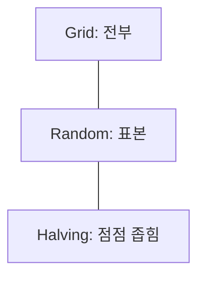

# 하이퍼파라미터 (Hyperparameter)

> 하이퍼파라미터는 학습 전에 사람이 정하는 설정값(학습률·정규화 강도·층 수 등)이고, 파라미터는 학습으로 데이터에서 배우는 값(가중치)이다.

## 쉽게 말하면
요리에서 불 세기와 조리 시간은 요리사가 정하는 설정(하이퍼파라미터)이고, 간이 배는 정도는 조리 결과(파라미터)다. 설정을 바꿔 가며 여러 번 해 보고 가장 맛있는 조합을 찾는다.

## 자세히
scikit-learn 튜닝 문서 기준:
- **파라미터**: `fit` 중에 배운다(선형 모델의 계수). **하이퍼파라미터**: 생성자에 넘기는 값(`SVC`의 `C`·`kernel`·`gamma`, `Lasso`의 `alpha`). `estimator.get_params()`로 확인.
- 검색은 추정기·탐색 공간·탐색 방법·교차검증·점수 함수로 구성되고 후보는 교차검증으로 평가한다.
- **GridSearchCV**: 모든 조합을 시도. **RandomizedSearchCV**: `n_iter`개를 분포에서 추출 — 예산이 파라미터 수와 무관하고 무관한 파라미터가 늘어도 효율이 안 떨어진다. 연속값은 연속 분포(`loguniform`)로. **Successive halving**(실험적): 적은 자원으로 많이 돌려 상위 1/factor만 남겨 자원을 늘린다.
- 함정: `best_score_`는 같은 데이터로 골랐으므로 **낙관적**이다. 별도 평가 세트나 중첩 교차검증을 써야 한다. 불균형 데이터는 `scoring`을 [F1](#f1-score)·balanced accuracy로.
- `LassoCV`·`RidgeCV`처럼 내장 CV 모델이 더 싸다. 딥러닝·LLM 파인튜닝의 학습률, 배치 크기, epoch, [LoRA](#lora-image) 순위도 하이퍼파라미터다.

## 그림으로 보기



## 예시
```python
from sklearn.model_selection import GridSearchCV
from sklearn.svm import SVC
search = GridSearchCV(SVC(), {"C": [1, 10, 100], "kernel": ["rbf"]}, cv=5, n_jobs=-1).fit(X, y)
print(search.best_params_, search.best_score_)
```

## 헷갈리는 것과 비교
| 개념 | 차이 |
|---|---|
| 파라미터 | 데이터로 학습되는 값 |
| 하이퍼파라미터 | 사람이 정하는 설정 |
| [조기 종료](#early-stopping) | 하이퍼파라미터 중 하나(멈춤 기준) |
| [정규화 강도 λ](#regularization-loss) | 대표적 하이퍼파라미터 |

## 더 읽을거리
- [sklearn Hyperparameter tuning](https://scikit-learn.org/stable/modules/grid_search.html) — Grid·Random·Halving 검색과 함정.
