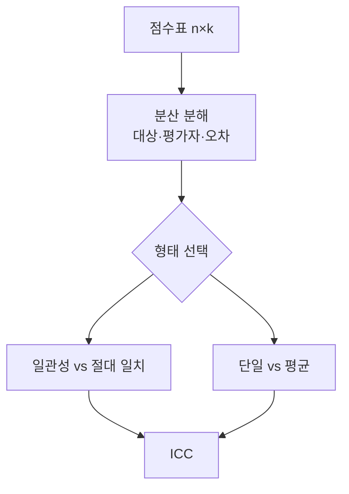

# ICC (급내상관계수)

> 같은 대상을 여러 평가자가 점수로 평가했을 때, 점수 차이가 "대상 간 진짜 차이"에서 오는 몫을 0~1로 나타낸 신뢰도 지표. 평가자 설계(누가 누구를 평가했나)와 "일관성 vs 절대 일치"에 따라 여러 형태가 있다.

## 쉽게 말하면
학생 6명의 에세이를 교사 4명이 채점했을 때, 점수 차이 대부분이 "학생 실력 차이" 때문이면 ICC가 높고, 교사가 후하거나 박한 성향 차이 때문이면 낮아진다.

## 자세히
출처는 위키백과 "Intraclass correlation"(열람, 2차 출처)와 PDQI-9 논문(PMC3347480, 열람)이다.
- **정의**: 같은 집단 안의 측정값들이 얼마나 서로 닮았는지를 나타내는 기술 통계. 현대적 랜덤 효과 틀에서는 전체 분산 중 집단(대상) 간 차이에 해당하는 몫이고 음수가 되지 않는다.
- **세 모형**: 일원 랜덤(대상마다 다른 임의의 평가자 집합), 이원 랜덤(같은 임의 평가자들이 모든 대상을 평가), 이원 혼합(고정된 평가자들이 모든 대상을 평가).
- **여섯 형태(Shrout-Fleiss 표기)**: ICC(1,1), ICC(2,1), ICC(3,1)은 단일 평가자 점수, ICC(1,k), ICC(2,k), ICC(3,k)는 k명 평균 점수. 2는 절대 일치, 3은 일관성을 본다. 일관성은 평가자의 체계적 차이(후함·박함)를 무시하고 절대 일치는 이를 포함한다. 일원 랜덤 모형에서는 일관성 ICC를 추정할 수 없다.
- **해석 기준(Koo & Li 2016, 위키백과 인용)**: 0.50 미만 나쁨, 0.50~0.75 보통, 0.75~0.90 좋음, 0.90 초과 매우 좋음. 이 기준도 경험칙이다.
- **의료 평가 사례(PDQI-9 논문)**: 총점에 대해 이원 혼합 모형·평균 측정·일관성으로 ICC = 0.83(95% CI 0.72~0.91)을 보고했다.

## 직접 계산한 가상 예시
6명의 대상을 4명이 평가한 점수표(예시용 값): 

| 대상 | 평가자1 | 평가자2 | 평가자3 | 평가자4 |
|---|---|---|---|---|
| 1 | 9 | 2 | 5 | 8 |
| 2 | 6 | 1 | 3 | 2 |
| 3 | 8 | 4 | 6 | 8 |
| 4 | 7 | 1 | 2 | 6 |
| 5 | 10 | 5 | 6 | 9 |
| 6 | 6 | 2 | 4 | 7 |

이원 분산분석 평균제곱 MSR(대상) ≈ 11.24, MSC(평가자) ≈ 32.49, MSE(오차) ≈ 1.02. 표준 Shrout-Fleiss 공식(이 공식은 열람한 페이지에 없고 일반적으로 알려진 식이다)으로 직접 계산하면:
- ICC(2,1) ≈ 0.29 (절대 일치, 단일 평가자)
- ICC(3,1) ≈ 0.71 (일관성, 단일 평가자)
- ICC(2,k) ≈ 0.62 (절대 일치, 4명 평균)
- ICC(3,k) ≈ 0.91 (일관성, 4명 평균)
→ 평가자 성향 차이(MSC가 큼)가 크므로 절대 일치(0.29)는 낮고 일관성(0.71)은 높다. 같은 데이터라도 형태에 따라 해석이 크게 다르다. 어떤 형태를 썼는지 반드시 함께 보고한다.

## 그림으로 보기

## 예시
- LLM 요약 품질을 의사 3명이 0~10점으로 채점한 뒤 평균 점수 신뢰도로 ICC(3,k)를 보고(PDQI-9 연구와 같은 방식).
- 교육 실습: 위 표에서 평가자 4의 점수만 모두 +3 올려 ICC(3,1)과 ICC(2,1)이 어떻게 달라지는지 계산해 일관성과 절대 일치의 차이를 확인.

## 헷갈리는 것과 비교
| 개념 | 차이 |
|---|---|
| ICC | 연속·점수형 평가의 신뢰도 |
| [코헨 카파](#cohens-kappa) 등 | 범주형 라벨의 일치 |
| [Krippendorff alpha](#krippendorff-alpha) | 결측·여러 척도 허용 |
| 일관성 vs 절대 일치 | 평가자 성향 차이를 무시할지 |

## 더 읽을거리
- [Wikipedia: Intraclass correlation](https://en.wikipedia.org/wiki/Intraclass_correlation) — 형태와 해석(열람, 2차 출처)
- [PDQI-9 (PMC3347480)](https://pmc.ncbi.nlm.nih.gov/articles/PMC3347480) — ICC 사용 사례(열람)
