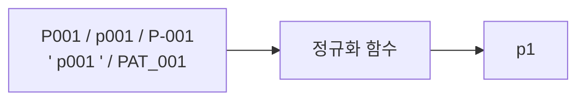
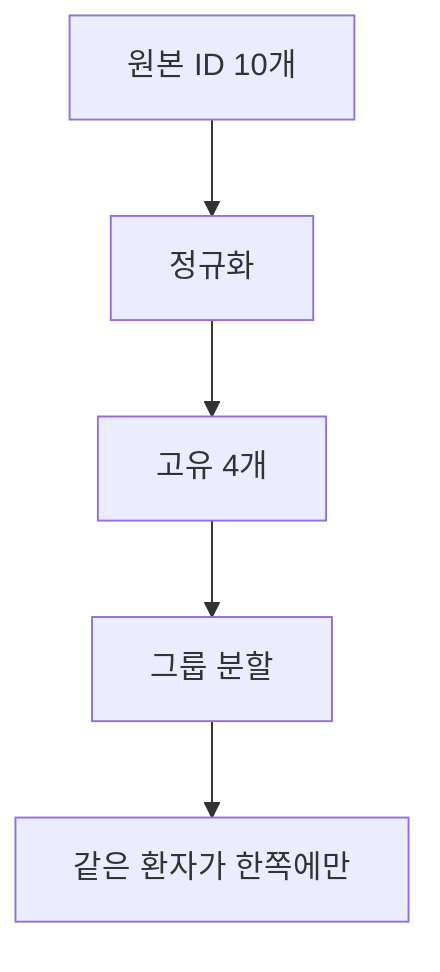

# ID 정규화

> ID 정규화는 같은 대상(환자·고객·문서)이 "P001", "p001", "P-001", " p001 "처럼 표기만 달리 적힌 것을 하나의 표준 형식으로 맞추는 일이다. 정규화를 안 하면 같은 대상이 서로 다른 그룹으로 취급돼 그룹 분할이 새는 누수가 생긴다.

## 쉽게 말하면
같은 학생이 출석부에는 "김철수", 시험 명단에는 "김 철수", 상담 기록에는 "철수 김"으로 적혀 있으면 컴퓨터는 세 사람으로 센다. 학생 단위로 조를 나누려 해도 한 학생이 여러 조에 흩어진다. 이름 표기를 하나로 맞춰야 한 학생이 한 조에만 들어간다.

## 자세히
- **직접 해 본 예(가상의 환자 ID 10개)**: 원본 ID `P001`, `p001`, `P-001`, ` p001 `(앞뒤 공백), `PAT_001`은 모두 같은 환자로 가정했고 `P002`·`p002 `, `P003`·`pat003`, `P004`도 같은 대상이다. 정규화 함수(공백 제거 → 소문자 → 영문·숫자만 남김 → 접두사 `pat`을 `p`로 통일 → 앞의 0 제거)를 적용하자 고유값이 10개에서 4개(`p1`, `p2`, `p3`, `p4`)로 줄었다. 정규화 전에 그룹 분할을 했다면 환자 1명의 기록이 5개 그룹으로 흩어져 학습·시험에 동시에 들어가는 누수가 생겼을 것이다([샘플 단위 vs 그룹 단위 분할](#sample-vs-group-split)).
- **흔한 불일치(해석)**: 대소문자, 앞뒤 공백, 구분 기호(`-`, `_`), 접두사, 앞자리 0, 전각·반각 문자, 유니코드 정규화 형태, 소스 시스템별 번호 체계. 이름은 동명이인과 철자 변형이 많아 ID 열 없이 이름으로 묶는 것은 위험하다.
- **원칙(해석)**: ① 정규화 규칙을 코드로 만들어 버전 관리 ② 정규화 전후 고유값 수와 변환 예시를 기록([분할 기록 남기기](#split-report-logging)) ③ 서로 다른 대상이 같은 ID로 합쳐지는 과정합(예: 앞자리 0 제거로 `P001`과 `P0001`이 합쳐짐)을 점검 ④ 변환 결과가 수동 확인과 맞는지 표본 점검.
- **주의**: 정규화는 틀릴 수 있다. 너무 공격적이면 다른 대상을 합치고, 너무 약하면 같은 대상이 흩어진다. 규칙을 바꿀 때마다 분할을 다시 만들고 [분할 단위 테스트](#split-assertion-test)를 돌린다.

## 그림으로 보기



## 예시
```python
import re
def norm(s):
    s = re.sub(r"[^a-z0-9]", "", s.strip().lower())
    return re.sub(r"^p0*", "p", re.sub(r"^pat", "p", s))
df["pid"] = df["raw_id"].map(norm)
```
교육 활용: 지저분한 ID 열을 주고 고유값 수가 어떻게 줄어드는지, 잘못 합쳐지는 경우가 있는지 찾아보게 한다.

## 헷갈리는 것과 비교
| 개념 | 차이 |
| --- | --- |
| ID 정규화 | 표기 통일(같은 대상 합치기) |
| 중복 제거 | 같은 행 삭제 |
| [누락된 그룹 ID](#missing-group-ids) | ID 자체가 없는 문제 |
| [분할 단위 테스트](#split-assertion-test) | 분할 후 겹침 검증 |

## 더 읽을거리
- [scikit-learn: Cross-validation iterators for grouped data](https://scikit-learn.org/stable/modules/cross_validation.html) — 그룹 열이 정확해야 하는 이유
