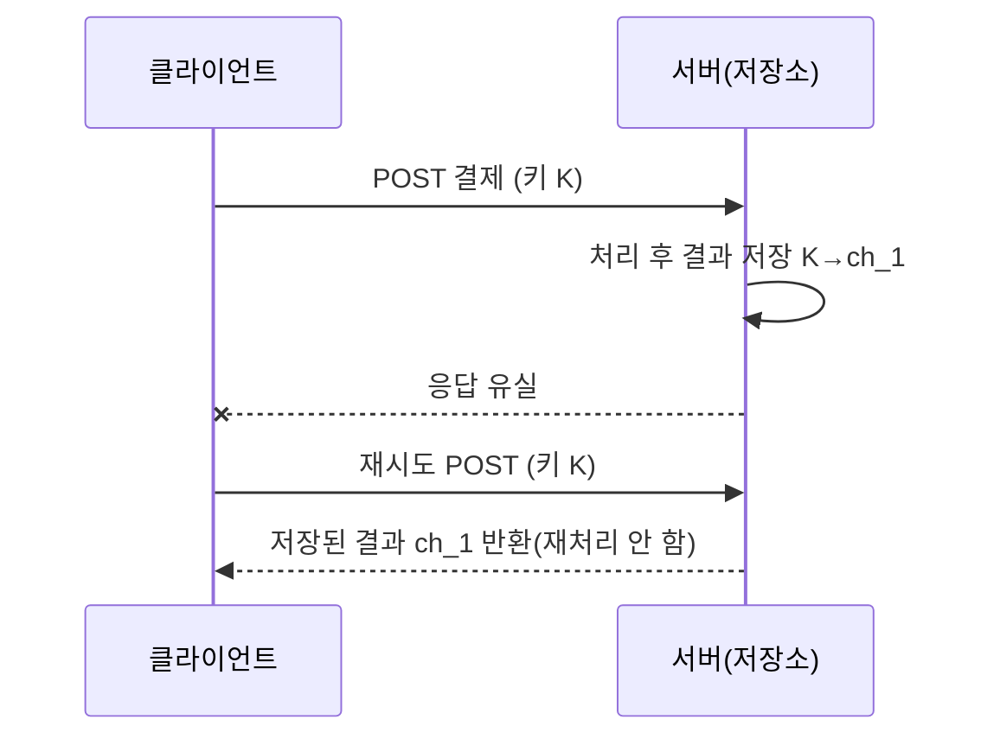
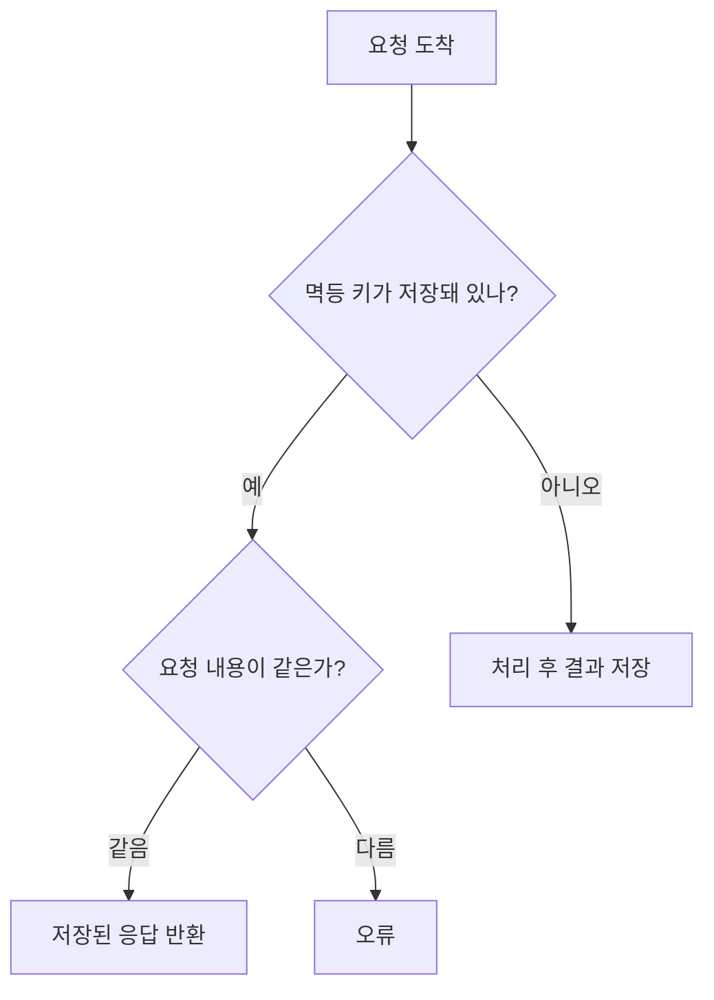

# 멱등성

> **같은 요청을 여러 번 보내도 결과가 한 번 보낸 것과 같도록 만드는 성질.** 네트워크 오류로 "성공했는지 모르는" 상황에서 안전하게 **재시도**하기 위한 핵심 개념이다. 결제·주문·에이전트 도구 호출처럼 **부작용이 있는 일**에서 중복 실행을 막는다.

## 쉽게 말하면
엘리베이터 호출 버튼을 두 번 눌러도 엘리베이터는 한 대만 온다. 반면 "송금" 버튼을 두 번 누르면 두 번 송금될 수 있다. 송금에도 "이 요청의 번호"를 붙여 같은 번호는 한 번만 처리하게 하면 눌러도 안전하다.

## 자세히
(Stripe API 문서 "Idempotent requests" 기준 + 직접 실행)
- **왜 필요한가**: 요청을 보냈는데 응답이 안 오면 **서버가 처리했는지 알 수 없다.** 그냥 다시 보내면 **두 번 처리**될 수 있고, 안 보내면 **한 번도 안 될** 수 있다. 재시도를 안전하게 하려면 서버가 같은 요청을 알아봐야 한다.
- **멱등 키(Idempotency Key)**: 클라이언트가 요청마다 만든 **고유 키**를 헤더로 보내면, 서버가 **같은 키의 첫 결과를 저장해 두었다가** 재시도에는 저장된 응답을 돌려준다. Stripe 문서(API v1): 실행이 시작된 뒤의 첫 요청의 상태 코드와 본문을 저장하고, 같은 키의 재시도는 `500` 오류까지 포함해 **저장된 응답을 반환**한다. 키는 **V4 UUID** 같은 충분히 무작위인 값을 권장하고(최대 255자), **이메일 같은 민감 정보를 키로 쓰지 말라**고 한다. 키는 **24시간 이상 지나면 삭제될 수 있어** 그 뒤 재사용하면 새 요청으로 처리된다. 같은 키에 **다른 매개변수**를 보내면 오용 방지로 오류를 낸다.
- **자연스럽게 멱등인 것**: HTTP의 `GET`·`DELETE`는 정의상 멱등이라 멱등 키가 효과가 없고(문서), `POST` 같은 **생성·변경 요청**에 키가 필요하다.
- **직접 실행**(결제 승인이 네트워크 오류로 응답을 못 받아 클라이언트가 3번 재시도하는 시뮬레이션):

| 방식 | 청구 건수 | 총액 |
|---|---|---|
| 멱등 키 **없이** 3회 재시도 | **3건** | **3,000** (중복 결제) |
| **같은 멱등 키**로 3회 재시도 | **1건** | 1,000 (첫 결과 재사용) |

- **에이전트·웹훅과의 연결**: LLM 에이전트가 도구를 재시도하거나 [시간 여행](#time-travel)으로 노드를 다시 실행할 때, 이메일 발송·결제 같은 도구는 **멱등하게** 설계해야 한다. 웹훅은 같은 이벤트가 여러 번 올 수 있어 **이벤트 ID를 기록**해 중복을 걸러낸다([웹훅](#webhook)).
- **설계 요령**: ① 부작용 있는 API는 멱등 키를 받게, ② 키로 결과를 **저장**(TTL 설정), ③ 같은 키·다른 내용은 오류, ④ 동시에 같은 키가 오면 하나만 실행(잠금), ⑤ 재시도는 **지수 백오프**와 함께.
- 한계: 멱등성은 서버가 키를 저장·검사해야 성립한다. 서비스마다 키 보관 기간과 동작(예: Stripe API v2의 재시도 방식)이 다르므로 해당 문서를 확인한다.

## 그림으로 보기



## 예시
```python
import uuid, requests
key = str(uuid.uuid4())
for attempt in range(3):
    try:
        r = requests.post(URL, json=payload, headers={"Idempotency-Key": key}, timeout=5)
        break
    except requests.Timeout:
        continue          # 같은 키로 재시도 — 중복 결제 없음
```
- 에이전트 도구 설계: "이메일 보내기" 도구에 `request_id`를 받아 같은 ID면 다시 보내지 않게 한다.

## 헷갈리는 것과 비교
| 개념 | 차이 |
|---|---|
| 멱등성 | 여러 번 해도 결과가 같음 |
| 재시도 | 실패 시 다시 시도(멱등이 아니면 위험) |
| 중복 제거 | 이미 처리한 것을 걸러냄(멱등 구현 방법 중 하나) |
| [웹훅](#webhook) | 같은 이벤트가 중복 전달될 수 있어 멱등 처리 필요 |

## 더 읽을거리
- [Stripe: Idempotent requests](https://docs.stripe.com/api/idempotent_requests) — 멱등 키 동작과 주의점.
