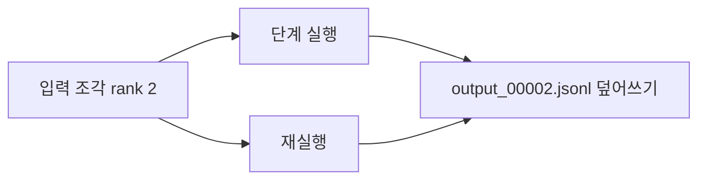
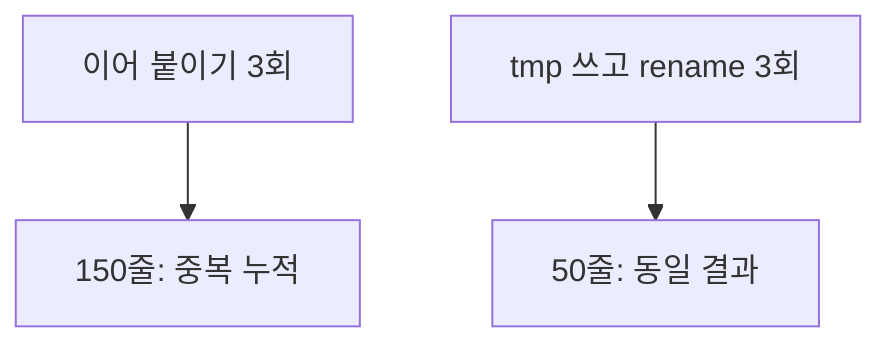

# 멱등 처리 단계

> 같은 입력으로 **여러 번 실행해도 결과가 한 번 실행한 것과 같은** 처리 단계다. 데이터 파이프라인은 중단·재시도가 흔하므로, 단계가 멱등이어야 다시 돌려도 중복이나 손상이 생기지 않는다.

## 쉽게 말하면
엘리베이터의 "위층" 버튼은 열 번 눌러도 한 번 누른 것과 같다(멱등). 반면 "주문하기" 버튼을 열 번 누르면 주문이 열 개 생긴다(멱등 아님). 파이프라인 단계가 후자처럼 만들어지면 재시도할 때마다 결과가 쌓인다.

## 자세히
- **정의**: 연산을 반복해도 시스템 상태에 미치는 효과가 한 번 실행과 같다. HTTP의 GET·PUT·DELETE는 멱등이어야 하고 POST는 그럴 필요가 없다(Wikipedia 확인).
- **직접 실행 1 — 파일에 쓰는 두 방식**(문서 50줄을 3번 실행):

| 방식 | 3회 실행 후 줄 수 |
|---|---|
| 이어 붙이기(append) | **150줄**(재실행마다 중복 누적) |
| 임시 파일에 쓰고 `os.replace`로 교체(tmp+rename) | **50줄** |

- **직접 실행 2 — datatrove**(JSONL 4파일 200문서, `skip_completed=False`, 서로 다른 logging_dir로 같은 출력 폴더에 2번 실행): 1차·2차 모두 출력 폴더의 총 문서가 **200개**였다. 기본 JsonlWriter가 task 번호(`${rank}`)가 들어간 파일 이름으로 **덮어쓰기** 모드(`wt`)로 쓰기 때문에, 같은 task를 다시 돌려도 같은 파일이 같은 내용으로 교체된다. 소스에는 출력 파일명에 `${rank}`가 없으면 병렬 worker가 서로 덮어쓸 수 있다는 경고도 있다.
- **멱등하게 만드는 법(제안)**: ① 출력 경로를 입력 조각(rank)으로 **결정적으로** 정한다. ② 이어쓰기 대신 전체 쓰기 후 교체. ③ 난수·현재 시각을 출력 내용에 넣지 않거나 시드를 고정한다. ④ 외부 시스템(DB·API)에는 고유 키로 upsert.
- 완료 표시와의 관계: [skip_completed](#datatrove-skip-completed)는 "다시 안 돌린다"는 최적화이고, 멱등성은 "다시 돌려도 안전하다"는 안전장치다. 두 가지가 다 있으면 설정 변경 후에도 복구하기 쉽다([낡은 완료 표시](#stale-completion-marker)).
- 주의: 단계가 멱등이어도 결과가 **같은 입력**일 때만 같다. 입력이 바뀌면 결과가 바뀌는 것이 정상이다.

## 그림으로 보기

## 예시
- 야간 정제 작업이 새벽에 죽어 처음부터 다시 돌려도 출력이 두 배가 되지 않도록 출력 파일명에 조각 번호를 넣는다.
- 교육: append와 replace 두 함수를 3번씩 돌려 줄 수를 비교하는 5줄짜리 실습.

## 헷갈리는 것과 비교
| 개념 | 차이 |
|---|---|
| 멱등성 | 반복해도 같은 결과 |
| 결정성(determinism) | 같은 입력이면 항상 같은 출력. 멱등과 비슷하지만 별개 |
| 원자성(atomicity) | 중간 상태 없이 전부 반영되거나 전혀 안 됨. tmp+rename이 제공 |
| [재개 가능한 파이프라인](#resumable-data-pipelines) | 멱등성이 있으면 재개가 단순해짐 |

## 더 읽을거리
- [Idempotence — Wikipedia](https://en.wikipedia.org/wiki/Idempotence) — 정의와 HTTP 예(열어 확인).
- [huggingface/datatrove](https://github.com/huggingface/datatrove) — completions, 출력 파일 규칙(직접 설치해 실험).
