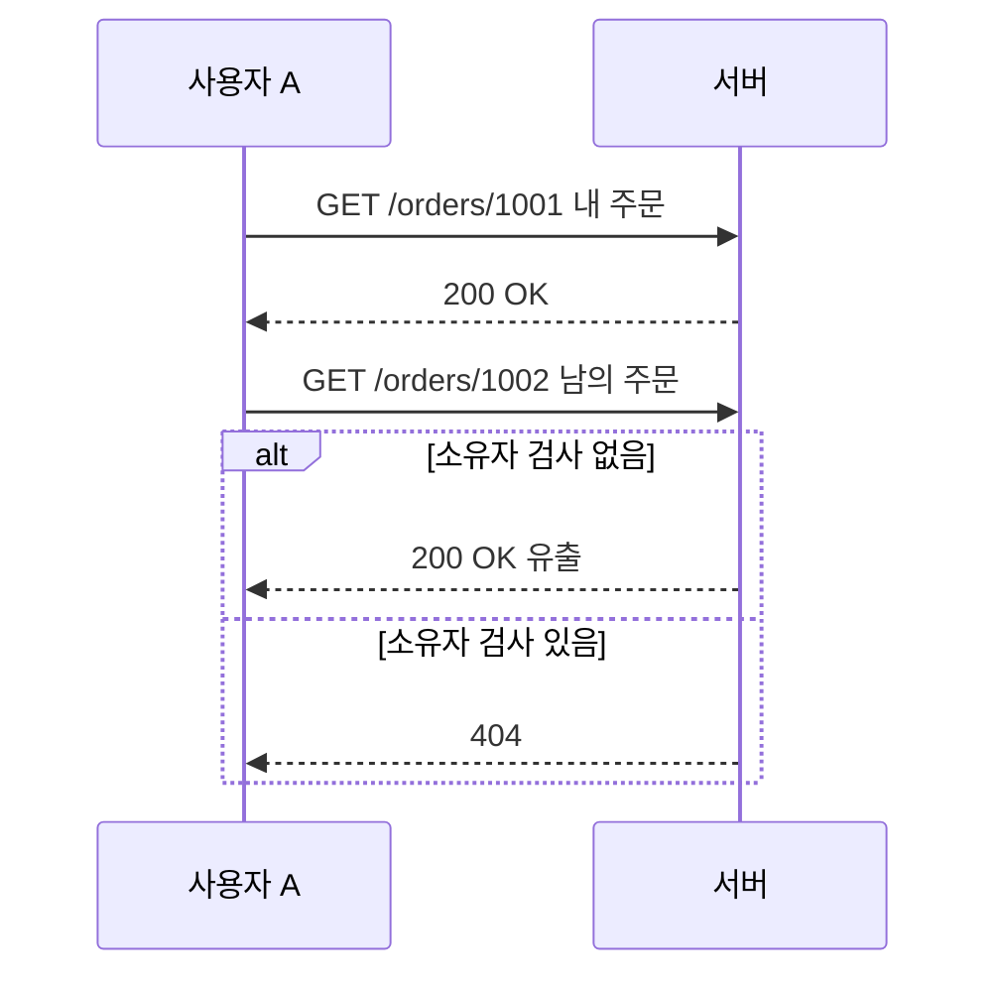
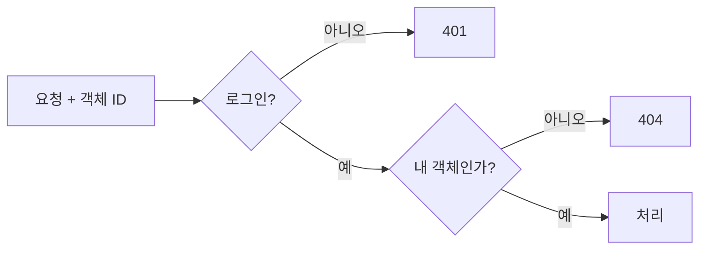

# IDOR (남의 번호로 접근)

> IDOR(Insecure Direct Object Reference)는 URL이나 요청 속 식별자(예: `/orders/1234`)만 바꿔도 **남의 데이터에 접근**되는 취약점이다. 원인은 "로그인했는가"만 보고 "이 객체가 내 것인가"를 확인하지 않는 권한 검사 누락이다.

## 쉽게 말하면
호텔 프런트에서 "302호 열쇠 주세요"라고만 하면 투숙객인지 확인 없이 열쇠를 주는 상황이다. 로그인(투숙)은 확인했지만 그 방이 내 방인지는 확인하지 않았다. 번호를 301, 303으로 바꿔 보기만 해도 남의 방이 열린다.

## 자세히
OWASP 예방 치트시트(열어 본 출처) 요지:
- **객체 수준 권한 검사**: 매 요청마다 로그인 여부가 아니라 "이 사용자가 이 객체에 접근해도 되는가"를 확인한다.
- **범위가 정해진 조회**: ID만으로 가져오지 말고 소유자 조건을 함께 건다(예: `findByIdAndOwnerId`).
- **신원은 서버 세션에서**: 사용자 ID를 URL·본문·숨은 필드로 받지 않는다.
- **예측 불가 ID(UUID 등)는 보조 수단**: 추측을 어렵게 할 뿐이므로 접근 통제는 여전히 필요하다. ID를 암호화하는 방식은 안전하게 구현하기 어려워 권장하지 않는다.
- **응답 일관성**: 존재 여부가 민감하면 없는 객체와 권한 없는 객체에 같은 응답(예: 404)을 준다.
- **테스트**: 권한이 다른 계정 여러 개를 만들고, 서로의 객체를 읽기·수정·삭제·내보내기·관리자 기능으로 접근해 거부되는지 확인한다.
- 바이브코딩 앱에서 자주 생기는 이유: AI가 만든 CRUD API가 인증(로그인)만 붙이고 소유자 검사를 빼기 쉽다(일반 경험칙).

## 그림으로 보기



## 예시
```sql
-- 위험: ID만 조회
SELECT * FROM invoices WHERE id = :id;
-- 안전: 소유자 조건 포함
SELECT * FROM invoices WHERE id = :id AND owner_id = :current_user;
```
Supabase라면 행 수준 보안(RLS) 정책으로 같은 효과를 구조적으로 강제한다(일반 지식).

## 헷갈리는 것과 비교
| 개념 | 차이 |
| --- | --- |
| 인증 | 누구인가 확인 |
| 인가(접근 통제) | 무엇을 할 수 있는가. IDOR은 여기 실패 |
| UUID 사용 | 추측 방지일 뿐 인가의 대체 아님 |
| [접근 통제](#access-control) | IDOR의 상위 개념 |
| [키 유출 대응](#secret-leak-response) | 다른 종류의 보안 사고 |

## 더 읽을거리
- [IDOR Prevention Cheat Sheet — OWASP](https://cheatsheetseries.owasp.org/cheatsheets/Insecure_Direct_Object_Reference_Prevention_Cheat_Sheet.html) — 예방과 테스트 요령
