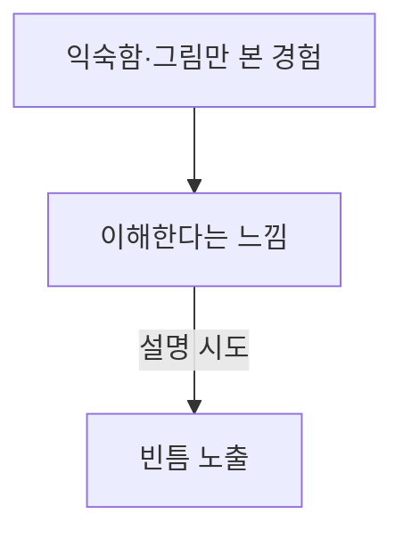

# 설명 깊이의 착각

> **설명 깊이의 착각(IOED)** 은 사람들이 어떤 것이 **어떻게 작동하는지 안다고 믿지만**, 막상 **설명해 보면 훨씬 모른다**는 사실을 깨닫는 인지 편향이다(Rozenblit & Keil, 2002).

## 쉽게 말하면
"자전거가 어떻게 움직이는지 알아"라고 자신 있게 말했다가, 페달에서 바퀴까지 힘이 전달되는 순서를 그려 보라 하면 막히는 경험이다. 익숙함을 이해로 착각한다.

## 자세히
(Rozenblit & Keil 2002 논문 제목 "The misunderstood limits of folk science: an illusion of explanatory depth", *Cognitive Science*. 검색 요약 기반)
- **방법**: 참가자가 대상(예: 기계 장치)을 **얼마나 이해하는지 평가** → **설명을 작성** → **다시 평가**. 설명 후 이해도 점수가 **내려가는** 것이 전형적이다.
- **영역**: 인과적 **작동 원리 설명** 지식에서 특히 강하다. 사실·절차·이야기 지식에서는 훨씬 약하며, 수도 같은 단순 사실 지식에는 거의 나타나지 않아 일반 과신과 구별된다.
- **교훈**: "안다는 느낌"을 믿지 말고 **직접 설명해 보는 시험**을 한다. 이것이 [파인만 기법](#feynman-technique)이 작동하는 이유와 연결된다.
- **AI 활용**(권고): AI 답변을 읽고 "이해했다"고 느끼는 것도 같은 착각일 수 있다. 읽은 뒤 책을 덮고 AI 없이 설명해 보고, 막히는 곳을 AI에게 질문한다. 정확한 실험 수치는 이 글에서 확인하지 않았다.

## 그림으로 보기

## 예시
- 교육 설계 실습: 수강생에게 "냉장고가 어떻게 차갑게 하는지 5단계로 쓰기" 전후 이해도 점수 비교.
- AI 요약을 읽은 뒤 핵심 원리를 AI 없이 써 보기.

## 헷갈리는 것과 비교
| 개념 | 차이 |
|---|---|
| 설명 깊이의 착각 | 작동 원리를 안다고 착각 |
| 더닝-크루거 효과 | 능력이 낮은 사람이 자기 능력을 과대평가(일반 지식) |
| [지식의 저주](#curse-of-knowledge) | 아는 사람이 모르는 사람 입장을 잊음 |
| [파인만 기법](#feynman-technique) | 이 착각을 깨는 학습법 |

## 더 읽을거리
- [Illusion of explanatory depth (Wikipedia)](https://en.wikipedia.org/wiki/Illusion_of_explanatory_depth)
- [Broad effects of shallow understanding (Cambridge Core 2023)](https://www.cambridge.org/core/product/9B9B8927C3E530EBCF0453504730E3F3/core-reader)
