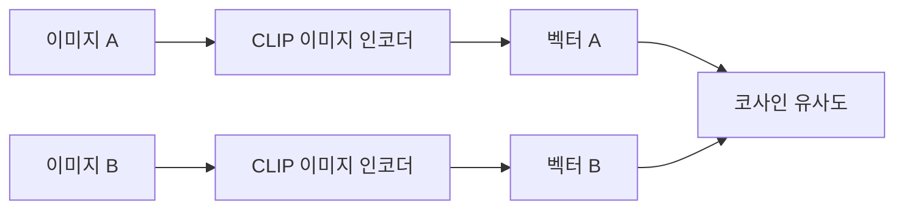
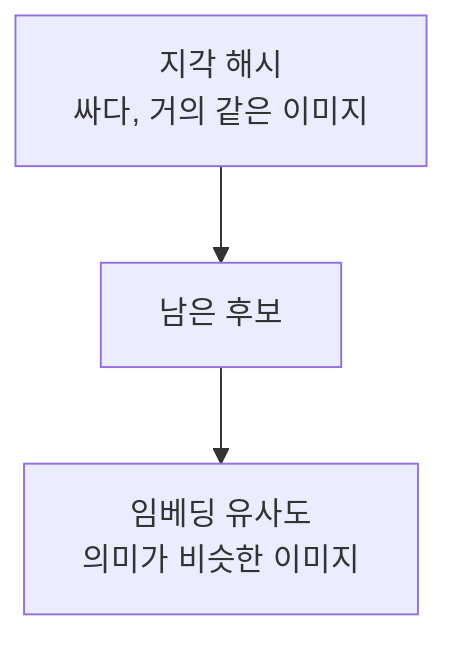

# 이미지 임베딩 유사도

> 이미지를 CLIP 같은 신경망에 넣어 얻은 벡터(임베딩)끼리의 거리를 재면, 픽셀이 달라도 내용이 비슷한 이미지를 찾을 수 있다. 지각 해시가 못 잡는 크롭·회전·재촬영·다른 사진의 같은 장면까지 후보로 올릴 수 있다.

## 쉽게 말하면
지각 해시는 "사진을 흐릿하게 줄여서 모양을 비교"하는 방식이고, 임베딩은 "사진에 무엇이 찍혔는지 설명을 숫자로 적어 비교"하는 방식이다. 같은 에펠탑을 다른 각도에서 찍은 두 사진은 흐릿하게 줄이면 다르지만, 설명은 "에펠탑"으로 비슷하다.

## 자세히
- **CLIP이 임베딩을 만드는 방식(CLIP 논문 초록, 열람)**: 인터넷에서 모은 약 4억 개의 (이미지, 글) 쌍으로 "어떤 캡션이 어떤 이미지에 맞는지 맞히기"를 사전학습한다. 그 결과 자연어로 시각 개념을 가리킬 수 있어 30개가 넘는 비전 데이터셋에 별도 학습 없이 전이되고, ImageNet에서도 학습 예제 128만 장을 쓰지 않고 원래 ResNet-50과 같은 정확도를 낸다고 보고한다.
- **유사도 계산(해석, 표준 방식)**: 이미지마다 벡터를 구하고 정규화한 뒤 코사인 유사도(내적)로 비교한다. 비슷한 이미지를 빨리 찾으려면 벡터 검색(근사 최근접 이웃 색인)을 쓴다.
- **지각 해시와의 차이(해석)**: 해시는 거의 같은 이미지(축소·압축·밝기)에 정확하고 싸다. 임베딩은 의미까지 잡지만 계산이 무겁고, 의미가 같아도 서로 다른 사진까지 "비슷하다"고 판정해 중복 제거에서는 오탐이 늘 수 있다. 두 방식을 조합해 해시로 정확 중복을 먼저 거르고 임베딩으로 나머지를 본다.
- **임계값**: 임베딩의 코사인 유사도 임계값도 데이터마다 다르므로 같음·다름 쌍으로 보정해야 한다([해시 임계값 보정](#hash-threshold-calibration)과 같은 절차). 이 글에서는 임베딩 모델 설치가 오래 걸려 직접 실험을 하지 않았고 임계값 수치를 제시하지 않는다.
- **용도**: 이미지 데이터셋 중복 제거, 비슷한 이미지 검색, 학습·시험 세트 간 겹침 점검([샘플 단위 vs 그룹 단위 분할](#sample-vs-group-split)).

## 그림으로 보기

## 예시
- 상품 사진 수십만 장에서 같은 상품의 다른 각도 사진을 묶을 때 해시로 정확 중복을 제거하고 임베딩 근접 이웃으로 후보를 만든다.
- 교육 활용: 같은 장면의 다른 사진 쌍과 전혀 다른 사진 쌍의 유사도를 비교해 분리가 되는지 본다(실행은 학습자가 환경에서).

## 헷갈리는 것과 비교
| 개념 | 차이 |
| --- | --- |
| 지각 해시 | 픽셀 구조 요약, 거의 같은 이미지 |
| 이미지 임베딩 | 의미 요약, 다른 사진의 같은 장면까지 |
| [크롭 내성 해시](#crop-resistant-hash) | 크롭만 보완한 해시 |
| [의미적 중복 제거](#semantic-deduplication) | 텍스트의 같은 원리 |

## 더 읽을거리
- [Learning Transferable Visual Models From Natural Language Supervision (CLIP, arXiv 2103.00020)](https://arxiv.org/abs/2103.00020) — 이미지-텍스트 대조 학습
