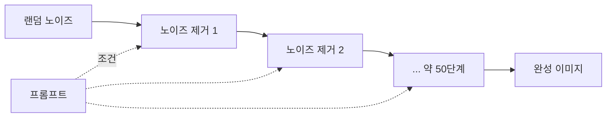
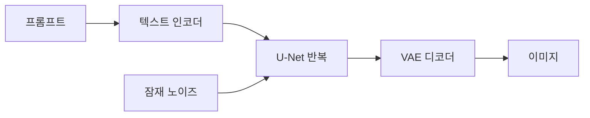

# 이미지 생성

> 글 설명(프롬프트)을 입력하면 새 그림을 만들어 내는 AI. 현재 주류는 노이즈에서 점점 그림을 복원하는 확산(diffusion) 모델이다.

## 쉽게 말하면
TV 화면의 눈보라(잡음)를 보면서 "이건 고양이일 거야" 하고 조금씩 지워 가며 그림을 드러내는 조각가를 떠올리면 된다. 한 번에 완성하지 않고 작은 단계로 여러 번 다듬기 때문에, 초반의 실수도 뒤에서 고쳐진다.

## 자세히
- **학습**: 실제 이미지에 여러 정도의 노이즈를 입혀 놓고, 모델이 "이 노이즈 낀 입력을 어떻게 깨끗하게 만들까"를 맞히도록 훈련한다(Hugging Face Diffusion Course 설명).
- **생성**: 완전한 랜덤 노이즈에서 시작해 학습된 모델을 반복 적용한다. 샘플러(스케줄러)는 더 적은 단계로 좋은 결과를 내려는 방법이다.
- **Stable Diffusion(잠재 확산) 구성**(Hugging Face 블로그 기준):
  - 텍스트 인코더(CLIP): 프롬프트를 임베딩으로 바꿈
  - U-Net: 노이즈를 예측하며 cross-attention으로 텍스트 조건을 반영
  - VAE: 큰 이미지를 작은 잠재 공간으로 줄였다가 마지막에 디코더로 이미지로 복원
  - 기본 약 50단계 반복, `guidance_scale`(기본 7.5)은 프롬프트를 얼마나 강하게 따를지 조절(classifier-free guidance)
- 시드(seed)가 같으면 같은 시작 노이즈라 재현이 쉽다.
- 최근엔 U-Net 대신 Transformer를 쓰는 구조와, 언어 모델이 직접 이미지를 만드는 방식도 늘었다(세부 모델·버전은 빨리 바뀜, 확인 필요).

## 그림으로 보기

## 예시
- 프롬프트: "수채화 스타일, 비 오는 서울 골목, 우산 든 사람, 따뜻한 가로등 불빛" — 피사체·스타일·조명을 나눠 쓰면 안정적.
- 업무: 교육 자료 삽화, 썸네일 시안, 목업 이미지. 저작권·초상권·AI 표기 정책은 [AI 안전](#ai-safety) 쪽에서 확인.

## 헷갈리는 것과 비교
| 개념 | 차이 |
| --- | --- |
| 확산 모델 | 노이즈 제거를 반복해 이미지 생성 |
| GAN | 생성자와 판별자가 경쟁하는 구형 방식 |
| [멀티모달](#multimodal) LLM | 이미지를 "이해"하는 쪽이 주력, 생성은 별도 모델이 많음 |
| [영상 AI](#video-ai) | 시간 축이 추가된 확장 |

## 더 읽을거리
- [Hugging Face Diffusion Course Unit 1](https://huggingface.co/learn/diffusion-course/unit1/1) — 확산 원리 입문
- [Stable Diffusion with Diffusers](https://huggingface.co/blog/stable_diffusion) — 구성 요소와 생성 과정
