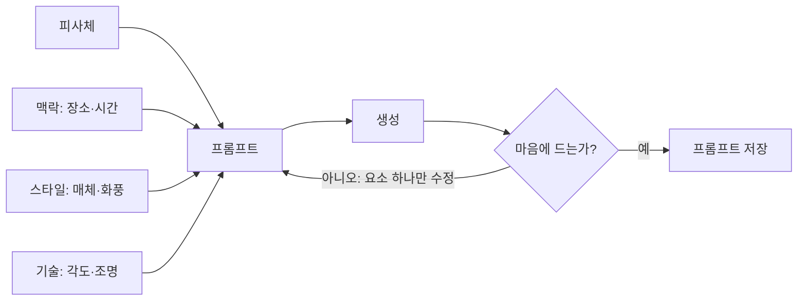

# 이미지 프롬프트 쓰기

> 이미지 프롬프트는 확산 모델 같은 이미지 생성 모델에게 "무엇을, 어떤 장면과 스타일로 그릴지" 알려 주는 글이다. 피사체·배경·스타일·기술적 디테일을 나눠 쓰면 결과가 안정된다.

## 쉽게 말하면
사진작가에게 촬영을 의뢰하는 일과 같다. "멋진 사진 찍어 줘"보다 "새벽 안개 낀 부두에서 그물을 손질하는 노인, 다큐 사진, 얕은 심도"라고 말해야 원하는 컷이 나온다. 다만 너무 길게 늘어놓는다고 좋아지진 않는다. 핵심만 짧게 주고 결과를 보며 고치는 편이 낫다.

## 자세히
Runway의 프롬프트 가이드(2026년 확인)가 권하는 네 층 구조:
1. **피사체(subject)**: 누가·무엇이. 형용사 한 단어로 분위기가 바뀐다(예: "낡은" 등대).
2. **맥락(context)**: 장소·시간·날씨·행동.
3. **스타일(style)**: 유화, 다큐 사진, 3D 렌더 등 매체와 화풍.
4. **기술 디테일(선택)**: 카메라 각도, 조명, 구도, 초점.

실무 요령:
- 길이는 한두 문장, 대략 15~50단어가 파라미터 나열보다 낫다는 것이 이 가이드의 주장이다.
- **한 번에 하나만 바꾼다.** 원하는 결과까지 보통 3~5번 시도한다. 거의 맞았다면 어긋난 요소만 고친다.
- 같은 프롬프트도 매번 결과가 다르다(비결정적). 잘 된 프롬프트는 저장해 두고 재사용한다.
- 모델마다 문법·키워드가 다르다(Midjourney의 파라미터, Stable Diffusion의 negative prompt 등). 쓰는 도구의 공식 도움말을 확인한다. 이 글의 출처는 negative prompt를 다루지 않으므로 여기선 일반론만 적는다.

## 그림으로 보기

## 예시
- 기본: "낡은 등대, 폭풍 치는 바위 절벽, 유화 스타일, 낮은 앵글"
- 조명만 교체: 같은 문장에 "새벽의 부드러운 역광"을 넣어 분위기 차이를 비교한다.
- 업무: 교육 슬라이드 삽화를 위해 "회의실에서 화이트보드를 보는 팀, 플랫 일러스트, 파스텔 톤"처럼 스타일을 먼저 고정하고 장면만 바꿔 일관성을 유지한다.

## 헷갈리는 것과 비교
| 개념 | 차이 |
| --- | --- |
| [확산 모델](#diffusion-model) | 이미지를 만드는 엔진. 프롬프트는 그 입력 |
| [이미지 생성](#image-generation) | 상위 주제. 도구·모델 지형 |
| 텍스트 LLM 프롬프트 | 지시·역할·형식 중심. 이미지는 시각 요소 묘사 중심 |

## 더 읽을거리
- [Runway: AI Image Prompting Guide](https://runway.com/resources/ai-image-prompting-guide) — 4층 구조와 반복 요령, 68개 예시
