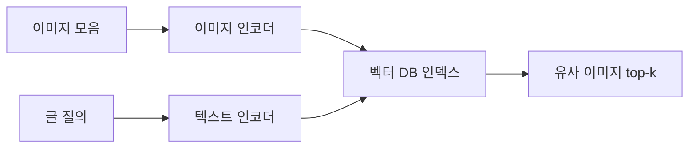
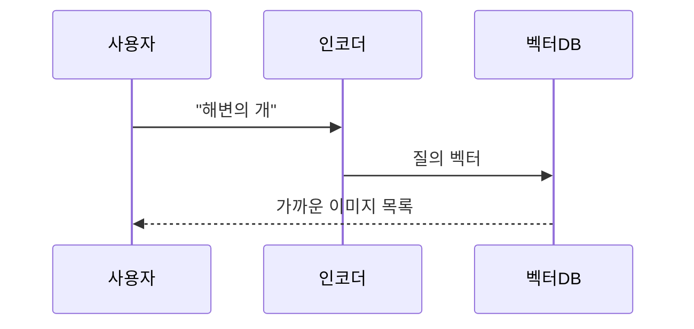

# 이미지 벡터 검색 구축

> **이미지 벡터 검색**은 이미지를 임베딩(벡터)으로 바꿔 벡터 DB에 넣고, **글이나 다른 이미지로** 비슷한 이미지를 찾는 파이프라인이다. CLIP 같은 이미지-글 공동 임베딩이 핵심이다.

## 쉽게 말하면
사진 수만 장에 일일이 태그를 달지 않고도 "해 질 녘 해변에 서 있는 개"라고 쓰면 비슷한 사진이 나오게 하는 검색이다. 사진과 문장이 같은 좌표 공간에 놓여 있어서 가능하다.

## 자세히
- **핵심 부품**: 이미지·글을 같은 공간에 보내는 인코더. CLIP은 4억 쌍의 이미지-텍스트로 어떤 캡션이 어떤 이미지에 맞는지를 학습해 글로 이미지 개념을 가리킬 수 있게 한다(arXiv 2103.00020 초록 확인). 그래서 텍스트 질의 임베딩과 이미지 임베딩을 직접 비교할 수 있다.
- **파이프라인**(일반 지식): ① 이미지 인코더로 모든 이미지를 벡터화해 저장 ② 벡터 DB에 인덱스 생성([HNSW](#hnsw) 같은 근사 이웃 탐색) ③ 질의(글 또는 이미지)를 같은 인코더로 벡터화 ④ 유사도 상위 k개 반환 ⑤ 필요 시 재정렬·메타데이터 필터.
- 구체 모델·DB 제품의 선택과 성능은 이 글에서 직접 확인하지 않았다. 내 이미지로 소규모 평가(질문 20~50개, 정답 이미지 지정)를 해서 고른다.
- 주의(권고): 개인 얼굴·저작권 이미지 보관 정책, 임베딩 모델 교체 시 전체 재색인 필요.

## 그림으로 보기

## 예시
- 디자인팀이 보유한 이미지 자산 5만 장을 글로 검색.
- 제품 사진을 올려 비슷한 상품을 찾는 이미지-이미지 검색.

## 헷갈리는 것과 비교
| 개념 | 차이 |
|---|---|
| 태그 검색 | 사람이 단 키워드에 의존 |
| 이미지 벡터 검색 | 의미 유사도로 검색 |
| [멀티모달 RAG](#multimodal-rag) | 검색 결과로 답변까지 생성 |
| [제로샷 분류](#zero-shot-image-classification) | 후보 문장 중 선택 |

## 더 읽을거리
- [CLIP](https://arxiv.org/abs/2103.00020)
